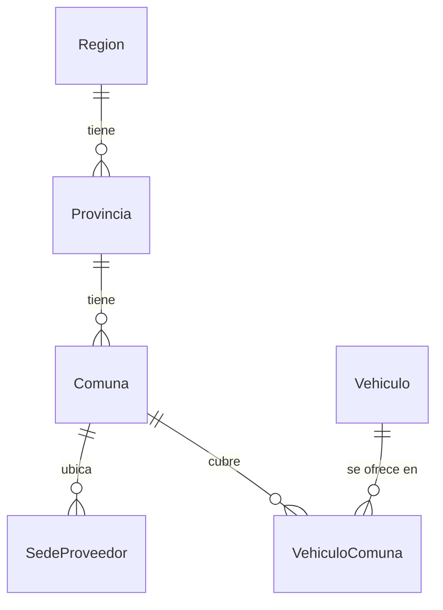
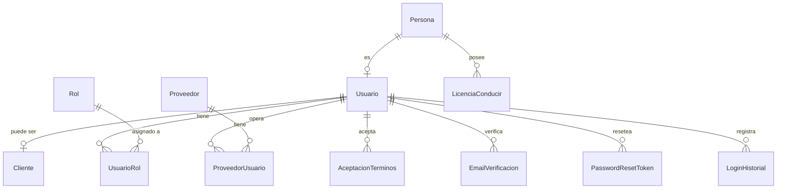
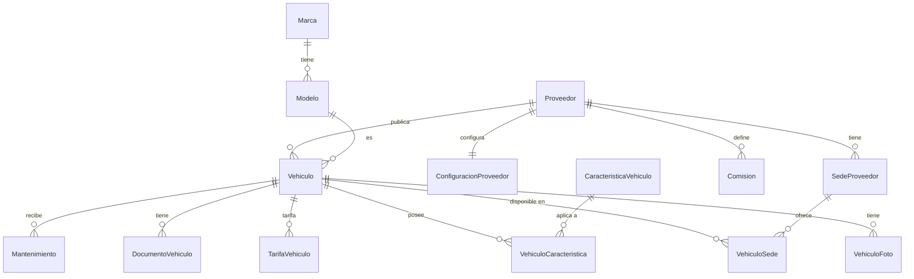
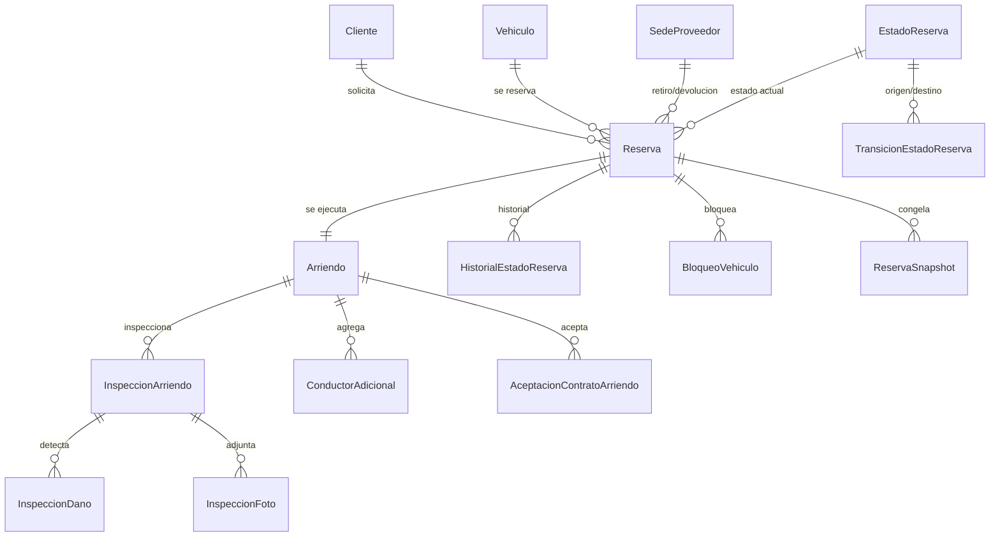
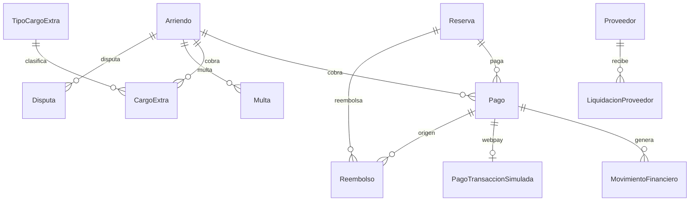
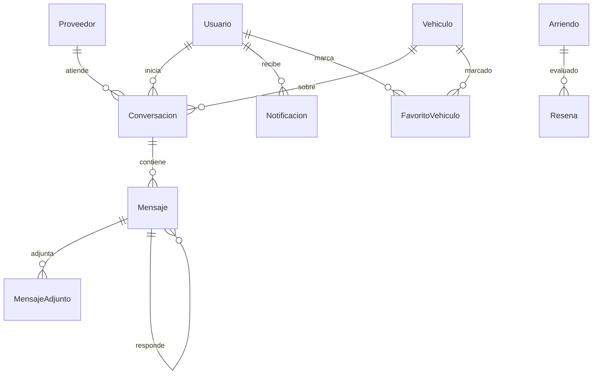

# 06 — Diagramas Entidad‑Relación (ERD)

Diagramas por **módulo** (más legibles que un único diagrama con las 82 tablas).

**Notación (crow's foot):**
- `||--o{` = **uno a muchos** (`#` en el uno · `∞` en el muchos).
- `||--||` = **uno a uno**.
- `}o--o{` = **muchos a muchos** (se implementa con tabla asociativa).

> La **FK siempre está en el lado `∞`** (hijo). Los nombres son las tablas reales.

---

## Módulo 1 — Geografía (Chile)

## Módulo 2 — Usuarios y seguridad

## Módulo 3 — Proveedores y vehículos

## Módulo 4 — Reservas y arriendos

## Módulo 5 — Pagos y finanzas

## Módulo 6 — Comunicación y reputación

---

## Cómo dibujarlo en el Diseñador de MS‑SQL Server (SSMS)

1. En el **Explorador de objetos**, expande **Bases de datos → RentaCarDB**.
2. Clic derecho en **Diagramas de base de datos** → **Nuevo diagrama de base de datos**
   (si pregunta, acepta crear el soporte de diagramas).
3. En el panel **Tablas**, agrega las tablas del módulo que quieras (arrástralas al lienzo).
   - Sugerencia: dibuja **un diagrama por módulo** (como arriba) para que sea legible.
4. SSMS dibuja automáticamente las relaciones con **llave (`#`) en el lado uno** y
   **símbolo de infinito (`∞`) en el lado muchos**.
5. Verifica que cada línea tenga la llave en el lado **correcto** (el "uno") y el infinito en
   el lado con la FK (el "muchos").
6. Guarda con un nombre por módulo (p. ej. `ERD_Reservas`).

> Atajo: si prefieres dibujarlos desde cero, usa la vista de **Mermaid** de este documento y
> replica las mismas entidades/relaciones en el lienzo de SSMS.

## Verificación de cardinalidades
- [x] Llave (`#`) siempre en el lado **uno**.
- [x] Infinito (`∞`) siempre en el lado **muchos** (donde está la FK).
- [x] N:M representados con su **tabla asociativa** (no como línea directa).
- [x] 1:1 con `||--||` (PK=FK o `UNIQUE`).
