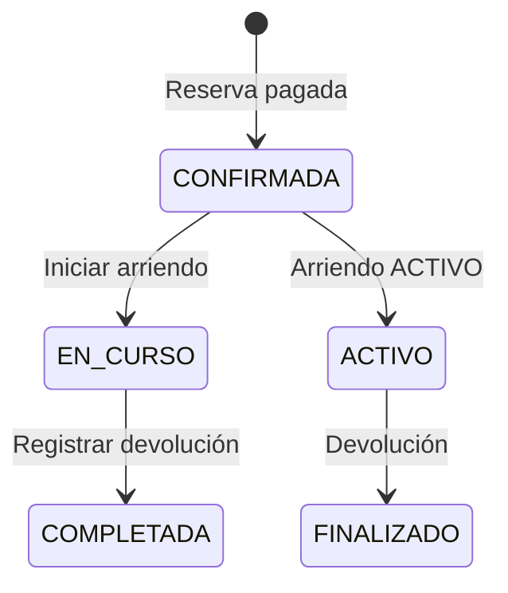

# Arriendos, inspecciones y devoluciones — S3 (E9)

Documento de implementación del ciclo de arriendo posterior a la reserva pagada.

## 1. Flujo

- `Reserva`: `CONFIRMADA → EN_CURSO → COMPLETADA`.
- `Arriendo`: `ACTIVO → FINALIZADO`.
- `Vehiculo`: `ARRENDADO → DISPONIBLE` (y cambia su sede actual a la sede de devolución).

## 2. Endpoints

| Método | Ruta | Acceso | SQL |
|---|---|---|---|
| GET | `/arriendos?scope=cliente\|proveedor\|todos` | AUTH | consulta explícita sobre `Arriendo`, `Reserva`, `Vehiculo`, `EstadoArriendo` |
| GET | `/arriendos/:id` | AUTH dueño/proveedor/admin | detalle + inspecciones + daños + cargos + conductores + contrato + reseñas |
| POST | `/arriendos/iniciar` | PROVEEDOR/OPERADOR/ADMIN | `u_sp_IniciarArriendo` |
| POST | `/arriendos/:id/devolucion` | PROVEEDOR/OPERADOR/ADMIN | `u_sp_RegistrarDevolucion` |
| POST | `/arriendos/:id/inspecciones/:inspeccionId/danos` | PROVEEDOR/OPERADOR/ADMIN | `u_sp_RegistrarDanoInspeccion` |
| POST | `/arriendos/:id/conductores` | CLIENTE dueño | `u_sp_RegistrarConductorAdicional` |
| POST | `/arriendos/:id/contrato` | CLIENTE dueño | `u_sp_CrearAceptacionContrato` |
| GET | `/arriendos/:id/contrato` | AUTH dueño/proveedor/admin | texto generado + hash + aceptación vigente |

## 3. Reglas de negocio

### Iniciar arriendo
- La reserva debe estar `CONFIRMADA`.
- El cliente debe tener licencia activa, verificada y vigente.
- El vehículo debe estar en la sede de retiro real, salvo que el proveedor permita entrega a domicilio.
- La sede debe estar habilitada para entrega y pertenecer al proveedor.
- El SP crea el `Arriendo`, la inspección `ENTREGA`, marca el vehículo `ARRENDADO` y la reserva `EN_CURSO`.

### Devolución
- El arriendo debe estar `ACTIVO`.
- El kilometraje final no puede ser menor al inicial.
- La sede de devolución debe pertenecer al proveedor y estar habilitada.
- La política de km es del servidor: `200` km incluidos por día y `$100` por km excedido (configurable por proveedor queda para S4). El cliente no puede editarla.
- Si la reserva tiene `km_incluidos_dia` y `cargo_km_excedido`, se calcula el exceso y se crea un `CargoExtra` `KM_EXCEDIDO`.
- Se crea la inspección `DEVOLUCION`, el arriendo pasa a `FINALIZADO`, la reserva a `COMPLETADA` y el vehículo a `DISPONIBLE` en la sede de devolución.
- Se registra una `Notificacion` para el cliente.

### Inspecciones y daños
- `u_sp_RegistrarDanoInspeccion` solo admite inspecciones `DEVOLUCION`.
- Para registrar daños, el operador usa el `ID_inspeccion` que devuelve `GET /arriendos/:id`.
- Severidades permitidas: `LEVE`, `MEDIO`, `GRAVE`.
- Las fotos de inspección quedan para S4 (no hay SP).

### Contrato
- El backend genera un texto determinístico con datos inmutables de la reserva/arriendo.
- Se guarda `SHA-256` del texto y una URL en `AceptacionContratoArriendo`.
- `POST /arriendos/:id/contrato` exige `{ "aceptado": true }`.
- Cada aceptación genera una nueva versión vigente.

### Conductores adicionales
- El cliente envía el RUT; el backend resuelve `Persona`.
- La licencia es opcional; si se envía, el SP valida que pertenezca a la persona, esté activa, verificada y vigente.
- Solo se permite agregar conductores mientras el arriendo esté `ACTIVO`.

## 4. Seguridad y ownership

- `GET /arriendos` filtra por cliente dueño, proveedor del vehículo o admin.
- `GET /arriendos/:id` valida acceso antes de devolver datos.
- Inicio/devolución/daños: solo proveedor/operador vinculado o admin.
- Contrato/conductor: solo el cliente dueño.
- Los IDs de usuario se toman del JWT; no se aceptan desde el body.
- Los SPs usan `SESSION_CONTEXT` y transacciones para las operaciones críticas.

## 5. Limitaciones conocidas de E9

- La verificación de licencias no tiene UI/SP propio; el seed las marca verificadas por SQL directo.
- No se implementan fotos de inspección (S4).
- No se implementan cargos extra manuales ni multas (S4).
- La devolución no recalcula comisión; la comisión se registra al pagar.
- El contrato es texto plano con hash; no se genera PDF firmado. El hash se recalcula con datos vivos, por lo que cambios posteriores de nombres/sedes pueden alterarlo; el texto aceptado no se persiste.
- `u_sp_IniciarArriendo` y `u_sp_RegistrarDevolucion` actualizan `Reserva` directamente y no insertan en `HistorialEstadoReserva`; el trigger de auditoría registra el cambio en `Auditoria`, pero el historial de la API no muestra `EN_CURSO`/`COMPLETADA`.
- El seed restaura estado/sede/km del vehículo solo si no hay un arriendo `ACTIVO`; no ejecutarlo durante una demo en curso.
- La política de km es global del servidor; configurarla por proveedor requiere cambios de esquema (S4).
- No todos los SP de E9 usan `SESSION_CONTEXT`/transacción: conductor y daño son operaciones simples.

## 6. Pruebas

- `sql/tests/06_arriendos.sql`: 22 casos de inicio, contrato, conductor, devolución, km, daños, reseña y errores.
- `tests/arriendos.test.ts`: validación, autenticación y autorización.
- `scripts/smoke-s3.ts`: flujo real reserva → pago → inicio → contrato → conductor → devolución → daño.
- Frontend: badges y tabla de arriendos.
