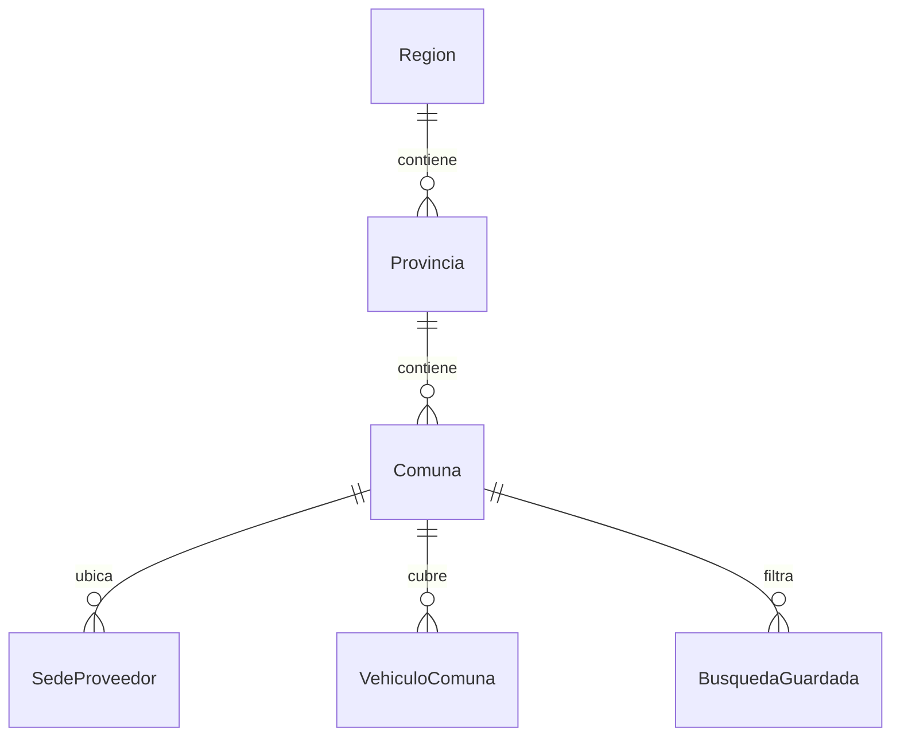
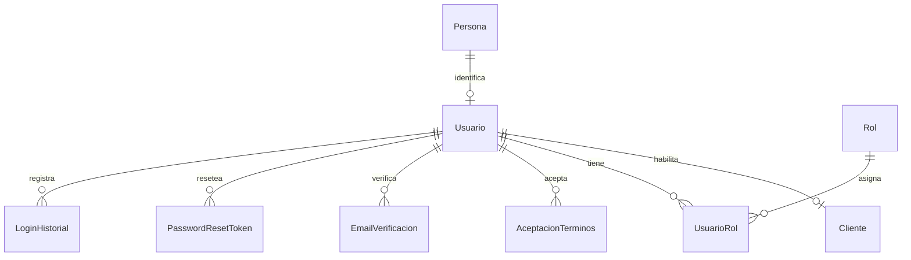
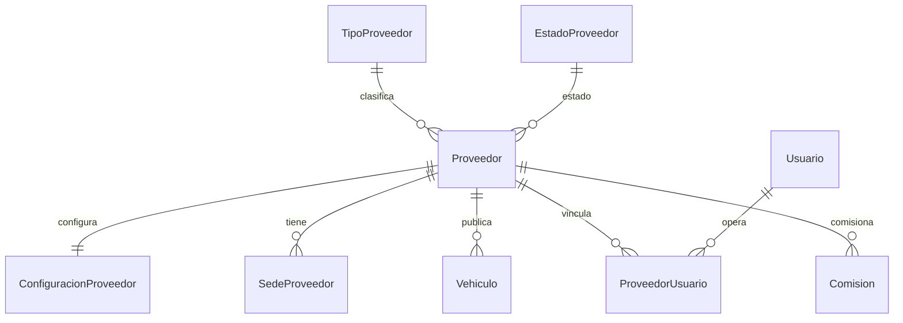
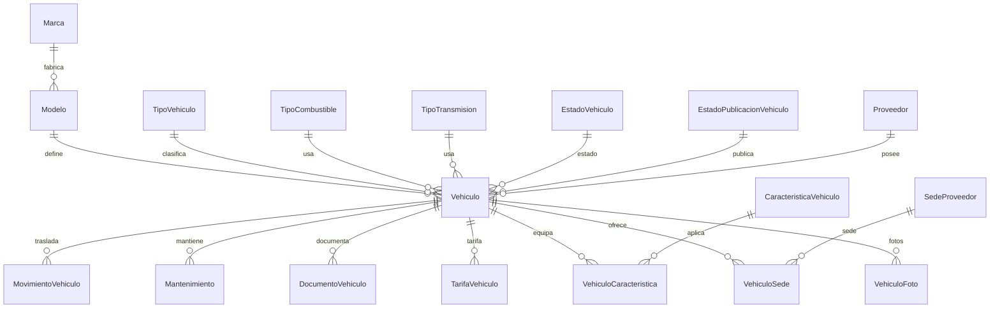
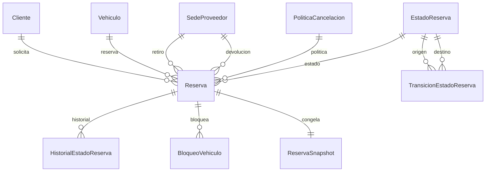
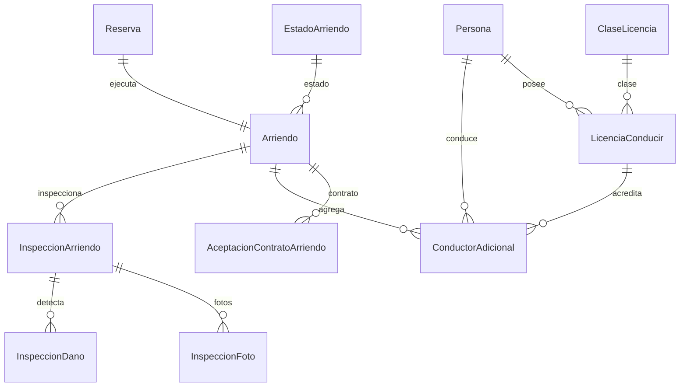
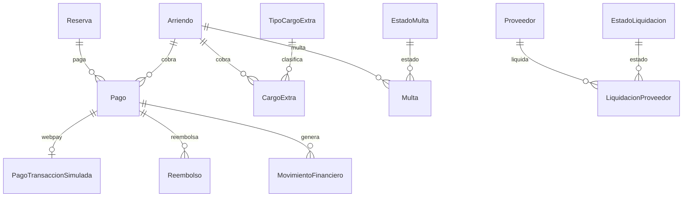
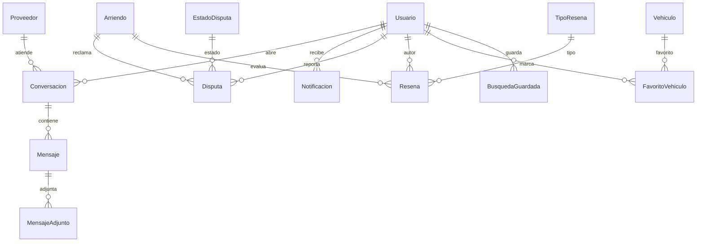
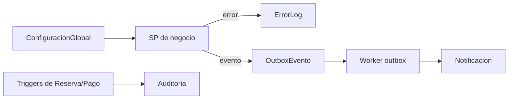

# Documentación técnica de la base de datos RentaCarDB

Documento de referencia de los objetos de `RentaCarDB`: qué hace cada uno, para qué se creó, cómo está implementado y dónde se usa en la aplicación web.

> **Alcance:** 83 tablas, 86 procedimientos almacenados, 6 vistas, 3 funciones y 4 triggers.
> **Motor:** Microsoft SQL Server 2022/2025, base `RentaCarDB`, compatibilidad 160.
> **Verificación:** 1 de noviembre de 2026 sobre `RentacarFinal.sql`, el backend Express/TypeScript y el frontend React.

## Contenido

1. [Cómo leer este documento](#cómo-leer-este-documento)
2. [Resumen de uso](#resumen-de-uso)
3. [Arquitectura de implementación](#arquitectura-de-implementación)
4. [Tablas](#tablas)
5. [Vistas](#vistas)
6. [Procedimientos almacenados](#procedimientos-almacenados)
7. [Funciones](#funciones)
8. [Triggers](#triggers)
9. [Objetos sin uso o internos](#objetos-sin-uso-o-internos)
10. [Trazabilidad app ↔ base de datos](#trazabilidad-app--base-de-datos)
11. [Pruebas y evidencia](#pruebas-y-evidencia)
12. [Anexo: índice alfabético](#anexo-índice-alfabético)

## Cómo leer este documento

Cada ficha usa el mismo contrato de lectura:

- **Qué hace / qué representa:** descripción funcional del objeto.
- **Para qué se creó:** problema de negocio o técnico que resuelve.
- **Cómo se implementa:** PK, FKs, parámetros, tablas afectadas, transacciones, errores y objetos relacionados.
- **Dónde se usa:** capa de aplicación, endpoint, pantalla y objetos SQL que lo invocan.
- **Estado:** `USADO`, `INTERNO` o `SIN USO`.

Los propósitos se derivan del DDL, de los nombres, de los parámetros, de los consumidores y de la documentación existente. Cuando no hay un comentario explícito en el script, la explicación es una **interpretación técnica** del contrato observable.

## Resumen de uso

| Tipo | Total | Usados | Detalle |
|---|---:|---:|---|
| Tablas | 83 | 78 | 5 sin referencias en la app ni en objetos SQL. |
| Vistas | 6 | 6 | Todas consumidas por el backend. |
| Procedimientos | 86 | 86 | 82 invocados desde la API; 4 internos. |
| Funciones | 3 | 3 | Usadas en constraints, SPs y consultas. |
| Triggers | 4 | 4 | Activos sobre `Reserva`, `Pago` y `BloqueoVehiculo`. |

### Tablas sin uso

| Tabla | Situación | Recomendación |
|---|---|---|
| `AceptacionTerminos` | Solo DDL; el registro no guarda evidencia. | Integrar en el registro. |
| `EstadoLiquidacion` | Catálogo sembrado, pero la app usa strings. | Integrar en filtros/validación. |
| `MigracionLog` | Tabla técnica vacía. | Exponer en admin o eliminar. |
| `MovimientoVehiculo` | Sin endpoint ni UI de traslado. | Integrar o eliminar. |
| `VehiculoComuna` | Vacía; `VehiculoSede` cubre la ubicación. | Integrar como comunas extra o eliminar. |

### Procedimientos internos

| SP | Invocado por | Función |
|---|---|---|
| `u_sp_CrearSnapshotReserva` | `u_sp_CrearReserva` | Congela condiciones comerciales. |
| `u_sp_LiberarDeposito` | `u_sp_CancelarReserva` | Libera el depósito retenido. |
| `u_sp_PublicarEvento` | `u_sp_CrearReserva` | Encola eventos en outbox. |
| `u_sp_RegistrarError` | 13 SP de negocio | Registra errores SQL con contexto. |

## Arquitectura de implementación

```text
React (Vite)
  → fetch /api/*
  → Express (routes → controllers → services)
  → repositories (mssql)
  → SQL Server (SPs, vistas, funciones, triggers)
```

- La API usa el pool `mssql` y ejecuta SPs mediante `request().execute(...)`.
- Las escrituras críticas se encapsulan en SP con `SET XACT_ABORT ON`, `BEGIN TRANSACTION` y `TRY/CATCH`.
- Los errores de negocio se propagan con `THROW` y códigos numéricos; el backend los traduce a respuestas HTTP.
- La seguridad se apoya en roles de aplicación y permisos de base (`db_rentacar_rw`, `db_rentacar_report`).
- Los triggers cubren reglas que no pueden depender solo de la API: solapamientos y auditoría.
- El patrón outbox desacopla notificaciones y eventos de la transacción principal.

## Tablas

Las tablas se agrupan por módulo funcional. El diccionario completo de columnas está en [`docs/01-ModeloRelacional.md`](01-ModeloRelacional.md); aquí se documenta la implementación y el uso.

### Geografía de Chile

Base territorial usada para ubicar sedes, filtrar vehículos y normalizar la dirección de proveedores.

**Frontend:** `/catalogo`, filtros por región/comuna y formularios de sedes.

**Pruebas:** `sql/tests/02_functional.sql`, `sql/tests/16_busqueda_region.sql`.



#### `Region`

**Qué representa:** regiones de Chile (16). Referencia estable.

**Para qué se creó:** regiones de Chile (16). Referencia estable.

**Cómo se implementa:**

- PK: `PK_region` (`ID_region`).
- Columnas: 3. Principales: `ID_region` `int`, `nombre_region` `nvarchar(100)`, `activo_region` `bit`.
- FKs: no tiene claves foráneas salientes.
- Estado: **USADA**.

**Dónde se usa:**

- Backend: `backend/src/repositories/catalogo.repository.ts`, `backend/src/repositories/favorito.repository.ts`.
- Objetos SQL: `u_sp_BuscarVehiculos`, `vw_VehiculosPublicados`.
- Pruebas: `sql/tests/02_functional.sql`, `sql/tests/16_busqueda_region.sql`.

#### `Provincia`

**Qué representa:** provincias (56); pertenecen a una región.

**Para qué se creó:** provincias (56); pertenecen a una región.

**Cómo se implementa:**

- PK: `PK_provincia` (`ID_provincia`).
- Columnas: 4. Principales: `ID_provincia` `int`, `ID_region_provincia` `int`, `nombre_provincia` `nvarchar(100)`, `activo_provincia` `bit`.
- FKs: `ID_region_provincia` → `Region`.`ID_region`.
- Estado: **USADA**.

**Dónde se usa:**

- Backend: `backend/src/repositories/catalogo.repository.ts`, `backend/src/repositories/favorito.repository.ts`.
- Objetos SQL: `u_sp_BuscarVehiculos`, `vw_VehiculosPublicados`.
- Pruebas: `sql/tests/02_functional.sql`, `sql/tests/16_busqueda_region.sql`.

#### `Comuna`

**Qué representa:** comunas (346); pertenecen a una provincia. Incluye código oficial (CUT).

**Para qué se creó:** comunas (346); pertenecen a una provincia. Incluye código oficial (CUT).

**Cómo se implementa:**

- PK: `PK_comuna` (`ID_comuna`).
- Columnas: 5. Principales: `ID_comuna` `int`, `nombre_comuna` `nvarchar(100)`, `activo_comuna` `bit`, `codigo_comuna` `varchar(5)`, `ID_provincia_comuna` `int`.
- FKs: `ID_provincia_comuna` → `Provincia`.`ID_provincia`.
- Estado: **USADA**.

**Dónde se usa:**

- Backend: `backend/src/repositories/catalogo.repository.ts`, `backend/src/repositories/favorito.repository.ts`, `backend/src/repositories/proveedor.repository.ts`, `backend/src/repositories/vehiculo.repository.ts`.
- Objetos SQL: `u_sp_ActualizarSedeProveedor`, `u_sp_BuscarVehiculos`, `u_sp_RegistrarSedeProveedor`, `vw_VehiculosPublicados`.
- Pruebas: `sql/tests/02_functional.sql`, `sql/tests/16_busqueda_region.sql`.

### Personas y seguridad

Identidad, autenticación, roles, verificación de correo y evidencia de aceptación de términos.

**Frontend:** `/login`, `/registro`, `/recuperar`, `/reset-password`, `/verificar-email`, `/perfil`.

**Pruebas:** `sql/tests/02_functional.sql`, `sql/tests/03_triggers_security_errorlog.sql`; `backend/tests/auth.test.ts`.



#### `Persona`

**Qué representa:** identidad de las personas (base de Usuario y Proveedor).

**Para qué se creó:** identidad de las personas (base de Usuario y Proveedor).

**Cómo se implementa:**

- PK: `PK_persona` (`ID_persona`).
- Columnas: 7. Principales: `ID_persona` `int`, `rut_persona` `varchar(12)`, `nombres_persona` `nvarchar(80)`, `apellido_paterno_persona` `nvarchar(50)`, `apellido_materno_persona` `nvarchar(50)`, `telefono_persona` `varchar(20)`, `fecha_nacimiento_persona` `date`.
- FKs: no tiene claves foráneas salientes.
- Estado: **USADA**.

**Dónde se usa:**

- Backend: `backend/src/config/swagger.ts`, `backend/src/repositories/arriendo.repository.ts`, `backend/src/repositories/auditoria.repository.ts`, `backend/src/repositories/auth.repository.ts`, `backend/src/repositories/disputa.repository.ts`, `backend/src/repositories/outbox.repository.ts`, `backend/src/repositories/resena.repository.ts`, `backend/src/repositories/reserva.repository.ts`.
- Objetos SQL: `u_sp_ActualizarPerfilUsuario`, `u_sp_CrearReserva`, `u_sp_Login`, `u_sp_RegistrarConductorAdicional`, `u_sp_RegistrarLicenciaConducir`, `u_sp_RegistrarProveedor`, `u_sp_RegistrarUsuario`, `vw_ReservasDetalle`.
- Pruebas: `sql/tests/02_functional.sql`, `sql/tests/03_triggers_security_errorlog.sql`; `backend/tests/auth.test.ts`.

#### `Usuario`

**Qué representa:** cuenta de acceso (email + hash de contraseña).

**Para qué se creó:** cuenta de acceso (email + hash de contraseña).

**Cómo se implementa:**

- PK: `PK_usuario` (`ID_usuario`).
- Columnas: 7. Principales: `ID_usuario` `int`, `ID_persona_usuario` `int`, `email_usuario` `varchar(150)`, `password_hash_usuario` `varchar(255)`, `activo_usuario` `bit`, `email_confirmado_usuario` `bit`, `fecha_creacion_usuario` `datetime2(0)`.
- FKs: `ID_persona_usuario` → `Persona`.`ID_persona`.
- Estado: **USADA**.

**Dónde se usa:**

- Backend: `backend/src/config/swagger.ts`, `backend/src/controllers/auth.controller.ts`, `backend/src/repositories/arriendo.repository.ts`, `backend/src/repositories/auditoria.repository.ts`, `backend/src/repositories/auth.repository.ts`, `backend/src/repositories/disputa.repository.ts`, `backend/src/repositories/outbox.repository.ts`, `backend/src/repositories/proveedor.repository.ts`, `backend/src/repositories/resena.repository.ts`, `backend/src/repositories/reserva.repository.ts`, `backend/src/services/arriendo.service.ts`, `backend/src/services/auth.service.ts`, `backend/src/services/favorito.service.ts`.
- Objetos SQL: `u_sp_ActualizarPerfilUsuario`, `u_sp_AgregarFavorito`, `u_sp_AsignarRolUsuario`, `u_sp_CerrarConversacion`, `u_sp_ConfirmarResetPassword`, `u_sp_CrearConversacion`, `u_sp_CrearReserva`, `u_sp_EnviarMensaje`, `u_sp_GuardarBusqueda`, `u_sp_IniciarArriendo`, `u_sp_Login`, `u_sp_MarcarMensajesLeidos`, `u_sp_RegistrarMensajeAdjunto`, `u_sp_RegistrarMulta`, `u_sp_RegistrarNotificacion`, `u_sp_RegistrarPago`, `u_sp_RegistrarUsuario`, `u_sp_SolicitarResetPassword`, `u_sp_VerificarEmail`, `u_sp_VincularUsuarioProveedor`, `vw_ReservasDetalle`.
- Pruebas: `sql/tests/02_functional.sql`, `sql/tests/03_triggers_security_errorlog.sql`; `backend/tests/auth.test.ts`.

#### `Cliente`

**Qué representa:** rol de cliente (usuario habilitado para reservar). Extensión 1:1 de Usuario.

**Para qué se creó:** rol de cliente (usuario habilitado para reservar). Extensión 1:1 de Usuario.

**Cómo se implementa:**

- PK: `PK_cliente` (`ID_usuario_cliente`).
- Columnas: 3. Principales: `ID_usuario_cliente` `int`, `fecha_alta_cliente` `datetime2(0)`, `activo_cliente` `bit`.
- FKs: `ID_usuario_cliente` → `Usuario`.`ID_usuario`.
- Estado: **USADA**.

**Dónde se usa:**

- Backend: `backend/src/utils/contract.ts`.
- Objetos SQL: `u_sp_CrearReserva`, `u_sp_EnviarMensaje`, `u_sp_IniciarArriendo`, `u_sp_RegistrarUsuario`, `vw_ReservasDetalle`.
- Pruebas: `sql/tests/02_functional.sql`, `sql/tests/03_triggers_security_errorlog.sql`; `backend/tests/auth.test.ts`.

#### `Rol`

**Qué representa:** Roles del sistema.

**Para qué se creó:** Roles del sistema.

**Cómo se implementa:**

- PK: `PK_rol` (`ID_rol`).
- Columnas: 3. Principales: `ID_rol` `int`, `nombre_rol` `varchar(50)`, `descripcion_rol` `nvarchar(200)`.
- FKs: no tiene claves foráneas salientes.
- Estado: **USADA**.

**Dónde se usa:**

- Backend: `backend/src/repositories/auth.repository.ts`, `backend/src/repositories/proveedor.repository.ts`.
- Objetos SQL: `u_sp_AprobarProveedor`, `u_sp_AsignarRolUsuario`, `u_sp_Login`, `u_sp_PublicarVehiculo`, `u_sp_RegistrarUsuario`.
- Pruebas: `sql/tests/02_functional.sql`, `sql/tests/03_triggers_security_errorlog.sql`; `backend/tests/auth.test.ts`.

#### `UsuarioRol`

**Qué representa:** Usuario ↔ Rol.

**Para qué se creó:** Usuario ↔ Rol.

**Cómo se implementa:**

- PK: `PK_usuario_rol` (`ID_usuario_usuario_rol`, `ID_rol_usuario_rol`).
- Columnas: 3. Principales: `ID_usuario_usuario_rol` `int`, `ID_rol_usuario_rol` `int`, `fecha_asignacion_usuario_rol` `datetime2(0)`.
- FKs: `ID_rol_usuario_rol` → `Rol`.`ID_rol`; `ID_usuario_usuario_rol` → `Usuario`.`ID_usuario`.
- Estado: **USADA**.

**Dónde se usa:**

- Backend: `backend/src/repositories/auth.repository.ts`, `backend/src/repositories/proveedor.repository.ts`.
- Objetos SQL: `u_sp_AprobarProveedor`, `u_sp_AsignarRolUsuario`, `u_sp_Login`, `u_sp_PublicarVehiculo`, `u_sp_RegistrarUsuario`.
- Pruebas: `sql/tests/02_functional.sql`, `sql/tests/03_triggers_security_errorlog.sql`; `backend/tests/auth.test.ts`.

#### `AceptacionTerminos`

**Qué representa:** Evidencia de aceptación de términos.

**Para qué se creó:** Dejar evidencia legal y auditable de la versión de términos aceptada por cada usuario, incluyendo IP y user-agent.

**Cómo se implementa:**

- PK: `PK_aceptacion_terminos` (`ID_aceptacion`).
- Columnas: 6. Principales: `ID_aceptacion` `bigint`, `ID_usuario_aceptacion` `int`, `version_terminos` `varchar(20)`, `fecha_aceptacion` `datetime2(0)`, `ip_aceptacion` `varchar(45)`, `user_agent_aceptacion` `nvarchar(300)`.
- FKs: `ID_usuario_aceptacion` → `Usuario`.`ID_usuario`.
- Estado: **SIN USO**.

**Dónde se usa:**

- Sin referencias detectadas en la app ni en objetos SQL.
- Pruebas: `sql/tests/02_functional.sql`, `sql/tests/03_triggers_security_errorlog.sql`; `backend/tests/auth.test.ts`.

#### `EmailVerificacion`

**Qué representa:** Tokens de verificación de correo.

**Para qué se creó:** Tokens de verificación de correo.

**Cómo se implementa:**

- PK: `PK_email_verificacion` (`ID_email_verificacion`).
- Columnas: 6. Principales: `ID_email_verificacion` `bigint`, `ID_usuario_email_verificacion` `int`, `token_hash_email_verificacion` `char(64)`, `fecha_expiracion_email_verificacion` `datetime2(0)`, `fecha_uso_email_verificacion` `datetime2(0)`, `fecha_creacion_email_verificacion` `datetime2(0)`.
- FKs: `ID_usuario_email_verificacion` → `Usuario`.`ID_usuario`.
- Estado: **USADA**.

**Dónde se usa:**

- Objetos SQL: `u_sp_RegistrarUsuario`, `u_sp_VerificarEmail`.
- Pruebas: `sql/tests/02_functional.sql`, `sql/tests/03_triggers_security_errorlog.sql`; `backend/tests/auth.test.ts`.

#### `PasswordResetToken`

**Qué representa:** Tokens de reseteo de contraseña.

**Para qué se creó:** Tokens de reseteo de contraseña.

**Cómo se implementa:**

- PK: `PK_password_reset` (`ID_password_reset`).
- Columnas: 6. Principales: `ID_password_reset` `bigint`, `ID_usuario_password_reset` `int`, `token_hash_password_reset` `char(64)`, `fecha_expiracion_password_reset` `datetime2(0)`, `fecha_uso_password_reset` `datetime2(0)`, `fecha_creacion_password_reset` `datetime2(0)`.
- FKs: `ID_usuario_password_reset` → `Usuario`.`ID_usuario`.
- Estado: **USADA**.

**Dónde se usa:**

- Objetos SQL: `u_sp_ConfirmarResetPassword`, `u_sp_SolicitarResetPassword`.
- Pruebas: `sql/tests/02_functional.sql`, `sql/tests/03_triggers_security_errorlog.sql`; `backend/tests/auth.test.ts`.

#### `LoginHistorial`

**Qué representa:** Registro de inicios de sesión.

**Para qué se creó:** Auditar intentos de login exitosos y fallidos para seguridad y diagnóstico.

**Cómo se implementa:**

- PK: `PK_login_historial` (`ID_login`).
- Columnas: 7. Principales: `ID_login` `bigint`, `ID_usuario_login` `int`, `email_intentado_login` `varchar(150)`, `exitoso_login` `bit`, `ip_login` `varchar(45)`, `user_agent_login` `nvarchar(300)`, `fecha_login` `datetime2(0)`.
- FKs: `ID_usuario_login` → `Usuario`.`ID_usuario`.
- Estado: **USADA**.

**Dónde se usa:**

- Objetos SQL: `u_sp_Login`.
- Pruebas: `sql/tests/02_functional.sql`, `sql/tests/03_triggers_security_errorlog.sql`; `backend/tests/auth.test.ts`.

### Proveedores y sedes

Entidades que publican vehículos, sus sedes físicas, configuración operativa y comisión aplicable.

**Frontend:** `/proveedor/registro`, `/proveedor/panel`, `/admin/proveedores`.

**Pruebas:** `sql/tests/02_functional.sql`; `backend/tests/proveedor.test.ts`.



#### `Proveedor`

**Qué representa:** dueño/gestor de vehículos (persona o empresa).

**Para qué se creó:** dueño/gestor de vehículos (persona o empresa).

**Cómo se implementa:**

- PK: `PK_proveedor` (`ID_proveedor`).
- Columnas: 12. Principales: `ID_proveedor` `int`, `ID_tipo_proveedor_proveedor` `int`, `ID_persona_proveedor` `int`, `ID_estado_proveedor_proveedor` `int`, `razon_social_proveedor` `nvarchar(150)`, `nombre_comercial_proveedor` `nvarchar(150)`, `rut_proveedor` `varchar(12)`, `telefono_proveedor` `varchar(20)`, … (12 en total).
- FKs: `ID_estado_proveedor_proveedor` → `EstadoProveedor`.`ID_estado_proveedor`; `ID_persona_proveedor` → `Persona`.`ID_persona`; `ID_tipo_proveedor_proveedor` → `TipoProveedor`.`ID_tipo_proveedor`.
- Estado: **USADA**.

**Dónde se usa:**

- Backend: `backend/src/config/swagger.ts`, `backend/src/repositories/arriendo.repository.ts`, `backend/src/repositories/disputa.repository.ts`, `backend/src/repositories/favorito.repository.ts`, `backend/src/repositories/liquidacion.repository.ts`, `backend/src/repositories/proveedor.repository.ts`, `backend/src/repositories/resena.repository.ts`, `backend/src/services/liquidacion.service.ts`, `backend/src/services/proveedor.service.ts`, `backend/src/services/resena.service.ts`, `backend/src/utils/contract.ts`.
- Objetos SQL: `u_sp_AprobarProveedor`, `u_sp_BuscarVehiculos`, `u_sp_CrearConversacion`, `u_sp_CrearReserva`, `u_sp_EnviarMensaje`, `u_sp_GenerarLiquidacion`, `u_sp_ListarConversaciones`, `u_sp_PublicarVehiculo`, `u_sp_RegistrarProveedor`, `u_sp_RegistrarSedeProveedor`, `u_sp_RegistrarVehiculo`, `u_sp_ReporteLiquidaciones`, `u_sp_ReporteProveedores`, `u_sp_ReporteTiposProveedor`, `u_sp_VincularUsuarioProveedor`, `vw_ReservasDetalle`, `vw_VehiculosDisponibles`, `vw_VehiculosPublicados`.
- Pruebas: `sql/tests/02_functional.sql`; `backend/tests/proveedor.test.ts`.

#### `TipoProveedor`

**Qué representa:** Persona / empresa.

**Para qué se creó:** Persona / empresa.

**Cómo se implementa:**

- PK: `PK_tipo_proveedor` (`ID_tipo_proveedor`).
- Columnas: 2. Principales: `ID_tipo_proveedor` `int`, `nombre_tipo_proveedor` `varchar(50)`.
- FKs: no tiene claves foráneas salientes.
- Estado: **USADA**.

**Dónde se usa:**

- Backend: `backend/src/repositories/catalogo.repository.ts`, `backend/src/repositories/proveedor.repository.ts`.
- Objetos SQL: `u_sp_RegistrarProveedor`, `u_sp_ReporteTiposProveedor`, `vw_VehiculosPublicados`.
- Pruebas: `sql/tests/02_functional.sql`; `backend/tests/proveedor.test.ts`.

#### `EstadoProveedor`

**Qué representa:** Estados del proveedor (pendiente, aprobado…).

**Para qué se creó:** Estados del proveedor (pendiente, aprobado…).

**Cómo se implementa:**

- PK: `PK_estado_proveedor` (`ID_estado_proveedor`).
- Columnas: 2. Principales: `ID_estado_proveedor` `int`, `nombre_estado_proveedor` `varchar(50)`.
- FKs: no tiene claves foráneas salientes.
- Estado: **USADA**.

**Dónde se usa:**

- Backend: `backend/src/repositories/proveedor.repository.ts`.
- Objetos SQL: `u_sp_AprobarProveedor`, `u_sp_CrearReserva`, `u_sp_PublicarVehiculo`, `u_sp_RegistrarProveedor`, `vw_VehiculosDisponibles`, `vw_VehiculosPublicados`.
- Pruebas: `sql/tests/02_functional.sql`; `backend/tests/proveedor.test.ts`.

#### `SedeProveedor`

**Qué representa:** punto físico de retiro/devolución de un proveedor.

**Para qué se creó:** punto físico de retiro/devolución de un proveedor.

**Cómo se implementa:**

- PK: `PK_sede_proveedor` (`ID_sede_proveedor`).
- Columnas: 8. Principales: `ID_sede_proveedor` `int`, `ID_proveedor_sede_proveedor` `int`, `ID_comuna_sede_proveedor` `int`, `nombre_sede_proveedor` `nvarchar(100)`, `direccion_sede_proveedor` `nvarchar(200)`, `telefono_sede_proveedor` `varchar(20)`, `email_sede_proveedor` `varchar(150)`, `activo_sede_proveedor` `bit`.
- FKs: `ID_comuna_sede_proveedor` → `Comuna`.`ID_comuna`; `ID_proveedor_sede_proveedor` → `Proveedor`.`ID_proveedor`.
- Estado: **USADA**.

**Dónde se usa:**

- Backend: `backend/src/repositories/arriendo.repository.ts`, `backend/src/repositories/favorito.repository.ts`, `backend/src/repositories/proveedor.repository.ts`, `backend/src/repositories/vehiculo.repository.ts`.
- Objetos SQL: `u_sp_ActualizarSedeProveedor`, `u_sp_ActualizarVehiculo`, `u_sp_BuscarVehiculos`, `u_sp_CrearReserva`, `u_sp_EliminarSedeProveedor`, `u_sp_IniciarArriendo`, `u_sp_RegistrarDevolucion`, `u_sp_RegistrarSedeProveedor`, `u_sp_RegistrarVehiculo`, `vw_ReservasDetalle`, `vw_VehiculosPublicados`.
- Pruebas: `sql/tests/02_functional.sql`; `backend/tests/proveedor.test.ts`.

#### `ConfiguracionProveedor`

**Qué representa:** parámetros operativos por proveedor. Extensión 1:1 de Proveedor.

**Para qué se creó:** parámetros operativos por proveedor. Extensión 1:1 de Proveedor.

**Cómo se implementa:**

- PK: `PK_configuracion_proveedor` (`ID_proveedor_configuracion_proveedor`).
- Columnas: 12. Principales: `ID_proveedor_configuracion_proveedor` `int`, `permite_devolucion_otra_sede_configuracion_proveedor` `bit`, `permite_entrega_domicilio_configuracion_proveedor` `bit`, `permite_retiro_domicilio_configuracion_proveedor` `bit`, `radio_maximo_km_configuracion_proveedor` `decimal(8, 2)`, `minutos_expiracion_reserva_configuracion_proveedor` `int`, `edad_minima_arriendo_configuracion_proveedor` `int`, `requiere_deposito_configuracion_proveedor` `bit`, … (12 en total).
- FKs: `ID_proveedor_configuracion_proveedor` → `Proveedor`.`ID_proveedor`.
- Estado: **USADA**.

**Dónde se usa:**

- Backend: `backend/src/repositories/proveedor.repository.ts`, `backend/src/repositories/vehiculo.repository.ts`.
- Objetos SQL: `u_sp_ActualizarConfiguracionProveedor`, `u_sp_CrearReserva`, `u_sp_GenerarLiquidacion`, `u_sp_IniciarArriendo`, `u_sp_RegistrarDevolucion`, `u_sp_RegistrarProveedor`.
- Pruebas: `sql/tests/02_functional.sql`; `backend/tests/proveedor.test.ts`.

#### `ProveedorUsuario`

**Qué representa:** Proveedor ↔ Usuario.

**Para qué se creó:** Proveedor ↔ Usuario.

**Cómo se implementa:**

- PK: `PK_proveedor_usuario` (`ID_proveedor_proveedor_usuario`, `ID_usuario_proveedor_usuario`).
- Columnas: 4. Principales: `ID_proveedor_proveedor_usuario` `int`, `ID_usuario_proveedor_usuario` `int`, `fecha_vinculacion_proveedor_usuario` `datetime2(0)`, `es_administrador_proveedor_usuario` `bit`.
- FKs: `ID_proveedor_proveedor_usuario` → `Proveedor`.`ID_proveedor`; `ID_usuario_proveedor_usuario` → `Usuario`.`ID_usuario`.
- Estado: **USADA**.

**Dónde se usa:**

- Backend: `backend/src/repositories/admin.repository.ts`, `backend/src/repositories/arriendo.repository.ts`, `backend/src/repositories/chat.repository.ts`, `backend/src/repositories/disputa.repository.ts`, `backend/src/repositories/outbox.repository.ts`, `backend/src/repositories/proveedor.repository.ts`, `backend/src/repositories/reserva.repository.ts`, `backend/src/repositories/vehiculo.repository.ts`.
- Objetos SQL: `u_sp_CerrarConversacion`, `u_sp_CrearDisputa`, `u_sp_CrearResena`, `u_sp_EnviarMensaje`, `u_sp_ListarConversaciones`, `u_sp_ListarMensajes`, `u_sp_MarcarMensajesLeidos`, `u_sp_PublicarVehiculo`, `u_sp_RegistrarMensajeAdjunto`, `u_sp_VincularUsuarioProveedor`.
- Pruebas: `sql/tests/02_functional.sql`; `backend/tests/proveedor.test.ts`.

#### `Comision`

**Qué representa:** porcentaje de comisión de la plataforma (global si ID_proveedor_comision es NULL, o por proveedor).

**Para qué se creó:** porcentaje de comisión de la plataforma (global si ID_proveedor_comision es NULL, o por proveedor).

**Cómo se implementa:**

- PK: `PK_comision` (`ID_comision`).
- Columnas: 6. Principales: `ID_comision` `int`, `ID_proveedor_comision` `int`, `porcentaje_comision` `decimal(5, 2)`, `fecha_inicio_comision` `date`, `fecha_fin_comision` `date`, `activo_comision` `bit`.
- FKs: `ID_proveedor_comision` → `Proveedor`.`ID_proveedor`.
- Estado: **USADA**.

**Dónde se usa:**

- Objetos SQL: `fn_ComisionAplicable`, `u_sp_RegistrarPago`, `u_sp_WebPay_ConfirmarTransaccion`.
- Pruebas: `sql/tests/02_functional.sql`; `backend/tests/proveedor.test.ts`.

### Vehículos y mantenimiento

Catálogo, publicación, fotos, características, tarifas, documentos legales, sedes y mantenimiento de la flota.

**Frontend:** `/catalogo`, `/catalogo/:id`, `/proveedor/vehiculos`, `/proveedor/vehiculos/:id`, `/proveedor/vehiculos/nuevo`.

**Pruebas:** `sql/tests/02_functional.sql`, `sql/tests/12_adjuntos_fotos.sql`, `sql/tests/19_mantenimiento.sql`; `backend/tests/vehiculo.test.ts`.



#### `Marca`

**Qué representa:** Fabricante del vehículo.

**Para qué se creó:** Fabricante del vehículo.

**Cómo se implementa:**

- PK: `PK_marca` (`ID_marca`).
- Columnas: 3. Principales: `ID_marca` `int`, `nombre_marca` `varchar(80)`, `activo_marca` `bit`.
- FKs: no tiene claves foráneas salientes.
- Estado: **USADA**.

**Dónde se usa:**

- Backend: `backend/src/repositories/arriendo.repository.ts`, `backend/src/repositories/catalogo.repository.ts`, `backend/src/repositories/favorito.repository.ts`, `backend/src/repositories/vehiculo.repository.ts`.
- Objetos SQL: `u_sp_AdminCatalogoSimple`, `u_sp_AdminModelo`, `u_sp_BuscarVehiculos`, `vw_ReservasDetalle`, `vw_VehiculosPublicados`.
- Pruebas: `sql/tests/02_functional.sql`, `sql/tests/12_adjuntos_fotos.sql`, `sql/tests/19_mantenimiento.sql`; `backend/tests/vehiculo.test.ts`.

#### `Modelo`

**Qué representa:** Modelo (depende de marca).

**Para qué se creó:** Modelo (depende de marca).

**Cómo se implementa:**

- PK: `PK_modelo` (`ID_modelo`).
- Columnas: 4. Principales: `ID_modelo` `int`, `ID_marca_modelo` `int`, `nombre_modelo` `varchar(100)`, `activo_modelo` `bit`.
- FKs: `ID_marca_modelo` → `Marca`.`ID_marca`.
- Estado: **USADA**.

**Dónde se usa:**

- Backend: `backend/src/repositories/arriendo.repository.ts`, `backend/src/repositories/catalogo.repository.ts`, `backend/src/repositories/favorito.repository.ts`, `backend/src/repositories/vehiculo.repository.ts`.
- Objetos SQL: `u_sp_AdminModelo`, `u_sp_BuscarVehiculos`, `vw_ReservasDetalle`, `vw_VehiculosPublicados`.
- Pruebas: `sql/tests/02_functional.sql`, `sql/tests/12_adjuntos_fotos.sql`, `sql/tests/19_mantenimiento.sql`; `backend/tests/vehiculo.test.ts`.

#### `TipoVehiculo`

**Qué representa:** Categoría del vehículo (sedán, SUV…).

**Para qué se creó:** Categoría del vehículo (sedán, SUV…).

**Cómo se implementa:**

- PK: `PK_tipo_vehiculo` (`ID_tipo_vehiculo`).
- Columnas: 3. Principales: `ID_tipo_vehiculo` `int`, `nombre_tipo_vehiculo` `varchar(50)`, `activo_tipo_vehiculo` `bit`.
- FKs: no tiene claves foráneas salientes.
- Estado: **USADA**.

**Dónde se usa:**

- Backend: `backend/src/repositories/catalogo.repository.ts`, `backend/src/repositories/vehiculo.repository.ts`.
- Objetos SQL: `u_sp_AdminCatalogoSimple`, `u_sp_BuscarVehiculos`, `vw_VehiculosPublicados`.
- Pruebas: `sql/tests/02_functional.sql`, `sql/tests/12_adjuntos_fotos.sql`, `sql/tests/19_mantenimiento.sql`; `backend/tests/vehiculo.test.ts`.

#### `TipoCombustible`

**Qué representa:** Gasolina, diésel, híbrido, eléctrico.

**Para qué se creó:** Gasolina, diésel, híbrido, eléctrico.

**Cómo se implementa:**

- PK: `PK_tipo_combustible` (`ID_tipo_combustible`).
- Columnas: 3. Principales: `ID_tipo_combustible` `int`, `nombre_tipo_combustible` `varchar(50)`, `activo_tipo_combustible` `bit`.
- FKs: no tiene claves foráneas salientes.
- Estado: **USADA**.

**Dónde se usa:**

- Backend: `backend/src/repositories/catalogo.repository.ts`, `backend/src/repositories/vehiculo.repository.ts`.
- Objetos SQL: `u_sp_AdminCatalogoSimple`.
- Pruebas: `sql/tests/02_functional.sql`, `sql/tests/12_adjuntos_fotos.sql`, `sql/tests/19_mantenimiento.sql`; `backend/tests/vehiculo.test.ts`.

#### `TipoTransmision`

**Qué representa:** Manual / automática.

**Para qué se creó:** Manual / automática.

**Cómo se implementa:**

- PK: `PK_tipo_transmision` (`ID_tipo_transmision`).
- Columnas: 3. Principales: `ID_tipo_transmision` `int`, `nombre_tipo_transmision` `varchar(50)`, `activo_tipo_transmision` `bit`.
- FKs: no tiene claves foráneas salientes.
- Estado: **USADA**.

**Dónde se usa:**

- Backend: `backend/src/repositories/catalogo.repository.ts`, `backend/src/repositories/vehiculo.repository.ts`.
- Objetos SQL: `u_sp_AdminCatalogoSimple`.
- Pruebas: `sql/tests/02_functional.sql`, `sql/tests/12_adjuntos_fotos.sql`, `sql/tests/19_mantenimiento.sql`; `backend/tests/vehiculo.test.ts`.

#### `EstadoVehiculo`

**Qué representa:** Estados del vehículo (disponible, arrendado…).

**Para qué se creó:** Estados del vehículo (disponible, arrendado…).

**Cómo se implementa:**

- PK: `PK_estado_vehiculo` (`ID_estado_vehiculo`).
- Columnas: 2. Principales: `ID_estado_vehiculo` `int`, `nombre_estado_vehiculo` `varchar(50)`.
- FKs: no tiene claves foráneas salientes.
- Estado: **USADA**.

**Dónde se usa:**

- Backend: `backend/src/repositories/catalogo.repository.ts`, `backend/src/repositories/vehiculo.repository.ts`.
- Objetos SQL: `u_sp_CrearReserva`, `u_sp_FinalizarMantenimiento`, `u_sp_IniciarArriendo`, `u_sp_RegistrarDevolucion`, `u_sp_RegistrarMantenimiento`, `u_sp_RegistrarVehiculo`, `vw_VehiculosDisponibles`, `vw_VehiculosPublicados`.
- Pruebas: `sql/tests/02_functional.sql`, `sql/tests/12_adjuntos_fotos.sql`, `sql/tests/19_mantenimiento.sql`; `backend/tests/vehiculo.test.ts`.

#### `EstadoPublicacionVehiculo`

**Qué representa:** Estados de publicación (pendiente, publicado…).

**Para qué se creó:** Estados de publicación (pendiente, publicado…).

**Cómo se implementa:**

- PK: `PK_estado_publicacion_vehiculo` (`ID_estado_publicacion_vehiculo`).
- Columnas: 2. Principales: `ID_estado_publicacion_vehiculo` `int`, `nombre_estado_publicacion_vehiculo` `varchar(50)`.
- FKs: no tiene claves foráneas salientes.
- Estado: **USADA**.

**Dónde se usa:**

- Backend: `backend/src/repositories/catalogo.repository.ts`, `backend/src/repositories/vehiculo.repository.ts`.
- Objetos SQL: `u_sp_CrearReserva`, `u_sp_PublicarVehiculo`, `u_sp_RegistrarVehiculo`, `u_sp_ReporteProveedores`, `vw_VehiculosDisponibles`, `vw_VehiculosPublicados`.
- Pruebas: `sql/tests/02_functional.sql`, `sql/tests/12_adjuntos_fotos.sql`, `sql/tests/19_mantenimiento.sql`; `backend/tests/vehiculo.test.ts`.

#### `Vehiculo`

**Qué representa:** unidad arrendable.

**Para qué se creó:** unidad arrendable.

**Cómo se implementa:**

- PK: `PK_vehiculo` (`ID_vehiculo`).
- Columnas: 19. Principales: `ID_vehiculo` `int`, `ID_proveedor_vehiculo` `int`, `ID_sede_actual_vehiculo` `int`, `ID_modelo_vehiculo` `int`, `ID_tipo_vehiculo_vehiculo` `int`, `ID_tipo_combustible_vehiculo` `int`, `ID_tipo_transmision_vehiculo` `int`, `ID_estado_vehiculo_vehiculo` `int`, … (19 en total).
- FKs: `ID_tipo_combustible_vehiculo` → `TipoCombustible`.`ID_tipo_combustible`; `ID_estado_vehiculo_vehiculo` → `EstadoVehiculo`.`ID_estado_vehiculo`; `ID_modelo_vehiculo` → `Modelo`.`ID_modelo`; `ID_proveedor_vehiculo` → `Proveedor`.`ID_proveedor`; `ID_estado_publicacion_vehiculo_vehiculo` → `EstadoPublicacionVehiculo`.`ID_estado_publicacion_vehiculo`; `ID_sede_actual_vehiculo` → `SedeProveedor`.`ID_sede_proveedor`; `ID_tipo_vehiculo_vehiculo` → `TipoVehiculo`.`ID_tipo_vehiculo`; `ID_tipo_transmision_vehiculo` → `TipoTransmision`.`ID_tipo_transmision`.
- Concurrencia: incluye `rowversion` para control optimista.
- Estado: **USADA**.

**Dónde se usa:**

- Backend: `backend/src/config/swagger.ts`, `backend/src/controllers/favorito.controller.ts`, `backend/src/controllers/vehiculo.controller.ts`, `backend/src/repositories/admin.repository.ts`, `backend/src/repositories/arriendo.repository.ts`, `backend/src/repositories/disputa.repository.ts`, `backend/src/repositories/favorito.repository.ts`, `backend/src/repositories/pago.repository.ts`, `backend/src/repositories/resena.repository.ts`, `backend/src/repositories/reserva.repository.ts`, `backend/src/repositories/vehiculo.repository.ts`, `backend/src/services/favorito.service.ts`, `backend/src/services/resena.service.ts`, `backend/src/services/vehiculo.service.ts`, `backend/src/utils/contract.ts`.
- Objetos SQL: `fn_PrecioAplicable`, `u_sp_ActualizarTarifaVehiculo`, `u_sp_ActualizarVehiculo`, `u_sp_AgregarCaracteristicaVehiculo`, `u_sp_AgregarFavorito`, `u_sp_BuscarVehiculos`, `u_sp_CrearConversacion`, `u_sp_CrearDisputa`, `u_sp_CrearResena`, `u_sp_CrearReserva`, `u_sp_EliminarTarifaVehiculo`, `u_sp_EliminarVehiculoFoto`, `u_sp_FinalizarMantenimiento`, `u_sp_GenerarLiquidacion`, `u_sp_IniciarArriendo`, `u_sp_PublicarVehiculo`, `u_sp_QuitarCaracteristicaVehiculo`, `u_sp_RecalcularCalificacionVehiculo`, `u_sp_RegistrarDevolucion`, `u_sp_RegistrarDocumentoVehiculo`, `u_sp_RegistrarMantenimiento`, `u_sp_RegistrarPago`, `u_sp_RegistrarTarifaVehiculo`, `u_sp_RegistrarVehiculo`, `u_sp_RegistrarVehiculoFoto`, `u_sp_ReporteIngresosMensuales`, `u_sp_ReporteProveedores`, `u_sp_WebPay_ConfirmarTransaccion`, `vw_DocumentosVencidos`, `vw_MantenimientosActivos`, `vw_ReservasDetalle`, `vw_VehiculosDisponibles`, `vw_VehiculosPublicados`.
- Pruebas: `sql/tests/02_functional.sql`, `sql/tests/12_adjuntos_fotos.sql`, `sql/tests/19_mantenimiento.sql`; `backend/tests/vehiculo.test.ts`.

#### `VehiculoFoto`

**Qué representa:** Fotografías del vehículo.

**Para qué se creó:** Fotografías del vehículo.

**Cómo se implementa:**

- PK: `PK_vehiculofoto` (`ID_foto_vehiculo`).
- Columnas: 6. Principales: `ID_foto_vehiculo` `int`, `ID_vehiculo_vehiculo_foto` `int`, `url_foto_vehiculo` `varchar(500)`, `es_principal_foto` `bit`, `activo_foto_vehiculo` `bit`, `fecha_subida_foto` `datetime2(7)`.
- FKs: `ID_vehiculo_vehiculo_foto` → `Vehiculo`.`ID_vehiculo`.
- Estado: **USADA**.

**Dónde se usa:**

- Backend: `backend/src/repositories/favorito.repository.ts`, `backend/src/repositories/vehiculo.repository.ts`.
- Objetos SQL: `u_sp_BuscarVehiculos`, `u_sp_EliminarVehiculoFoto`, `u_sp_RegistrarVehiculoFoto`, `vw_VehiculosPublicados`.
- Pruebas: `sql/tests/02_functional.sql`, `sql/tests/12_adjuntos_fotos.sql`, `sql/tests/19_mantenimiento.sql`; `backend/tests/vehiculo.test.ts`.

#### `VehiculoComuna`

**Qué representa:** Vehiculo ↔ Comuna.

**Para qué se creó:** Permitir ofrecer un vehículo en comunas adicionales a la sede física, sin duplicar la sede.

**Cómo se implementa:**

- PK: `PK_vehiculo_comuna` (`ID_vehiculo_vehiculo_comuna`, `ID_comuna_vehiculo_comuna`).
- Columnas: 2. Principales: `ID_vehiculo_vehiculo_comuna` `int`, `ID_comuna_vehiculo_comuna` `int`.
- FKs: `ID_comuna_vehiculo_comuna` → `Comuna`.`ID_comuna`; `ID_vehiculo_vehiculo_comuna` → `Vehiculo`.`ID_vehiculo`.
- Estado: **SIN USO**.

**Dónde se usa:**

- Sin referencias detectadas en la app ni en objetos SQL.
- Pruebas: `sql/tests/02_functional.sql`, `sql/tests/12_adjuntos_fotos.sql`, `sql/tests/19_mantenimiento.sql`; `backend/tests/vehiculo.test.ts`.

#### `VehiculoSede`

**Qué representa:** Vehiculo ↔ SedeProveedor.

**Para qué se creó:** Vehiculo ↔ SedeProveedor.

**Cómo se implementa:**

- PK: `PK_vehiculo_sede` (`ID_vehiculo_vehiculo_sede`, `ID_sede_proveedor_vehiculo_sede`).
- Columnas: 6. Principales: `ID_vehiculo_vehiculo_sede` `int`, `ID_sede_proveedor_vehiculo_sede` `int`, `disponible_para_entrega_vehiculo_sede` `bit`, `disponible_para_devolucion_vehiculo_sede` `bit`, `fecha_inicio_vehiculo_sede` `date`, `fecha_fin_vehiculo_sede` `date`.
- FKs: `ID_sede_proveedor_vehiculo_sede` → `SedeProveedor`.`ID_sede_proveedor`; `ID_vehiculo_vehiculo_sede` → `Vehiculo`.`ID_vehiculo`.
- Estado: **USADA**.

**Dónde se usa:**

- Backend: `backend/src/repositories/vehiculo.repository.ts`.
- Objetos SQL: `u_sp_CrearReserva`, `u_sp_IniciarArriendo`, `u_sp_RegistrarDevolucion`.
- Pruebas: `sql/tests/02_functional.sql`, `sql/tests/12_adjuntos_fotos.sql`, `sql/tests/19_mantenimiento.sql`; `backend/tests/vehiculo.test.ts`.

#### `VehiculoCaracteristica`

**Qué representa:** Vehiculo ↔ CaracteristicaVehiculo.

**Para qué se creó:** Vehiculo ↔ CaracteristicaVehiculo.

**Cómo se implementa:**

- PK: `PK_vehiculo_caracteristica` (`ID_vehiculo_vehiculo_caracteristica`, `ID_caracteristica_vehiculo_caracteristica`).
- Columnas: 4. Principales: `ID_vehiculo_vehiculo_caracteristica` `int`, `ID_caracteristica_vehiculo_caracteristica` `int`, `disponible_vehiculo_caracteristica` `bit`, `fecha_registro_vehiculo_caracteristica` `datetime2(0)`.
- FKs: `ID_caracteristica_vehiculo_caracteristica` → `CaracteristicaVehiculo`.`ID_caracteristica_vehiculo`; `ID_vehiculo_vehiculo_caracteristica` → `Vehiculo`.`ID_vehiculo`.
- Estado: **USADA**.

**Dónde se usa:**

- Backend: `backend/src/repositories/vehiculo.repository.ts`.
- Objetos SQL: `u_sp_AgregarCaracteristicaVehiculo`, `u_sp_BuscarVehiculos`, `u_sp_QuitarCaracteristicaVehiculo`.
- Pruebas: `sql/tests/02_functional.sql`, `sql/tests/12_adjuntos_fotos.sql`, `sql/tests/19_mantenimiento.sql`; `backend/tests/vehiculo.test.ts`.

#### `CaracteristicaVehiculo`

**Qué representa:** Equipamiento (GPS, A/C…).

**Para qué se creó:** Equipamiento (GPS, A/C…).

**Cómo se implementa:**

- PK: `PK_caracteristica_vehiculo` (`ID_caracteristica_vehiculo`).
- Columnas: 5. Principales: `ID_caracteristica_vehiculo` `int`, `nombre_caracteristica` `nvarchar(80)`, `categoria_caracteristica` `varchar(30)`, `descripcion_caracteristica` `nvarchar(200)`, `activo_caracteristica` `bit`.
- FKs: no tiene claves foráneas salientes.
- Estado: **USADA**.

**Dónde se usa:**

- Backend: `backend/src/repositories/catalogo.repository.ts`, `backend/src/repositories/vehiculo.repository.ts`.
- Objetos SQL: `u_sp_AdminCaracteristica`, `u_sp_AgregarCaracteristicaVehiculo`.
- Pruebas: `sql/tests/02_functional.sql`, `sql/tests/12_adjuntos_fotos.sql`, `sql/tests/19_mantenimiento.sql`; `backend/tests/vehiculo.test.ts`.

#### `TarifaVehiculo`

**Qué representa:** reglas de precio por día.

**Para qué se creó:** reglas de precio por día.

**Cómo se implementa:**

- PK: `PK_tarifa_vehiculo` (`ID_tarifa`).
- Columnas: 16. Principales: `ID_tarifa` `bigint`, `ID_vehiculo_tarifa` `int`, `ID_proveedor_tarifa` `int`, `nombre_tarifa` `varchar(80)`, `fecha_inicio_tarifa` `date`, `fecha_fin_tarifa` `date`, `dia_semana_aplica_tarifa_vehiculo` `tinyint`, `anticipacion_min_dias_tarifa_vehiculo` `int`, … (16 en total).
- FKs: `ID_proveedor_tarifa` → `Proveedor`.`ID_proveedor`; `ID_vehiculo_tarifa` → `Vehiculo`.`ID_vehiculo`.
- Estado: **USADA**.

**Dónde se usa:**

- Backend: `backend/src/repositories/vehiculo.repository.ts`.
- Objetos SQL: `fn_PrecioAplicable`, `u_sp_ActualizarTarifaVehiculo`, `u_sp_EliminarTarifaVehiculo`, `u_sp_RegistrarTarifaVehiculo`.
- Pruebas: `sql/tests/02_functional.sql`, `sql/tests/12_adjuntos_fotos.sql`, `sql/tests/19_mantenimiento.sql`; `backend/tests/vehiculo.test.ts`.

#### `DocumentoVehiculo`

**Qué representa:** Documento legal del vehículo.

**Para qué se creó:** Documento legal del vehículo.

**Cómo se implementa:**

- PK: `PK_documento_vehiculo` (`ID_documento_vehiculo`).
- Columnas: 10. Principales: `ID_documento_vehiculo` `int`, `ID_vehiculo_documento_vehiculo` `int`, `ID_tipo_documento_vehiculo_documento_vehiculo` `int`, `numero_documento` `varchar(50)`, `fecha_emision_documento` `date`, `fecha_vencimiento_documento` `date`, `url_archivo_documento` `varchar(500)`, `verificado_documento` `bit`, … (10 en total).
- FKs: `ID_tipo_documento_vehiculo_documento_vehiculo` → `TipoDocumentoVehiculo`.`ID_tipo_documento_vehiculo`; `ID_vehiculo_documento_vehiculo` → `Vehiculo`.`ID_vehiculo`.
- Estado: **USADA**.

**Dónde se usa:**

- Backend: `backend/src/repositories/vehiculo.repository.ts`.
- Objetos SQL: `u_sp_CrearReserva`, `u_sp_RegistrarDocumentoVehiculo`, `vw_DocumentosVencidos`.
- Pruebas: `sql/tests/02_functional.sql`, `sql/tests/12_adjuntos_fotos.sql`, `sql/tests/19_mantenimiento.sql`; `backend/tests/vehiculo.test.ts`.

#### `TipoDocumentoVehiculo`

**Qué representa:** Permiso, revisión técnica, SOAP, seguro.

**Para qué se creó:** Permiso, revisión técnica, SOAP, seguro.

**Cómo se implementa:**

- PK: `PK_tipo_documento_vehiculo` (`ID_tipo_documento_vehiculo`).
- Columnas: 4. Principales: `ID_tipo_documento_vehiculo` `int`, `nombre_tipo_documento` `varchar(50)`, `obligatorio_tipo_documento` `bit`, `activo_tipo_documento` `bit`.
- FKs: no tiene claves foráneas salientes.
- Estado: **USADA**.

**Dónde se usa:**

- Backend: `backend/src/repositories/catalogo.repository.ts`, `backend/src/repositories/vehiculo.repository.ts`.
- Objetos SQL: `u_sp_AdminTipoDocumento`, `u_sp_CrearReserva`, `u_sp_RegistrarDocumentoVehiculo`, `vw_DocumentosVencidos`.
- Pruebas: `sql/tests/02_functional.sql`, `sql/tests/12_adjuntos_fotos.sql`, `sql/tests/19_mantenimiento.sql`; `backend/tests/vehiculo.test.ts`.

#### `Mantenimiento`

**Qué representa:** Servicio de mantenimiento.

**Para qué se creó:** Servicio de mantenimiento.

**Cómo se implementa:**

- PK: `PK_mantenimiento` (`ID_mantenimiento`).
- Columnas: 12. Principales: `ID_mantenimiento` `int`, `ID_vehiculo_mantenimiento` `int`, `ID_tipo_mantenimiento_mantenimiento` `int`, `descripcion_mantenimiento` `nvarchar(500)`, `taller_mantenimiento` `nvarchar(150)`, `kilometraje_mantenimiento` `int`, `costo_mantenimiento` `decimal(12, 2)`, `fecha_inicio_mantenimiento` `datetime2(0)`, … (12 en total).
- FKs: `ID_tipo_mantenimiento_mantenimiento` → `TipoMantenimiento`.`ID_tipo_mantenimiento`; `ID_usuario_registro_mantenimiento` → `Usuario`.`ID_usuario`; `ID_vehiculo_mantenimiento` → `Vehiculo`.`ID_vehiculo`.
- Estado: **USADA**.

**Dónde se usa:**

- Backend: `backend/src/repositories/vehiculo.repository.ts`.
- Objetos SQL: `u_sp_CrearReserva`, `u_sp_FinalizarMantenimiento`, `u_sp_RegistrarMantenimiento`, `vw_MantenimientosActivos`.
- Pruebas: `sql/tests/02_functional.sql`, `sql/tests/12_adjuntos_fotos.sql`, `sql/tests/19_mantenimiento.sql`; `backend/tests/vehiculo.test.ts`.

#### `TipoMantenimiento`

**Qué representa:** Preventivo, correctivo….

**Para qué se creó:** Preventivo, correctivo….

**Cómo se implementa:**

- PK: `PK_tipo_mantenimiento` (`ID_tipo_mantenimiento`).
- Columnas: 3. Principales: `ID_tipo_mantenimiento` `int`, `nombre_tipo_mantenimiento` `varchar(50)`, `activo_tipo_mantenimiento` `bit`.
- FKs: no tiene claves foráneas salientes.
- Estado: **USADA**.

**Dónde se usa:**

- Backend: `backend/src/repositories/catalogo.repository.ts`, `backend/src/repositories/vehiculo.repository.ts`.
- Objetos SQL: `u_sp_RegistrarMantenimiento`, `vw_MantenimientosActivos`.
- Pruebas: `sql/tests/02_functional.sql`, `sql/tests/12_adjuntos_fotos.sql`, `sql/tests/19_mantenimiento.sql`; `backend/tests/vehiculo.test.ts`.

#### `MovimientoVehiculo`

**Qué representa:** Traslado entre sedes.

**Para qué se creó:** Registrar el traslado de un vehículo entre sedes y conservar el historial físico de la flota.

**Cómo se implementa:**

- PK: `PK_movimiento_vehiculo` (`ID_movimiento_vehiculo`).
- Columnas: 6. Principales: `ID_movimiento_vehiculo` `int`, `ID_vehiculo_movimiento_vehiculo` `int`, `ID_sede_origen_movimiento_vehiculo` `int`, `ID_sede_destino_movimiento_vehiculo` `int`, `fecha_movimiento_vehiculo` `datetime2(0)`, `observacion_movimiento_vehiculo` `nvarchar(300)`.
- FKs: `ID_sede_destino_movimiento_vehiculo` → `SedeProveedor`.`ID_sede_proveedor`; `ID_sede_origen_movimiento_vehiculo` → `SedeProveedor`.`ID_sede_proveedor`; `ID_vehiculo_movimiento_vehiculo` → `Vehiculo`.`ID_vehiculo`.
- Estado: **SIN USO**.

**Dónde se usa:**

- Sin referencias detectadas en la app ni en objetos SQL.
- Pruebas: `sql/tests/02_functional.sql`, `sql/tests/12_adjuntos_fotos.sql`, `sql/tests/19_mantenimiento.sql`; `backend/tests/vehiculo.test.ts`.

### Reservas, bloqueos y snapshots

Núcleo transaccional de disponibilidad: reserva, estados válidos, bloqueos, snapshot de condiciones e historial.

**Frontend:** `/catalogo/:id`, `/checkout/:vehiculoId`, `/reservas`, `/reservas/:id`.

**Pruebas:** `sql/tests/05_reservas_pagos.sql`; `backend/tests/reservas.test.ts`; `frontend/e2e/flujo-critico.spec.ts`.



#### `EstadoReserva`

**Qué representa:** Estados de la reserva.

**Para qué se creó:** Estados de la reserva.

**Cómo se implementa:**

- PK: `PK_estado_reserva` (`ID_estado_reserva`).
- Columnas: 2. Principales: `ID_estado_reserva` `int`, `nombre_estado_reserva` `varchar(50)`.
- FKs: no tiene claves foráneas salientes.
- Estado: **USADA**.

**Dónde se usa:**

- Backend: `backend/src/repositories/arriendo.repository.ts`, `backend/src/repositories/pago.repository.ts`, `backend/src/repositories/reserva.repository.ts`, `backend/src/repositories/vehiculo.repository.ts`.
- Objetos SQL: `trg_Reserva_AfterUpdate_Auditoria`, `trg_Reserva_SinSolape`, `u_sp_BuscarVehiculos`, `u_sp_CambiarEstadoReserva`, `u_sp_CancelarReserva`, `u_sp_CrearReserva`, `u_sp_ExpirarReservas`, `u_sp_IniciarArriendo`, `u_sp_RegistrarDevolucion`, `u_sp_RegistrarPago`, `u_sp_ReporteIngresosMensuales`, `u_sp_WebPay_ConfirmarTransaccion`, `u_sp_WebPay_IniciarTransaccion`, `vw_ReservasDetalle`.
- Pruebas: `sql/tests/05_reservas_pagos.sql`; `backend/tests/reservas.test.ts`; `frontend/e2e/flujo-critico.spec.ts`.

#### `TransicionEstadoReserva`

**Qué representa:** Reglas de transición de estados de reserva.

**Para qué se creó:** Reglas de transición de estados de reserva.

**Cómo se implementa:**

- PK: `PK_transicion_estado_reserva` (`ID_transicion_estado_reserva`).
- Columnas: 7. Principales: `ID_transicion_estado_reserva` `int`, `ID_estado_origen_transicion_estado_reserva` `int`, `ID_estado_destino_transicion_estado_reserva` `int`, `evento_transicion_estado_reserva` `varchar(60)`, `requiere_pago_transicion_estado_reserva` `bit`, `requiere_arriendo_transicion_estado_reserva` `bit`, `activo_transicion_estado_reserva` `bit`.
- FKs: `ID_estado_destino_transicion_estado_reserva` → `EstadoReserva`.`ID_estado_reserva`; `ID_estado_origen_transicion_estado_reserva` → `EstadoReserva`.`ID_estado_reserva`.
- Estado: **USADA**.

**Dónde se usa:**

- Objetos SQL: `u_sp_CambiarEstadoReserva`.
- Pruebas: `sql/tests/05_reservas_pagos.sql`; `backend/tests/reservas.test.ts`; `frontend/e2e/flujo-critico.spec.ts`.

#### `Reserva`

**Qué representa:** núcleo del negocio. Solicitud de uso de un vehículo entre dos fechas.

**Para qué se creó:** núcleo del negocio. Solicitud de uso de un vehículo entre dos fechas.

**Cómo se implementa:**

- PK: `PK_reserva` (`ID_reserva`).
- Columnas: 30. Principales: `ID_reserva` `int`, `ID_usuario_cliente_reserva` `int`, `ID_vehiculo_reserva` `int`, `ID_sede_retiro_reserva` `int`, `ID_sede_devolucion_reserva` `int`, `ID_estado_reserva_reserva` `int`, `fecha_inicio_reserva` `date`, `fecha_fin_reserva` `date`, … (30 en total).
- FKs: `ID_usuario_cliente_reserva` → `Cliente`.`ID_usuario_cliente`; `ID_estado_reserva_reserva` → `EstadoReserva`.`ID_estado_reserva`; `ID_politica_cancelacion_reserva` → `PoliticaCancelacion`.`ID_politica_cancelacion`; `ID_sede_devolucion_reserva` → `SedeProveedor`.`ID_sede_proveedor`; `ID_sede_retiro_reserva` → `SedeProveedor`.`ID_sede_proveedor`; `ID_vehiculo_reserva` → `Vehiculo`.`ID_vehiculo`.
- Concurrencia: incluye `rowversion` para control optimista.
- Idempotencia: incluye `idempotency_key`.
- Estado: **USADA**.

**Dónde se usa:**

- Backend: `backend/src/config/swagger.ts`, `backend/src/jobs/outbox.job.ts`, `backend/src/repositories/arriendo.repository.ts`, `backend/src/repositories/disputa.repository.ts`, `backend/src/repositories/outbox.repository.ts`, `backend/src/repositories/pago.repository.ts`, `backend/src/repositories/reembolso.repository.ts`, `backend/src/repositories/resena.repository.ts`, `backend/src/repositories/reserva.repository.ts`, `backend/src/repositories/vehiculo.repository.ts`, `backend/src/services/arriendo.service.ts`, `backend/src/services/reserva.service.ts`, `backend/src/utils/contract.ts`.
- Objetos SQL: `trg_Reserva_AfterUpdate_Auditoria`, `trg_Reserva_SinSolape`, `u_sp_BuscarVehiculos`, `u_sp_CambiarEstadoReserva`, `u_sp_CancelarReserva`, `u_sp_CrearAceptacionContrato`, `u_sp_CrearCargoExtra`, `u_sp_CrearDisputa`, `u_sp_CrearReembolso`, `u_sp_CrearResena`, `u_sp_CrearReserva`, `u_sp_CrearSnapshotReserva`, `u_sp_ExpirarReservas`, `u_sp_GenerarLiquidacion`, `u_sp_IniciarArriendo`, `u_sp_LiberarDeposito`, `u_sp_MarcarReembolsoCompletado`, `u_sp_RecalcularCalificacionVehiculo`, `u_sp_RegistrarDevolucion`, `u_sp_RegistrarMulta`, `u_sp_RegistrarPago`, `u_sp_ReporteIngresosMensuales`, `u_sp_ReporteProveedores`, `u_sp_ValidarIntegridad`, `u_sp_WebPay_ConfirmarTransaccion`, `u_sp_WebPay_IniciarTransaccion`, `vw_ReservasDetalle`.
- Pruebas: `sql/tests/05_reservas_pagos.sql`; `backend/tests/reservas.test.ts`; `frontend/e2e/flujo-critico.spec.ts`.

#### `PoliticaCancelacion`

**Qué representa:** Políticas de cancelación/reembolso.

**Para qué se creó:** Políticas de cancelación/reembolso.

**Cómo se implementa:**

- PK: `PK_politica_cancelacion` (`ID_politica_cancelacion`).
- Columnas: 6. Principales: `ID_politica_cancelacion` `int`, `nombre_politica_cancelacion` `varchar(50)`, `descripcion_politica_cancelacion` `nvarchar(300)`, `dias_anticipacion_reembolso` `int`, `porcentaje_reembolso` `decimal(5, 2)`, `activa_politica_cancelacion` `bit`.
- FKs: no tiene claves foráneas salientes.
- Estado: **USADA**.

**Dónde se usa:**

- Backend: `backend/src/repositories/catalogo.repository.ts`, `backend/src/repositories/reserva.repository.ts`.
- Objetos SQL: `u_sp_AdminPoliticaCancelacion`, `u_sp_CrearReserva`, `u_sp_CrearSnapshotReserva`.
- Pruebas: `sql/tests/05_reservas_pagos.sql`; `backend/tests/reservas.test.ts`; `frontend/e2e/flujo-critico.spec.ts`.

#### `HistorialEstadoReserva`

**Qué representa:** Bitácora de cambios de estado.

**Para qué se creó:** Bitácora de cambios de estado.

**Cómo se implementa:**

- PK: `PK_historial_estado_reserva` (`ID_historial`).
- Columnas: 8. Principales: `ID_historial` `bigint`, `ID_reserva_historial` `int`, `ID_estado_anterior_historial_estado_reserva` `int`, `ID_estado_nuevo_historial_estado_reserva` `int`, `evento_historial_estado_reserva` `varchar(100)`, `motivo_historial_estado_reserva` `nvarchar(500)`, `ID_usuario_historial` `int`, `fecha_historial` `datetime2(0)`.
- FKs: `ID_estado_anterior_historial_estado_reserva` → `EstadoReserva`.`ID_estado_reserva`; `ID_estado_nuevo_historial_estado_reserva` → `EstadoReserva`.`ID_estado_reserva`; `ID_reserva_historial` → `Reserva`.`ID_reserva`.
- Estado: **USADA**.

**Dónde se usa:**

- Backend: `backend/src/repositories/reserva.repository.ts`.
- Objetos SQL: `u_sp_CambiarEstadoReserva`, `u_sp_CrearReserva`, `u_sp_WebPay_ConfirmarTransaccion`.
- Pruebas: `sql/tests/05_reservas_pagos.sql`; `backend/tests/reservas.test.ts`; `frontend/e2e/flujo-critico.spec.ts`.

#### `BloqueoVehiculo`

**Qué representa:** Intervalo de no disponibilidad.

**Para qué se creó:** Intervalo de no disponibilidad.

**Cómo se implementa:**

- PK: `PK_bloqueo_vehiculo` (`ID_bloqueo`).
- Columnas: 12. Principales: `ID_bloqueo` `bigint`, `ID_vehiculo_bloqueo` `int`, `tipo_bloqueo` `varchar(30)`, `fecha_inicio_bloqueo` `datetime2(0)`, `fecha_fin_bloqueo` `datetime2(0)`, `activo_bloqueo` `bit`, `motivo_bloqueo` `nvarchar(500)`, `ID_reserva_bloqueo` `int`, … (12 en total).
- FKs: `ID_mantenimiento_bloqueo` → `Mantenimiento`.`ID_mantenimiento`; `ID_reserva_bloqueo` → `Reserva`.`ID_reserva`; `ID_vehiculo_bloqueo` → `Vehiculo`.`ID_vehiculo`.
- Estado: **USADA**.

**Dónde se usa:**

- Backend: `backend/src/repositories/vehiculo.repository.ts`.
- Objetos SQL: `trg_BloqueoVehiculo_SinSolape`, `u_sp_BuscarVehiculos`, `u_sp_CambiarEstadoReserva`, `u_sp_CrearReserva`, `u_sp_ValidarIntegridad`.
- Pruebas: `sql/tests/05_reservas_pagos.sql`; `backend/tests/reservas.test.ts`; `frontend/e2e/flujo-critico.spec.ts`.

#### `ReservaSnapshot`

**Qué representa:** Copia congelada de condiciones.

**Para qué se creó:** Conservar las condiciones comerciales exactas aceptadas al crear la reserva, aunque luego cambien las tarifas.

**Cómo se implementa:**

- PK: `PK_reserva_snapshot` (`ID_snapshot`).
- Columnas: 20. Principales: `ID_snapshot` `bigint`, `ID_reserva_snapshot` `int`, `version_snapshot` `int`, `precio_dia_reserva_snapshot` `decimal(14, 2)`, `cantidad_dias_reserva_snapshot` `int`, `subtotal_reserva_snapshot` `decimal(14, 2)`, `descuento_reserva_snapshot` `decimal(14, 2)`, `impuesto_reserva_snapshot` `decimal(14, 2)`, … (20 en total).
- FKs: `ID_reserva_snapshot` → `Reserva`.`ID_reserva`.
- Estado: **USADA**.

**Dónde se usa:**

- Backend: `backend/src/repositories/reserva.repository.ts`.
- Objetos SQL: `u_sp_CrearSnapshotReserva`, `u_sp_ValidarIntegridad`.
- Pruebas: `sql/tests/05_reservas_pagos.sql`; `backend/tests/reservas.test.ts`; `frontend/e2e/flujo-critico.spec.ts`.

### Arriendos, inspecciones y licencias

Ejecución real del arriendo: retiro, devolución, inspecciones, daños, conductores adicionales y contrato aceptado.

**Frontend:** `/arriendos`, `/arriendos/:id`, `/proveedor/arriendos`, `/proveedor/arriendos/iniciar/:reservaId`, `/perfil`.

**Pruebas:** `sql/tests/06_arriendos.sql`, `sql/tests/20_licencia.sql`; `backend/tests/arriendos.test.ts`; `frontend/e2e/flujo-critico.spec.ts`.



#### `Arriendo`

**Qué representa:** ejecución real de la reserva. Relación 1:1 con Reserva.

**Para qué se creó:** ejecución real de la reserva. Relación 1:1 con Reserva.

**Cómo se implementa:**

- PK: `PK_arriendo` (`ID_arriendo`).
- Columnas: 12. Principales: `ID_arriendo` `int`, `ID_reserva_arriendo` `int`, `ID_sede_retiro_real_arriendo` `int`, `ID_sede_devolucion_real_arriendo` `int`, `ID_estado_arriendo_arriendo` `int`, `fecha_hora_retiro_real_arriendo` `datetime2(0)`, `fecha_hora_devolucion_real_arriendo` `datetime2(0)`, `kilometraje_inicial_arriendo` `int`, … (12 en total).
- FKs: `ID_estado_arriendo_arriendo` → `EstadoArriendo`.`ID_estado_arriendo`; `ID_reserva_arriendo` → `Reserva`.`ID_reserva`; `ID_sede_devolucion_real_arriendo` → `SedeProveedor`.`ID_sede_proveedor`; `ID_sede_retiro_real_arriendo` → `SedeProveedor`.`ID_sede_proveedor`.
- Concurrencia: incluye `rowversion` para control optimista.
- Estado: **USADA**.

**Dónde se usa:**

- Backend: `backend/src/config/swagger.ts`, `backend/src/repositories/arriendo.repository.ts`, `backend/src/repositories/disputa.repository.ts`, `backend/src/repositories/resena.repository.ts`, `backend/src/services/arriendo.service.ts`, `backend/src/utils/contract.ts`.
- Objetos SQL: `u_sp_CambiarEstadoReserva`, `u_sp_CrearAceptacionContrato`, `u_sp_CrearCargoExtra`, `u_sp_CrearDisputa`, `u_sp_CrearResena`, `u_sp_IniciarArriendo`, `u_sp_RecalcularCalificacionVehiculo`, `u_sp_RegistrarConductorAdicional`, `u_sp_RegistrarDevolucion`, `u_sp_RegistrarMulta`, `u_sp_RegistrarPago`, `vw_ReservasDetalle`.
- Pruebas: `sql/tests/06_arriendos.sql`, `sql/tests/20_licencia.sql`; `backend/tests/arriendos.test.ts`; `frontend/e2e/flujo-critico.spec.ts`.

#### `EstadoArriendo`

**Qué representa:** Estados del arriendo.

**Para qué se creó:** Estados del arriendo.

**Cómo se implementa:**

- PK: `PK_estado_arriendo` (`ID_estado_arriendo`).
- Columnas: 2. Principales: `ID_estado_arriendo` `int`, `nombre_estado_arriendo` `varchar(50)`.
- FKs: no tiene claves foráneas salientes.
- Estado: **USADA**.

**Dónde se usa:**

- Backend: `backend/src/repositories/arriendo.repository.ts`.
- Objetos SQL: `u_sp_CrearCargoExtra`, `u_sp_CrearDisputa`, `u_sp_CrearResena`, `u_sp_IniciarArriendo`, `u_sp_RegistrarDevolucion`, `u_sp_RegistrarMulta`, `vw_ReservasDetalle`.
- Pruebas: `sql/tests/06_arriendos.sql`, `sql/tests/20_licencia.sql`; `backend/tests/arriendos.test.ts`; `frontend/e2e/flujo-critico.spec.ts`.

#### `InspeccionArriendo`

**Qué representa:** Inspección de entrega/devolución.

**Para qué se creó:** Inspección de entrega/devolución.

**Cómo se implementa:**

- PK: `PK_inspeccion_arriendo` (`ID_inspeccion_arriendo`).
- Columnas: 10. Principales: `ID_inspeccion_arriendo` `int`, `ID_arriendo_inspeccion_arriendo` `int`, `tipo_inspeccion` `varchar(20)`, `nivel_combustible_inspeccion` `decimal(5, 2)`, `kilometraje_inspeccion` `int`, `limpieza_inspeccion` `varchar(20)`, `observaciones_inspeccion` `nvarchar(1000)`, `firma_cliente_inspeccion` `bit`, … (10 en total).
- FKs: `ID_arriendo_inspeccion_arriendo` → `Arriendo`.`ID_arriendo`; `ID_usuario_operador_inspeccion` → `Usuario`.`ID_usuario`.
- Estado: **USADA**.

**Dónde se usa:**

- Backend: `backend/src/repositories/arriendo.repository.ts`.
- Objetos SQL: `u_sp_IniciarArriendo`, `u_sp_RegistrarDanoInspeccion`, `u_sp_RegistrarDevolucion`, `u_sp_RegistrarInspeccionFoto`.
- Pruebas: `sql/tests/06_arriendos.sql`, `sql/tests/20_licencia.sql`; `backend/tests/arriendos.test.ts`; `frontend/e2e/flujo-critico.spec.ts`.

#### `InspeccionDano`

**Qué representa:** Daño detectado en la inspección.

**Para qué se creó:** Daño detectado en la inspección.

**Cómo se implementa:**

- PK: `PK_inspeccion_dano` (`ID_inspeccion_dano`).
- Columnas: 9. Principales: `ID_inspeccion_dano` `int`, `ID_inspeccion_arriendo_inspeccion_dano` `int`, `zona_dano` `varchar(50)`, `tipo_dano` `varchar(50)`, `severidad_dano` `varchar(20)`, `descripcion_dano` `nvarchar(500)`, `monto_estimado_dano` `decimal(12, 2)`, `activo_dano` `bit`, … (9 en total).
- FKs: `ID_inspeccion_arriendo_inspeccion_dano` → `InspeccionArriendo`.`ID_inspeccion_arriendo`.
- Estado: **USADA**.

**Dónde se usa:**

- Backend: `backend/src/repositories/arriendo.repository.ts`.
- Objetos SQL: `u_sp_RegistrarDanoInspeccion`.
- Pruebas: `sql/tests/06_arriendos.sql`, `sql/tests/20_licencia.sql`; `backend/tests/arriendos.test.ts`; `frontend/e2e/flujo-critico.spec.ts`.

#### `InspeccionFoto`

**Qué representa:** Fotos de la inspección.

**Para qué se creó:** Fotos de la inspección.

**Cómo se implementa:**

- PK: `PK_inspeccion_foto` (`ID_inspeccion_foto`).
- Columnas: 6. Principales: `ID_inspeccion_foto` `int`, `ID_inspeccion_arriendo_inspeccion_foto` `int`, `url_foto_inspeccion` `varchar(500)`, `angulo_foto_inspeccion` `varchar(30)`, `activa_foto_inspeccion` `bit`, `fecha_subida_foto_inspeccion` `datetime2(0)`.
- FKs: `ID_inspeccion_arriendo_inspeccion_foto` → `InspeccionArriendo`.`ID_inspeccion_arriendo`.
- Estado: **USADA**.

**Dónde se usa:**

- Backend: `backend/src/repositories/arriendo.repository.ts`.
- Objetos SQL: `u_sp_RegistrarInspeccionFoto`.
- Pruebas: `sql/tests/06_arriendos.sql`, `sql/tests/20_licencia.sql`; `backend/tests/arriendos.test.ts`; `frontend/e2e/flujo-critico.spec.ts`.

#### `ConductorAdicional`

**Qué representa:** Conductor extra del arriendo.

**Para qué se creó:** Conductor extra del arriendo.

**Cómo se implementa:**

- PK: `PK_conductor_adicional` (`ID_conductor_adicional`).
- Columnas: 6. Principales: `ID_conductor_adicional` `int`, `ID_arriendo_conductor_adicional` `int`, `ID_persona_conductor_adicional` `int`, `ID_licencia_conducir_conductor_adicional` `int`, `activo_conductor_adicional` `bit`, `fecha_registro_conductor_adicional` `datetime2(0)`.
- FKs: `ID_arriendo_conductor_adicional` → `Arriendo`.`ID_arriendo`; `ID_licencia_conducir_conductor_adicional` → `LicenciaConducir`.`ID_licencia_conducir`; `ID_persona_conductor_adicional` → `Persona`.`ID_persona`.
- Estado: **USADA**.

**Dónde se usa:**

- Backend: `backend/src/repositories/arriendo.repository.ts`.
- Objetos SQL: `u_sp_RegistrarConductorAdicional`.
- Pruebas: `sql/tests/06_arriendos.sql`, `sql/tests/20_licencia.sql`; `backend/tests/arriendos.test.ts`; `frontend/e2e/flujo-critico.spec.ts`.

#### `LicenciaConducir`

**Qué representa:** Licencia de un conductor.

**Para qué se creó:** Licencia de un conductor.

**Cómo se implementa:**

- PK: `PK_licencia_conducir` (`ID_licencia_conducir`).
- Columnas: 10. Principales: `ID_licencia_conducir` `int`, `ID_persona_licencia_conducir` `int`, `ID_clase_licencia_licencia_conducir` `int`, `numero_licencia` `varchar(20)`, `fecha_emision_licencia` `date`, `fecha_vencimiento_licencia` `date`, `url_archivo_licencia` `varchar(500)`, `verificada_licencia` `bit`, … (10 en total).
- FKs: `ID_clase_licencia_licencia_conducir` → `ClaseLicencia`.`ID_clase_licencia`; `ID_persona_licencia_conducir` → `Persona`.`ID_persona`.
- Estado: **USADA**.

**Dónde se usa:**

- Backend: `backend/src/repositories/arriendo.repository.ts`, `backend/src/repositories/auth.repository.ts`.
- Objetos SQL: `u_sp_IniciarArriendo`, `u_sp_RegistrarConductorAdicional`, `u_sp_RegistrarLicenciaConducir`.
- Pruebas: `sql/tests/06_arriendos.sql`, `sql/tests/20_licencia.sql`; `backend/tests/arriendos.test.ts`; `frontend/e2e/flujo-critico.spec.ts`.

#### `ClaseLicencia`

**Qué representa:** Clases A1…F, B.

**Para qué se creó:** Clases A1…F, B.

**Cómo se implementa:**

- PK: `PK_clase_licencia` (`ID_clase_licencia`).
- Columnas: 4. Principales: `ID_clase_licencia` `int`, `codigo_clase_licencia` `varchar(10)`, `descripcion_clase_licencia` `nvarchar(200)`, `activo_clase_licencia` `bit`.
- FKs: no tiene claves foráneas salientes.
- Estado: **USADA**.

**Dónde se usa:**

- Backend: `backend/src/repositories/auth.repository.ts`, `backend/src/repositories/catalogo.repository.ts`.
- Pruebas: `sql/tests/06_arriendos.sql`, `sql/tests/20_licencia.sql`; `backend/tests/arriendos.test.ts`; `frontend/e2e/flujo-critico.spec.ts`.

#### `AceptacionContratoArriendo`

**Qué representa:** Evidencia de aceptación del contrato.

**Para qué se creó:** Evidencia de aceptación del contrato.

**Cómo se implementa:**

- PK: `PK_aceptacion_contrato` (`ID_aceptacion_contrato`).
- Columnas: 11. Principales: `ID_aceptacion_contrato` `bigint`, `ID_arriendo_aceptacion` `int`, `version_contrato` `int`, `es_vigente_aceptacion_contrato_arriendo` `bit`, `hash_contrato` `char(64)`, `url_contrato` `varchar(500)`, `fecha_generacion_aceptacion_contrato_arriendo` `datetime2(0)`, `fecha_aceptacion` `datetime2(0)`, … (11 en total).
- FKs: `ID_arriendo_aceptacion` → `Arriendo`.`ID_arriendo`.
- Estado: **USADA**.

**Dónde se usa:**

- Backend: `backend/src/repositories/arriendo.repository.ts`.
- Objetos SQL: `u_sp_CrearAceptacionContrato`.
- Pruebas: `sql/tests/06_arriendos.sql`, `sql/tests/20_licencia.sql`; `backend/tests/arriendos.test.ts`; `frontend/e2e/flujo-critico.spec.ts`.

### Pagos, finanzas y liquidaciones

Pagos, pasarela WebPay simulada, reembolsos, cargos, multas, movimientos contables y liquidación a proveedores.

**Frontend:** `/reservas/:id/pagar`, `/webpay/confirmar`, `/proveedor/liquidaciones`, `/admin/liquidaciones`, `/admin/reportes`.

**Pruebas:** `sql/tests/04_flows.sql`, `sql/tests/05_reservas_pagos.sql`, `sql/tests/08_cargos_multas.sql`, `sql/tests/10_liquidaciones.sql`; `backend/tests/pagos.test.ts`, `backend/tests/liquidaciones.test.ts`.



#### `Pago`

**Qué representa:** transacción monetaria.

**Para qué se creó:** transacción monetaria.

**Cómo se implementa:**

- PK: `PK_pago` (`ID_pago`).
- Columnas: 16. Principales: `ID_pago` `int`, `ID_reserva_pago` `int`, `ID_arriendo_pago` `int`, `ID_cargo_extra_pago` `int`, `ID_tipo_operacion_pago_pago` `int`, `ID_metodo_pago_pago` `int`, `ID_estado_pago_pago` `int`, `monto_pago` `decimal(14, 2)`, … (16 en total).
- FKs: `ID_arriendo_pago` → `Arriendo`.`ID_arriendo`; `ID_cargo_extra_pago` → `CargoExtra`.`ID_cargo_extra`; `ID_estado_pago_pago` → `EstadoPago`.`ID_estado_pago`; `ID_metodo_pago_pago` → `MetodoPago`.`ID_metodo_pago`; `ID_reserva_pago` → `Reserva`.`ID_reserva`; `ID_tipo_operacion_pago_pago` → `TipoOperacionPago`.`ID_tipo_operacion_pago`.
- Concurrencia: incluye `rowversion` para control optimista.
- Idempotencia: incluye `idempotency_key`.
- Estado: **USADA**.

**Dónde se usa:**

- Backend: `backend/src/config/swagger.ts`, `backend/src/repositories/pago.repository.ts`, `backend/src/repositories/reserva.repository.ts`.
- Objetos SQL: `trg_Pago_AfterInsert_Auditoria`, `u_sp_CambiarEstadoReserva`, `u_sp_CrearReembolso`, `u_sp_RegistrarPago`, `u_sp_ReporteProveedores`, `u_sp_ValidarIntegridad`, `u_sp_WebPay_ConfirmarTransaccion`, `u_sp_WebPay_IniciarTransaccion`, `vw_PagosPendientes`, `vw_ReservasDetalle`.
- Pruebas: `sql/tests/04_flows.sql`, `sql/tests/05_reservas_pagos.sql`, `sql/tests/08_cargos_multas.sql`, `sql/tests/10_liquidaciones.sql`; `backend/tests/pagos.test.ts`, `backend/tests/liquidaciones.test.ts`.

#### `EstadoPago`

**Qué representa:** Estados del pago.

**Para qué se creó:** Estados del pago.

**Cómo se implementa:**

- PK: `PK_estado_pago` (`ID_estado_pago`).
- Columnas: 2. Principales: `ID_estado_pago` `int`, `nombre_estado_pago` `varchar(50)`.
- FKs: no tiene claves foráneas salientes.
- Estado: **USADA**.

**Dónde se usa:**

- Backend: `backend/src/repositories/pago.repository.ts`, `backend/src/repositories/reserva.repository.ts`.
- Objetos SQL: `u_sp_CambiarEstadoReserva`, `u_sp_CrearReembolso`, `u_sp_RegistrarPago`, `u_sp_ReporteProveedores`, `u_sp_ValidarIntegridad`, `u_sp_WebPay_ConfirmarTransaccion`, `u_sp_WebPay_IniciarTransaccion`, `vw_PagosPendientes`, `vw_ReservasDetalle`.
- Pruebas: `sql/tests/04_flows.sql`, `sql/tests/05_reservas_pagos.sql`, `sql/tests/08_cargos_multas.sql`, `sql/tests/10_liquidaciones.sql`; `backend/tests/pagos.test.ts`, `backend/tests/liquidaciones.test.ts`.

#### `MetodoPago`

**Qué representa:** Débito, crédito, transferencia….

**Para qué se creó:** Débito, crédito, transferencia….

**Cómo se implementa:**

- PK: `PK_metodo_pago` (`ID_metodo_pago`).
- Columnas: 3. Principales: `ID_metodo_pago` `int`, `nombre_metodo_pago` `varchar(50)`, `activo_metodo_pago` `bit`.
- FKs: no tiene claves foráneas salientes.
- Estado: **USADA**.

**Dónde se usa:**

- Backend: `backend/src/repositories/pago.repository.ts`.
- Objetos SQL: `u_sp_RegistrarPago`, `u_sp_WebPay_IniciarTransaccion`, `vw_PagosPendientes`, `vw_ReservasDetalle`.
- Pruebas: `sql/tests/04_flows.sql`, `sql/tests/05_reservas_pagos.sql`, `sql/tests/08_cargos_multas.sql`, `sql/tests/10_liquidaciones.sql`; `backend/tests/pagos.test.ts`, `backend/tests/liquidaciones.test.ts`.

#### `TipoOperacionPago`

**Qué representa:** Reserva / arriendo / extra.

**Para qué se creó:** Reserva / arriendo / extra.

**Cómo se implementa:**

- PK: `PK_tipo_operacion_pago` (`ID_tipo_operacion_pago`).
- Columnas: 4. Principales: `ID_tipo_operacion_pago` `int`, `nombre_tipo_operacion_pago` `varchar(50)`, `descripcion_tipo_operacion_pago` `nvarchar(200)`, `activo_tipo_operacion_pago` `bit`.
- FKs: no tiene claves foráneas salientes.
- Estado: **USADA**.

**Dónde se usa:**

- Backend: `backend/src/repositories/pago.repository.ts`.
- Objetos SQL: `u_sp_RegistrarPago`, `u_sp_WebPay_IniciarTransaccion`, `vw_ReservasDetalle`.
- Pruebas: `sql/tests/04_flows.sql`, `sql/tests/05_reservas_pagos.sql`, `sql/tests/08_cargos_multas.sql`, `sql/tests/10_liquidaciones.sql`; `backend/tests/pagos.test.ts`, `backend/tests/liquidaciones.test.ts`.

#### `PagoTransaccionSimulada`

**Qué representa:** Transacción Webpay simulada.

**Para qué se creó:** Transacción Webpay simulada.

**Cómo se implementa:**

- PK: `PK_pago_transaccion_simulada` (`ID_transaccion_simulada`).
- Columnas: 9. Principales: `ID_transaccion_simulada` `bigint`, `ID_pago_transaccion_simulada` `int`, `buy_order_transaccion_simulada` `varchar(100)`, `session_id_transaccion_simulada` `varchar(100)`, `token_ws_transaccion_simulada` `char(64)`, `monto_transaccion_simulada` `decimal(12, 2)`, `estado_transaccion_simulada` `varchar(20)`, `fecha_creacion_transaccion_simulada` `datetime2(0)`, … (9 en total).
- FKs: `ID_pago_transaccion_simulada` → `Pago`.`ID_pago`.
- Estado: **USADA**.

**Dónde se usa:**

- Backend: `backend/src/repositories/pago.repository.ts`.
- Objetos SQL: `u_sp_WebPay_ConfirmarTransaccion`, `u_sp_WebPay_IniciarTransaccion`.
- Pruebas: `sql/tests/04_flows.sql`, `sql/tests/05_reservas_pagos.sql`, `sql/tests/08_cargos_multas.sql`, `sql/tests/10_liquidaciones.sql`; `backend/tests/pagos.test.ts`, `backend/tests/liquidaciones.test.ts`.

#### `Reembolso`

**Qué representa:** Devolución de dinero.

**Para qué se creó:** Devolución de dinero.

**Cómo se implementa:**

- PK: `PK_reembolso` (`ID_reembolso`).
- Columnas: 12. Principales: `ID_reembolso` `bigint`, `ID_reserva_reembolso` `int`, `ID_pago_reembolso` `int`, `monto_reembolso` `decimal(14, 2)`, `moneda_reembolso` `char(3)`, `estado_reembolso` `varchar(30)`, `motivo_reembolso` `nvarchar(500)`, `referencia_externa_reembolso` `varchar(150)`, … (12 en total).
- FKs: `ID_pago_reembolso` → `Pago`.`ID_pago`; `ID_reserva_reembolso` → `Reserva`.`ID_reserva`.
- Idempotencia: incluye `idempotency_key`.
- Estado: **USADA**.

**Dónde se usa:**

- Backend: `backend/src/config/swagger.ts`, `backend/src/jobs/outbox.job.ts`, `backend/src/repositories/outbox.repository.ts`, `backend/src/repositories/reembolso.repository.ts`, `backend/src/repositories/reserva.repository.ts`, `backend/src/services/reembolso.service.ts`.
- Objetos SQL: `u_sp_CancelarReserva`, `u_sp_CrearReembolso`, `u_sp_MarcarReembolsoCompletado`, `u_sp_ValidarIntegridad`.
- Pruebas: `sql/tests/04_flows.sql`, `sql/tests/05_reservas_pagos.sql`, `sql/tests/08_cargos_multas.sql`, `sql/tests/10_liquidaciones.sql`; `backend/tests/pagos.test.ts`, `backend/tests/liquidaciones.test.ts`.

#### `MovimientoFinanciero`

**Qué representa:** Asiento contable (cargo, comisión, multa…).

**Para qué se creó:** Mantener el asiento contable interno que explica cargos, comisiones, reembolsos y multas.

**Cómo se implementa:**

- PK: `PK_movimiento_financiero` (`ID_movimiento`).
- Columnas: 10. Principales: `ID_movimiento` `bigint`, `ID_reserva_movimiento` `int`, `ID_pago_movimiento` `int`, `tipo_movimiento` `varchar(40)`, `monto_movimiento` `decimal(14, 2)`, `moneda_movimiento` `char(3)`, `referencia_externa_movimiento_financiero` `varchar(150)`, `descripcion_movimiento_financiero` `nvarchar(500)`, … (10 en total).
- FKs: `ID_pago_movimiento` → `Pago`.`ID_pago`; `ID_reserva_movimiento` → `Reserva`.`ID_reserva`.
- Estado: **USADA**.

**Dónde se usa:**

- Objetos SQL: `u_sp_CancelarReserva`, `u_sp_CrearCargoExtra`, `u_sp_CrearReserva`, `u_sp_GenerarLiquidacion`, `u_sp_LiberarDeposito`, `u_sp_MarcarReembolsoCompletado`, `u_sp_RegistrarDevolucion`, `u_sp_RegistrarMulta`, `u_sp_RegistrarPago`, `u_sp_ReporteIngresosMensuales`, `u_sp_WebPay_ConfirmarTransaccion`.
- Pruebas: `sql/tests/04_flows.sql`, `sql/tests/05_reservas_pagos.sql`, `sql/tests/08_cargos_multas.sql`, `sql/tests/10_liquidaciones.sql`; `backend/tests/pagos.test.ts`, `backend/tests/liquidaciones.test.ts`.

#### `CargoExtra`

**Qué representa:** Cobro adicional.

**Para qué se creó:** Cobro adicional.

**Cómo se implementa:**

- PK: `PK_cargo_extra` (`ID_cargo_extra`).
- Columnas: 9. Principales: `ID_cargo_extra` `int`, `ID_arriendo_cargo_extra` `int`, `ID_estado_cargo_extra_cargo_extra` `int`, `concepto_cargo_extra` `nvarchar(200)`, `monto_cargo_extra` `decimal(12, 2)`, `fecha_registro_cargo_extra` `datetime2(0)`, `observaciones_cargo_extra` `nvarchar(500)`, `ID_tipo_cargo_extra_cargo_extra` `int`, … (9 en total).
- FKs: `ID_arriendo_cargo_extra` → `Arriendo`.`ID_arriendo`; `ID_estado_cargo_extra_cargo_extra` → `EstadoCargoExtra`.`ID_estado_cargo_extra`; `ID_tipo_cargo_extra_cargo_extra` → `TipoCargoExtra`.`ID_tipo_cargo_extra`.
- Concurrencia: incluye `rowversion` para control optimista.
- Estado: **USADA**.

**Dónde se usa:**

- Backend: `backend/src/repositories/arriendo.repository.ts`.
- Objetos SQL: `u_sp_CrearCargoExtra`, `u_sp_RegistrarDevolucion`, `u_sp_RegistrarPago`.
- Pruebas: `sql/tests/04_flows.sql`, `sql/tests/05_reservas_pagos.sql`, `sql/tests/08_cargos_multas.sql`, `sql/tests/10_liquidaciones.sql`; `backend/tests/pagos.test.ts`, `backend/tests/liquidaciones.test.ts`.

#### `EstadoCargoExtra`

**Qué representa:** Estados del cargo extra.

**Para qué se creó:** Estados del cargo extra.

**Cómo se implementa:**

- PK: `PK_estado_cargo_extra` (`ID_estado_cargo_extra`).
- Columnas: 2. Principales: `ID_estado_cargo_extra` `int`, `nombre_estado_cargo_extra` `varchar(50)`.
- FKs: no tiene claves foráneas salientes.
- Estado: **USADA**.

**Dónde se usa:**

- Backend: `backend/src/repositories/arriendo.repository.ts`.
- Objetos SQL: `u_sp_CrearCargoExtra`, `u_sp_RegistrarDevolucion`, `u_sp_RegistrarPago`.
- Pruebas: `sql/tests/04_flows.sql`, `sql/tests/05_reservas_pagos.sql`, `sql/tests/08_cargos_multas.sql`, `sql/tests/10_liquidaciones.sql`; `backend/tests/pagos.test.ts`, `backend/tests/liquidaciones.test.ts`.

#### `TipoCargoExtra`

**Qué representa:** Combustible, km excedido, daño….

**Para qué se creó:** Combustible, km excedido, daño….

**Cómo se implementa:**

- PK: `PK_tipo_cargo_extra` (`ID_tipo_cargo_extra`).
- Columnas: 4. Principales: `ID_tipo_cargo_extra` `int`, `nombre_tipo_cargo_extra` `varchar(30)`, `descripcion_tipo_cargo_extra` `nvarchar(200)`, `activo_tipo_cargo_extra` `bit`.
- FKs: no tiene claves foráneas salientes.
- Estado: **USADA**.

**Dónde se usa:**

- Backend: `backend/src/repositories/arriendo.repository.ts`.
- Objetos SQL: `u_sp_CrearCargoExtra`, `u_sp_RegistrarDevolucion`.
- Pruebas: `sql/tests/04_flows.sql`, `sql/tests/05_reservas_pagos.sql`, `sql/tests/08_cargos_multas.sql`, `sql/tests/10_liquidaciones.sql`; `backend/tests/pagos.test.ts`, `backend/tests/liquidaciones.test.ts`.

#### `Multa`

**Qué representa:** Multa de tránsito.

**Para qué se creó:** Multa de tránsito.

**Cómo se implementa:**

- PK: `PK_multa` (`ID_multa`).
- Columnas: 11. Principales: `ID_multa` `int`, `ID_arriendo_multa` `int`, `ID_estado_multa_multa` `int`, `fecha_multa` `date`, `descripcion_multa` `nvarchar(500)`, `organismo_multa` `nvarchar(150)`, `numero_parte_multa` `varchar(50)`, `monto_multa` `decimal(12, 2)`, … (11 en total).
- FKs: `ID_arriendo_multa` → `Arriendo`.`ID_arriendo`; `ID_estado_multa_multa` → `EstadoMulta`.`ID_estado_multa`; `ID_usuario_registro_multa` → `Usuario`.`ID_usuario`.
- Concurrencia: incluye `rowversion` para control optimista.
- Estado: **USADA**.

**Dónde se usa:**

- Backend: `backend/src/config/swagger.ts`, `backend/src/repositories/arriendo.repository.ts`.
- Objetos SQL: `u_sp_RegistrarMulta`.
- Pruebas: `sql/tests/04_flows.sql`, `sql/tests/05_reservas_pagos.sql`, `sql/tests/08_cargos_multas.sql`, `sql/tests/10_liquidaciones.sql`; `backend/tests/pagos.test.ts`, `backend/tests/liquidaciones.test.ts`.

#### `EstadoMulta`

**Qué representa:** Estados de la multa.

**Para qué se creó:** Estados de la multa.

**Cómo se implementa:**

- PK: `PK_estado_multa` (`ID_estado_multa`).
- Columnas: 2. Principales: `ID_estado_multa` `int`, `nombre_estado_multa` `varchar(30)`.
- FKs: no tiene claves foráneas salientes.
- Estado: **USADA**.

**Dónde se usa:**

- Backend: `backend/src/repositories/arriendo.repository.ts`.
- Objetos SQL: `u_sp_RegistrarMulta`.
- Pruebas: `sql/tests/04_flows.sql`, `sql/tests/05_reservas_pagos.sql`, `sql/tests/08_cargos_multas.sql`, `sql/tests/10_liquidaciones.sql`; `backend/tests/pagos.test.ts`, `backend/tests/liquidaciones.test.ts`.

#### `LiquidacionProveedor`

**Qué representa:** Liquidación periódica a un proveedor.

**Para qué se creó:** Liquidación periódica a un proveedor.

**Cómo se implementa:**

- PK: `PK_liquidacion_proveedor` (`ID_liquidacion`).
- Columnas: 16. Principales: `ID_liquidacion` `bigint`, `ID_proveedor_liquidacion` `int`, `periodo_inicio_liquidacion_proveedor` `date`, `periodo_fin_liquidacion_proveedor` `date`, `moneda_liquidacion` `char(3)`, `total_bruto_liquidacion_proveedor` `decimal(14, 2)`, `total_comision_liquidacion_proveedor` `decimal(14, 2)`, `total_reembolsos_liquidacion_proveedor` `decimal(14, 2)`, … (16 en total).
- FKs: `ID_proveedor_liquidacion` → `Proveedor`.`ID_proveedor`.
- Concurrencia: incluye `rowversion` para control optimista.
- Idempotencia: incluye `idempotency_key`.
- Estado: **USADA**.

**Dónde se usa:**

- Backend: `backend/src/repositories/liquidacion.repository.ts`.
- Objetos SQL: `u_sp_AprobarLiquidacion`, `u_sp_GenerarLiquidacion`, `u_sp_MarcarLiquidacionPagada`, `u_sp_ReporteLiquidaciones`.
- Pruebas: `sql/tests/04_flows.sql`, `sql/tests/05_reservas_pagos.sql`, `sql/tests/08_cargos_multas.sql`, `sql/tests/10_liquidaciones.sql`; `backend/tests/pagos.test.ts`, `backend/tests/liquidaciones.test.ts`.

#### `EstadoLiquidacion`

**Qué representa:** Estados de la liquidación.

**Para qué se creó:** Mantener un catálogo único de estados de liquidación para validar y mostrar el ciclo financiero.

**Cómo se implementa:**

- PK: `PK_estado_liquidacion` (`ID_estado_liquidacion`).
- Columnas: 2. Principales: `ID_estado_liquidacion` `int`, `nombre_estado_liquidacion` `varchar(50)`.
- FKs: no tiene claves foráneas salientes.
- Estado: **SIN USO**.

**Dónde se usa:**

- Sin referencias detectadas en la app ni en objetos SQL.
- Pruebas: `sql/tests/04_flows.sql`, `sql/tests/05_reservas_pagos.sql`, `sql/tests/08_cargos_multas.sql`, `sql/tests/10_liquidaciones.sql`; `backend/tests/pagos.test.ts`, `backend/tests/liquidaciones.test.ts`.

### Comunicación, disputas y reputación

Mensajería, adjuntos, notificaciones, reclamos, reseñas, favoritos y búsquedas guardadas.

**Frontend:** `/chat`, `/chat/:id`, `/disputas`, `/admin/disputas`, `/favoritos`, `/busquedas`, `/notificaciones`, ficha de vehículo.

**Pruebas:** `sql/tests/07_chat.sql`, `sql/tests/09_disputas.sql`, `sql/tests/11_notificaciones_outbox.sql`, `sql/tests/14_favoritos_busquedas.sql`, `sql/tests/15_calificacion.sql`; `backend/tests/chat.test.ts`, `backend/tests/disputas.test.ts`, `backend/tests/resenas.test.ts`.



#### `Conversacion`

**Qué representa:** Hilo de mensajería.

**Para qué se creó:** Hilo de mensajería.

**Cómo se implementa:**

- PK: `PK_conversacion` (`ID_conversacion`).
- Columnas: 11. Principales: `ID_conversacion` `int`, `ID_usuario_conversacion` `int`, `ID_proveedor_conversacion` `int`, `ID_vehiculo_conversacion` `int`, `activa_conversacion` `bit`, `fecha_inicio_conversacion` `datetime2(0)`, `fecha_ultimo_mensaje_conversacion` `datetime2(0)`, `ultimo_mensaje_preview_conversacion` `nvarchar(200)`, … (11 en total).
- FKs: `ID_proveedor_conversacion` → `Proveedor`.`ID_proveedor`; `ID_usuario_ultimo_mensaje_conversacion` → `Usuario`.`ID_usuario`; `ID_usuario_conversacion` → `Usuario`.`ID_usuario`; `ID_vehiculo_conversacion` → `Vehiculo`.`ID_vehiculo`.
- Estado: **USADA**.

**Dónde se usa:**

- Backend: `backend/src/config/swagger.ts`, `backend/src/repositories/chat.repository.ts`, `backend/src/repositories/outbox.repository.ts`, `backend/src/services/chat.service.ts`.
- Objetos SQL: `u_sp_CerrarConversacion`, `u_sp_CrearConversacion`, `u_sp_EnviarMensaje`, `u_sp_ListarConversaciones`, `u_sp_ListarMensajes`, `u_sp_MarcarMensajesLeidos`, `u_sp_RegistrarMensajeAdjunto`.
- Pruebas: `sql/tests/07_chat.sql`, `sql/tests/09_disputas.sql`, `sql/tests/11_notificaciones_outbox.sql`, `sql/tests/14_favoritos_busquedas.sql`, `sql/tests/15_calificacion.sql`; `backend/tests/chat.test.ts`, `backend/tests/disputas.test.ts`, `backend/tests/resenas.test.ts`.

#### `Mensaje`

**Qué representa:** Mensaje de una conversación.

**Para qué se creó:** Mensaje de una conversación.

**Cómo se implementa:**

- PK: `PK_mensaje` (`ID_mensaje`).
- Columnas: 14. Principales: `ID_mensaje` `bigint`, `ID_conversacion_mensaje` `int`, `ID_usuario_emisor_mensaje` `int`, `contenido_mensaje` `nvarchar(2000)`, `leido_mensaje` `bit`, `fecha_mensaje` `datetime2(0)`, `tipo_mensaje` `varchar(20)`, `fecha_entrega_mensaje` `datetime2(0)`, … (14 en total).
- FKs: `ID_conversacion_mensaje` → `Conversacion`.`ID_conversacion`; `ID_mensaje_padre_mensaje` → `Mensaje`.`ID_mensaje`; `ID_usuario_emisor_mensaje` → `Usuario`.`ID_usuario`.
- Estado: **USADA**.

**Dónde se usa:**

- Backend: `backend/src/config/swagger.ts`, `backend/src/repositories/chat.repository.ts`, `backend/src/services/chat.service.ts`.
- Objetos SQL: `u_sp_EnviarMensaje`, `u_sp_ListarConversaciones`, `u_sp_ListarMensajes`, `u_sp_MarcarMensajesLeidos`, `u_sp_RegistrarMensajeAdjunto`.
- Pruebas: `sql/tests/07_chat.sql`, `sql/tests/09_disputas.sql`, `sql/tests/11_notificaciones_outbox.sql`, `sql/tests/14_favoritos_busquedas.sql`, `sql/tests/15_calificacion.sql`; `backend/tests/chat.test.ts`, `backend/tests/disputas.test.ts`, `backend/tests/resenas.test.ts`.

#### `MensajeAdjunto`

**Qué representa:** Adjunto de un mensaje.

**Para qué se creó:** Adjunto de un mensaje.

**Cómo se implementa:**

- PK: `PK_mensaje_adjunto` (`ID_adjunto_mensaje_adjunto`).
- Columnas: 8. Principales: `ID_adjunto_mensaje_adjunto` `bigint`, `ID_mensaje_mensaje_adjunto` `bigint`, `url_archivo_mensaje_adjunto` `varchar(500)`, `nombre_archivo_mensaje_adjunto` `nvarchar(255)`, `tipo_mime_mensaje_adjunto` `varchar(100)`, `tamano_bytes_mensaje_adjunto` `int`, `fecha_subida_mensaje_adjunto` `datetime2(0)`, `activo_mensaje_adjunto` `bit`.
- FKs: `ID_mensaje_mensaje_adjunto` → `Mensaje`.`ID_mensaje`.
- Estado: **USADA**.

**Dónde se usa:**

- Backend: `backend/src/repositories/chat.repository.ts`.
- Objetos SQL: `u_sp_RegistrarMensajeAdjunto`.
- Pruebas: `sql/tests/07_chat.sql`, `sql/tests/09_disputas.sql`, `sql/tests/11_notificaciones_outbox.sql`, `sql/tests/14_favoritos_busquedas.sql`, `sql/tests/15_calificacion.sql`; `backend/tests/chat.test.ts`, `backend/tests/disputas.test.ts`, `backend/tests/resenas.test.ts`.

#### `Notificacion`

**Qué representa:** Aviso generado por el sistema.

**Para qué se creó:** Aviso generado por el sistema.

**Cómo se implementa:**

- PK: `PK_notificacion` (`ID_notificacion`).
- Columnas: 12. Principales: `ID_notificacion` `bigint`, `ID_usuario_notificacion` `int`, `tipo_notificacion` `varchar(50)`, `canal_notificacion` `varchar(20)`, `destinatario_notificacion` `varchar(150)`, `asunto_notificacion` `nvarchar(200)`, `cuerpo_notificacion` `nvarchar(max)`, `estado_notificacion` `varchar(20)`, … (12 en total).
- FKs: `ID_usuario_notificacion` → `Usuario`.`ID_usuario`.
- Estado: **USADA**.

**Dónde se usa:**

- Backend: `backend/src/config/swagger.ts`, `backend/src/repositories/notificacion.repository.ts`, `backend/src/services/notificacion.service.ts`.
- Objetos SQL: `u_sp_EnviarMensaje`, `u_sp_MarcarNotificacionEnviada`, `u_sp_MarcarNotificacionLeida`, `u_sp_RegistrarDevolucion`, `u_sp_RegistrarNotificacion`, `u_sp_RegistrarPago`.
- Pruebas: `sql/tests/07_chat.sql`, `sql/tests/09_disputas.sql`, `sql/tests/11_notificaciones_outbox.sql`, `sql/tests/14_favoritos_busquedas.sql`, `sql/tests/15_calificacion.sql`; `backend/tests/chat.test.ts`, `backend/tests/disputas.test.ts`, `backend/tests/resenas.test.ts`.

#### `Disputa`

**Qué representa:** Reclamo de un arriendo.

**Para qué se creó:** Reclamo de un arriendo.

**Cómo se implementa:**

- PK: `PK_disputa` (`ID_disputa`).
- Columnas: 10. Principales: `ID_disputa` `int`, `ID_arriendo_disputa` `int`, `ID_usuario_reporta_disputa` `int`, `ID_estado_disputa_disputa` `int`, `tipo_disputa` `varchar(50)`, `descripcion_disputa` `nvarchar(1000)`, `monto_disputado` `decimal(12, 2)`, `resolucion_disputa` `nvarchar(1000)`, … (10 en total).
- FKs: `ID_arriendo_disputa` → `Arriendo`.`ID_arriendo`; `ID_estado_disputa_disputa` → `EstadoDisputa`.`ID_estado_disputa`; `ID_usuario_reporta_disputa` → `Usuario`.`ID_usuario`.
- Estado: **USADA**.

**Dónde se usa:**

- Backend: `backend/src/config/swagger.ts`, `backend/src/repositories/disputa.repository.ts`, `backend/src/services/disputa.service.ts`.
- Objetos SQL: `u_sp_CrearDisputa`, `u_sp_ResolverDisputa`.
- Pruebas: `sql/tests/07_chat.sql`, `sql/tests/09_disputas.sql`, `sql/tests/11_notificaciones_outbox.sql`, `sql/tests/14_favoritos_busquedas.sql`, `sql/tests/15_calificacion.sql`; `backend/tests/chat.test.ts`, `backend/tests/disputas.test.ts`, `backend/tests/resenas.test.ts`.

#### `EstadoDisputa`

**Qué representa:** Estados de la disputa.

**Para qué se creó:** Estados de la disputa.

**Cómo se implementa:**

- PK: `PK_estado_disputa` (`ID_estado_disputa`).
- Columnas: 2. Principales: `ID_estado_disputa` `int`, `nombre_estado_disputa` `varchar(30)`.
- FKs: no tiene claves foráneas salientes.
- Estado: **USADA**.

**Dónde se usa:**

- Backend: `backend/src/repositories/disputa.repository.ts`.
- Objetos SQL: `u_sp_CrearDisputa`, `u_sp_ResolverDisputa`.
- Pruebas: `sql/tests/07_chat.sql`, `sql/tests/09_disputas.sql`, `sql/tests/11_notificaciones_outbox.sql`, `sql/tests/14_favoritos_busquedas.sql`, `sql/tests/15_calificacion.sql`; `backend/tests/chat.test.ts`, `backend/tests/disputas.test.ts`, `backend/tests/resenas.test.ts`.

#### `Resena`

**Qué representa:** Evaluación de un arriendo.

**Para qué se creó:** Evaluación de un arriendo.

**Cómo se implementa:**

- PK: `PK_resena` (`ID_resena`).
- Columnas: 8. Principales: `ID_resena` `int`, `ID_arriendo_resena` `int`, `ID_usuario_autor_resena` `int`, `ID_tipo_resena_resena` `int`, `calificacion_resena` `tinyint`, `comentario_resena` `nvarchar(1000)`, `fecha_resena` `datetime2(0)`, `activo_resena` `bit`.
- FKs: `ID_arriendo_resena` → `Arriendo`.`ID_arriendo`; `ID_usuario_autor_resena` → `Usuario`.`ID_usuario`; `ID_tipo_resena_resena` → `TipoResena`.`ID_tipo_resena`.
- Estado: **USADA**.

**Dónde se usa:**

- Backend: `backend/src/config/swagger.ts`, `backend/src/repositories/arriendo.repository.ts`, `backend/src/repositories/resena.repository.ts`.
- Objetos SQL: `u_sp_CrearResena`, `u_sp_RecalcularCalificacionVehiculo`, `vw_ReservasDetalle`.
- Pruebas: `sql/tests/07_chat.sql`, `sql/tests/09_disputas.sql`, `sql/tests/11_notificaciones_outbox.sql`, `sql/tests/14_favoritos_busquedas.sql`, `sql/tests/15_calificacion.sql`; `backend/tests/chat.test.ts`, `backend/tests/disputas.test.ts`, `backend/tests/resenas.test.ts`.

#### `TipoResena`

**Qué representa:** Cliente↔proveedor/vehículo.

**Para qué se creó:** Cliente↔proveedor/vehículo.

**Cómo se implementa:**

- PK: `PK_tipo_resena` (`ID_tipo_resena`).
- Columnas: 4. Principales: `ID_tipo_resena` `int`, `nombre_tipo_resena` `varchar(50)`, `descripcion_tipo_resena` `nvarchar(200)`, `activo_tipo_resena` `bit`.
- FKs: no tiene claves foráneas salientes.
- Estado: **USADA**.

**Dónde se usa:**

- Backend: `backend/src/repositories/arriendo.repository.ts`, `backend/src/repositories/resena.repository.ts`, `backend/src/schemas/resena.schema.ts`.
- Objetos SQL: `u_sp_CrearResena`, `u_sp_RecalcularCalificacionVehiculo`.
- Pruebas: `sql/tests/07_chat.sql`, `sql/tests/09_disputas.sql`, `sql/tests/11_notificaciones_outbox.sql`, `sql/tests/14_favoritos_busquedas.sql`, `sql/tests/15_calificacion.sql`; `backend/tests/chat.test.ts`, `backend/tests/disputas.test.ts`, `backend/tests/resenas.test.ts`.

#### `FavoritoVehiculo`

**Qué representa:** Usuario ↔ Vehiculo.

**Para qué se creó:** Usuario ↔ Vehiculo.

**Cómo se implementa:**

- PK: `PK_favorito_vehiculo` (`ID_usuario_favorito`, `ID_vehiculo_favorito`).
- Columnas: 3. Principales: `ID_usuario_favorito` `int`, `ID_vehiculo_favorito` `int`, `fecha_favorito` `datetime2(0)`.
- FKs: `ID_usuario_favorito` → `Usuario`.`ID_usuario`; `ID_vehiculo_favorito` → `Vehiculo`.`ID_vehiculo`.
- Estado: **USADA**.

**Dónde se usa:**

- Backend: `backend/src/repositories/favorito.repository.ts`.
- Objetos SQL: `u_sp_AgregarFavorito`, `u_sp_QuitarFavorito`.
- Pruebas: `sql/tests/07_chat.sql`, `sql/tests/09_disputas.sql`, `sql/tests/11_notificaciones_outbox.sql`, `sql/tests/14_favoritos_busquedas.sql`, `sql/tests/15_calificacion.sql`; `backend/tests/chat.test.ts`, `backend/tests/disputas.test.ts`, `backend/tests/resenas.test.ts`.

#### `BusquedaGuardada`

**Qué representa:** Búsquedas guardadas por el usuario.

**Para qué se creó:** Búsquedas guardadas por el usuario.

**Cómo se implementa:**

- PK: `PK_busqueda_guardada` (`ID_busqueda`).
- Columnas: 11. Principales: `ID_busqueda` `int`, `ID_usuario_busqueda` `int`, `nombre_busqueda` `nvarchar(100)`, `ID_comuna_busqueda` `int`, `ID_region_busqueda` `int`, `ID_tipo_vehiculo_busqueda` `int`, `precio_maximo_busqueda` `decimal(12, 2)`, `fecha_desde_busqueda` `date`, … (11 en total).
- FKs: `ID_comuna_busqueda` → `Comuna`.`ID_comuna`; `ID_region_busqueda` → `Region`.`ID_region`; `ID_tipo_vehiculo_busqueda` → `TipoVehiculo`.`ID_tipo_vehiculo`; `ID_usuario_busqueda` → `Usuario`.`ID_usuario`.
- Estado: **USADA**.

**Dónde se usa:**

- Backend: `backend/src/repositories/favorito.repository.ts`.
- Objetos SQL: `u_sp_EliminarBusqueda`, `u_sp_GuardarBusqueda`.
- Pruebas: `sql/tests/07_chat.sql`, `sql/tests/09_disputas.sql`, `sql/tests/11_notificaciones_outbox.sql`, `sql/tests/14_favoritos_busquedas.sql`, `sql/tests/15_calificacion.sql`; `backend/tests/chat.test.ts`, `backend/tests/disputas.test.ts`, `backend/tests/resenas.test.ts`.

### Auditoría e infraestructura

Soporte transversal: trazas, eventos asíncronos, errores, parámetros globales y registro de migraciones.

**Frontend:** `/admin/auditoria`, `/admin/outbox`, `/admin/reportes`; workers de outbox.

**Pruebas:** `sql/tests/03_triggers_security_errorlog.sql`, `sql/tests/11_notificaciones_outbox.sql`, `sql/tests/18_outbox_objetos.sql`.



#### `Auditoria`

**Qué representa:** Traza de cambios.

**Para qué se creó:** Guardar trazas de cambios de negocio y financieros generadas por triggers y procedimientos.

**Cómo se implementa:**

- PK: `PK_auditoria` (`ID_auditoria`).
- Columnas: 14. Principales: `ID_auditoria` `bigint`, `entidad_auditoria` `varchar(128)`, `ID_registro_auditoria` `bigint`, `accion_auditoria` `varchar(30)`, `ID_usuario_auditoria` `int`, `fecha_auditoria` `datetime2(0)`, `valor_anterior_auditoria` `nvarchar(max)`, `valor_nuevo_auditoria` `nvarchar(max)`, … (14 en total).
- FKs: `ID_usuario_auditoria` → `Usuario`.`ID_usuario`.
- Estado: **USADA**.

**Dónde se usa:**

- Backend: `backend/src/repositories/auditoria.repository.ts`.
- Objetos SQL: `trg_Pago_AfterInsert_Auditoria`, `trg_Reserva_AfterUpdate_Auditoria`.
- Pruebas: `sql/tests/03_triggers_security_errorlog.sql`, `sql/tests/11_notificaciones_outbox.sql`, `sql/tests/18_outbox_objetos.sql`.

#### `OutboxEvento`

**Qué representa:** Cola de eventos (integración asíncrona).

**Para qué se creó:** Implementar el patrón outbox para desacoplar eventos y notificaciones de la transacción principal.

**Cómo se implementa:**

- PK: `PK_outbox_evento` (`ID_evento`).
- Columnas: 12. Principales: `ID_evento` `bigint`, `tipo_evento` `varchar(100)`, `agregado_tipo_outbox_evento` `varchar(50)`, `agregado_id_outbox_evento` `bigint`, `payload_outbox_evento` `nvarchar(max)`, `fecha_creacion_outbox_evento` `datetime2(0)`, `fecha_procesamiento_outbox_evento` `datetime2(0)`, `estado_outbox_evento` `varchar(20)`, … (12 en total).
- FKs: no tiene claves foráneas salientes.
- Estado: **USADA**.

**Dónde se usa:**

- Backend: `backend/src/repositories/outbox.repository.ts`.
- Objetos SQL: `u_sp_CambiarEstadoReserva`, `u_sp_CrearReembolso`, `u_sp_EnviarMensaje`, `u_sp_LiberarDeposito`, `u_sp_MarcarEventoProcesado`, `u_sp_MarcarReembolsoCompletado`, `u_sp_ObtenerOutboxPendiente`, `u_sp_PublicarEvento`, `u_sp_RegistrarPago`, `u_sp_ReintentarOutboxError`, `u_sp_WebPay_ConfirmarTransaccion`.
- Pruebas: `sql/tests/03_triggers_security_errorlog.sql`, `sql/tests/11_notificaciones_outbox.sql`, `sql/tests/18_outbox_objetos.sql`.

#### `MigracionLog`

**Qué representa:** Registro de migraciones.

**Para qué se creó:** Registrar qué migraciones se aplicaron y cuándo, para trazabilidad operativa.

**Cómo se implementa:**

- PK: `PK_migracion_log` (`ID_migracion`).
- Columnas: 4. Principales: `ID_migracion` `bigint`, `nombre_migracion` `varchar(100)`, `fecha_ejecucion_migracion_log` `datetime2(0)`, `detalles_migracion_log` `nvarchar(max)`.
- FKs: no tiene claves foráneas salientes.
- Estado: **SIN USO**.

**Dónde se usa:**

- Sin referencias detectadas en la app ni en objetos SQL.
- Pruebas: `sql/tests/03_triggers_security_errorlog.sql`, `sql/tests/11_notificaciones_outbox.sql`, `sql/tests/18_outbox_objetos.sql`.

#### `ErrorLog`

**Qué representa:** Registro técnico de errores SQL, con procedimiento, parámetros, usuario y contexto.

**Para qué se creó:** Conservar el detalle técnico de errores SQL para diagnóstico sin exponerlo al usuario final.

**Cómo se implementa:**

- PK: `PK_error_log` (`ID_error_log`).
- Columnas: 16. Principales: `ID_error_log` `bigint`, `fecha_error_log` `datetime2(0)`, `numero_error_log` `int`, `severidad_error_log` `int`, `estado_error_log` `int`, `procedimiento_error_log` `nvarchar(128)`, `linea_error_log` `int`, `mensaje_error_log` `nvarchar(4000)`, … (16 en total).
- FKs: no tiene claves foráneas salientes.
- Estado: **USADA**.

**Dónde se usa:**

- Objetos SQL: `u_sp_RegistrarError`.
- Pruebas: `sql/tests/03_triggers_security_errorlog.sql`, `sql/tests/11_notificaciones_outbox.sql`, `sql/tests/18_outbox_objetos.sql`.

#### `ConfiguracionGlobal`

**Qué representa:** Parámetros de la plataforma (fila única).

**Para qué se creó:** Centralizar parámetros de plataforma como IVA, comisión y expiración de reservas.

**Cómo se implementa:**

- PK: `PK_configuracion_global` (`ID_configuracion`).
- Columnas: 7. Principales: `ID_configuracion` `tinyint`, `iva_porcentaje_configuracion_global` `decimal(5, 2)`, `comision_porcentaje_configuracion_global` `decimal(5, 2)`, `minutos_expiracion_reserva_configuracion_global` `int`, `moneda_configuracion_global` `char(3)`, `dias_minimos_publicacion_configuracion_global` `int`, `fecha_actualizacion_configuracion_global` `datetime2(0)`.
- FKs: no tiene claves foráneas salientes.
- Estado: **USADA**.

**Dónde se usa:**

- Backend: `backend/src/repositories/vehiculo.repository.ts`.
- Objetos SQL: `fn_ComisionAplicable`, `u_sp_CrearReserva`.
- Pruebas: `sql/tests/03_triggers_security_errorlog.sql`, `sql/tests/11_notificaciones_outbox.sql`, `sql/tests/18_outbox_objetos.sql`.

## Vistas

Las vistas encapsulan consultas de reporte y lectura que la API consume sin duplicar joins.

### `vw_VehiculosDisponibles`

**Qué hace:** Lista vehículos publicados y disponibles para búsqueda.

**Para qué se creó:** Evitar repetir en la API la lógica de publicación, documentos, bloqueos y mantenimiento.

**Cómo se implementa:**

- Tablas fuente: `Vehiculo`, `EstadoPublicacionVehiculo`, `EstadoVehiculo`, `Proveedor`, `EstadoProveedor`.
- Es una vista de solo lectura; no tiene claves ni escritura propia.
- Objetos que la referencian: ninguno detectado en SQL.

**Dónde se usa:**

- Backend: `backend/src/repositories/vehiculo.repository.ts`.
- Pantalla: `/catalogo`, `/catalogo/:id`.

### `vw_VehiculosPublicados`

**Qué hace:** Lista la flota publicada con proveedor, sede, comuna, región y foto principal.

**Para qué se creó:** Alimentar la métrica y el listado de vehículos publicados del panel admin.

**Cómo se implementa:**

- Tablas fuente: `VehiculoFoto`, `Vehiculo`, `Proveedor`, `TipoProveedor`, `Modelo`, `Marca`, `TipoVehiculo`, `EstadoVehiculo`, `EstadoPublicacionVehiculo`, `SedeProveedor`, `Comuna`, `Provincia`, `Region`, `EstadoProveedor`.
- Es una vista de solo lectura; no tiene claves ni escritura propia.
- Objetos que la referencian: ninguno detectado en SQL.

**Dónde se usa:**

- Backend: `backend/src/repositories/admin.repository.ts`.
- Pantalla: `/panel` (admin) y accesos a flota publicada.

### `vw_PagosPendientes`

**Qué hace:** Lista pagos registrados que aún no están confirmados.

**Para qué se creó:** Alimentar el panel y las alertas de pagos pendientes.

**Cómo se implementa:**

- Tablas fuente: `Pago`, `EstadoPago`, `MetodoPago`.
- Es una vista de solo lectura; no tiene claves ni escritura propia.
- Objetos que la referencian: ninguno detectado en SQL.

**Dónde se usa:**

- Backend: `backend/src/repositories/admin.repository.ts`.
- Pantalla: `/panel` (admin).

### `vw_DocumentosVencidos`

**Qué hace:** Lista documentos de vehículos vencidos o próximos a vencer con días restantes.

**Para qué se creó:** Alertar al proveedor y al admin antes de que un vehículo quede no disponible.

**Cómo se implementa:**

- Tablas fuente: `DocumentoVehiculo`, `Vehiculo`, `TipoDocumentoVehiculo`.
- Es una vista de solo lectura; no tiene claves ni escritura propia.
- Objetos que la referencian: ninguno detectado en SQL.

**Dónde se usa:**

- Backend: `backend/src/repositories/admin.repository.ts`.
- Pantalla: `/proveedor/panel`, `/admin/reportes`.

### `vw_MantenimientosActivos`

**Qué hace:** Lista los mantenimientos activos por vehículo.

**Para qué se creó:** Mostrar el estado de mantenimiento en el detalle del vehículo y bloquear su uso.

**Cómo se implementa:**

- Tablas fuente: `Mantenimiento`, `Vehiculo`, `TipoMantenimiento`.
- Es una vista de solo lectura; no tiene claves ni escritura propia.
- Objetos que la referencian: ninguno detectado en SQL.

**Dónde se usa:**

- Backend: `backend/src/repositories/vehiculo.repository.ts`.
- Pantalla: `/proveedor/vehiculos/:id`.

### `vw_ReservasDetalle`

**Qué hace:** Integra reserva, cliente, vehículo, sedes y estado en una sola fila.

**Para qué se creó:** Alimentar el detalle de reserva sin repetir joins en la API.

**Cómo se implementa:**

- Tablas fuente: `Resena`, `Reserva`, `Cliente`, `Usuario`, `Persona`, `Vehiculo`, `Modelo`, `Marca`, `Proveedor`, `SedeProveedor`, `EstadoReserva`, `Arriendo`, `EstadoArriendo`, `Pago`, `EstadoPago`, `MetodoPago`, `TipoOperacionPago`.
- Es una vista de solo lectura; no tiene claves ni escritura propia.
- Objetos que la referencian: ninguno detectado en SQL.

**Dónde se usa:**

- Backend: `backend/src/repositories/reserva.repository.ts`.
- Pantalla: `/reservas/:id`.

## Procedimientos almacenados

Los 86 SP se agrupan por dominio. Los parámetros y tablas se extraen de la definición; los errores se listan por código y las pruebas se agrupan por módulo.

### Autenticación y seguridad

**Pruebas:** `sql/tests/02_functional.sql`, `sql/tests/03_triggers_security_errorlog.sql`; `backend/tests/auth.test.ts`.

#### `u_sp_Login`

**Qué hace:** Autentica un usuario y registra el intento de login.

**Para qué se creó:** Registrar el acceso, validar el hash de contraseña, devolver roles y alimentar `LoginHistorial`/`ErrorLog` sin exponer credenciales.

**Cómo se implementa:**

- Parámetros: `@email` `VARCHAR(150)`, `@password_hash` `VARCHAR(255)`, `@ip` `VARCHAR(45)` = `NULL`, `@user_agent` `NVARCHAR(300)` = `NULL`.
- Tablas referenciadas: `Usuario`, `LoginHistorial`, `UsuarioRol`, `Rol`, `Persona`.
- Operaciones: INSERT en `LoginHistorial`.
- Control: sin transacción explícita; TRY/CATCH.
- Errores de negocio: 1 código(s): 51130.
- Estado: **USADO**.

**Dónde se usa:**

- Endpoint: `POST /api/auth/login`.
- Backend: `backend/src/repositories/auth.repository.ts`.
- Pruebas: `sql/tests/02_functional.sql`, `sql/tests/03_triggers_security_errorlog.sql`; `backend/tests/auth.test.ts`.

#### `u_sp_RegistrarUsuario`

**Qué hace:** Registra una persona, su usuario, rol y token de verificación.

**Para qué se creó:** Crear una cuenta completa de forma atómica, con validación de RUT/email y evidencia de verificación.

**Cómo se implementa:**

- Parámetros: `@rut` `VARCHAR(12)`, `@nombres` `NVARCHAR(80)`, `@apellido_paterno` `NVARCHAR(50)`, `@apellido_materno` `NVARCHAR(50)` = `NULL`, `@telefono` `VARCHAR(20)` = `NULL`, `@fecha_nacimiento` `DATE` = `NULL`, `@email` `VARCHAR(150)`, `@password_hash` `VARCHAR(255)`, `@rol` `VARCHAR(50)` = `'CLIENTE'`.
- Tablas referenciadas: `Persona`, `Usuario`, `Rol`, `UsuarioRol`, `Cliente`, `EmailVerificacion`.
- Operaciones: INSERT en `Persona`; INSERT en `Usuario`; INSERT en `UsuarioRol`; INSERT en `Cliente`; INSERT en `EmailVerificacion`.
- Control: transacción explícita; TRY/CATCH.
- Errores de negocio: 7 código(s): 51101, 51102, 51103, 51104, 51105, 51106, 51107.
- Estado: **USADO**.

**Dónde se usa:**

- Endpoint: `POST /api/auth/registro`.
- Backend: `backend/src/repositories/auth.repository.ts`.
- Pruebas: `sql/tests/02_functional.sql`, `sql/tests/03_triggers_security_errorlog.sql`; `backend/tests/auth.test.ts`.

#### `u_sp_VerificarEmail`

**Qué hace:** Marca un email como confirmado a partir de un token.

**Para qué se creó:** Completar el flujo de verificación sin permitir reutilizar tokens.

**Cómo se implementa:**

- Parámetros: `@token_hash` `CHAR(64)`.
- Tablas referenciadas: `EmailVerificacion`, `Usuario`.
- Operaciones: UPDATE en `EmailVerificacion`; UPDATE en `Usuario`.
- Control: sin transacción explícita; sin TRY/CATCH.
- Errores de negocio: 1 código(s): 51120.
- Estado: **USADO**.

**Dónde se usa:**

- Endpoint: `POST /api/auth/verificar-email`.
- Backend: `backend/src/repositories/auth.repository.ts`.
- Pruebas: `sql/tests/02_functional.sql`, `sql/tests/03_triggers_security_errorlog.sql`; `backend/tests/auth.test.ts`.

#### `u_sp_SolicitarResetPassword`

**Qué hace:** Genera un token de restablecimiento de contraseña.

**Para qué se creó:** Permitir recuperación de acceso con token de un solo uso y expiración.

**Cómo se implementa:**

- Parámetros: `@email` `VARCHAR(150)`.
- Tablas referenciadas: `Usuario`, `PasswordResetToken`.
- Operaciones: INSERT en `PasswordResetToken`.
- Control: sin transacción explícita; sin TRY/CATCH.
- Errores de negocio: 1 código(s): 51140.
- Estado: **USADO**.

**Dónde se usa:**

- Endpoint: `POST /api/auth/recuperar`.
- Backend: `backend/src/repositories/auth.repository.ts`.
- Pruebas: `sql/tests/02_functional.sql`, `sql/tests/03_triggers_security_errorlog.sql`; `backend/tests/auth.test.ts`.

#### `u_sp_ConfirmarResetPassword`

**Qué hace:** Confirma el reset y actualiza el hash de contraseña.

**Para qué se creó:** Cerrar el flujo de recuperación invalidando el token usado.

**Cómo se implementa:**

- Parámetros: `@token_hash` `CHAR(64)`, `@nuevo_hash` `VARCHAR(255)`.
- Tablas referenciadas: `PasswordResetToken`, `Usuario`.
- Operaciones: UPDATE en `PasswordResetToken`; UPDATE en `Usuario`.
- Control: sin transacción explícita; sin TRY/CATCH.
- Errores de negocio: 2 código(s): 51150, 51151.
- Estado: **USADO**.

**Dónde se usa:**

- Endpoint: `POST /api/auth/recuperar/confirmar`.
- Backend: `backend/src/repositories/auth.repository.ts`.
- Pruebas: `sql/tests/02_functional.sql`, `sql/tests/03_triggers_security_errorlog.sql`; `backend/tests/auth.test.ts`.

#### `u_sp_ActualizarPerfilUsuario`

**Qué hace:** Actualiza los datos personales del usuario autenticado.

**Para qué se creó:** Mantener el perfil editable sin permitir cambios de identidad críticos.

**Cómo se implementa:**

- Parámetros: `@ID_usuario` `INT`, `@nombres` `NVARCHAR(80)` = `NULL`, `@apellido_paterno` `NVARCHAR(50)` = `NULL`, `@apellido_materno` `NVARCHAR(50)` = `NULL`, `@telefono` `VARCHAR(20)` = `NULL`.
- Tablas referenciadas: `Usuario`, `Persona`.
- Operaciones: UPDATE en `Persona`.
- Control: sin transacción explícita; sin TRY/CATCH.
- Errores de negocio: 1 código(s): 54001.
- Estado: **USADO**.

**Dónde se usa:**

- Endpoint: `PUT /api/usuarios/perfil`.
- Backend: `backend/src/repositories/auth.repository.ts`.
- Pruebas: `sql/tests/02_functional.sql`, `sql/tests/03_triggers_security_errorlog.sql`; `backend/tests/auth.test.ts`.

#### `u_sp_AsignarRolUsuario`

**Qué hace:** Asigna un rol a un usuario.

**Para qué se creó:** Gestionar permisos de ADMIN/OPERADOR/PROVEEDOR/CLIENTE con validación de existencia.

**Cómo se implementa:**

- Parámetros: `@ID_usuario` `INT`, `@rol` `VARCHAR(50)`, `@ID_usuario_ejecutor` `INT`.
- Tablas referenciadas: `Usuario`, `Rol`, `UsuarioRol`.
- Operaciones: INSERT en `Usuario`; INSERT en `UsuarioRol`.
- Control: sin transacción explícita; sin TRY/CATCH.
- Errores de negocio: 5 código(s): 54002, 54004, 54003, 54005, 54006.
- Estado: **USADO**.

**Dónde se usa:**

- Backend: `backend/src/repositories/proveedor.repository.ts`.
- Pruebas: `sql/tests/02_functional.sql`, `sql/tests/03_triggers_security_errorlog.sql`; `backend/tests/auth.test.ts`.

#### `u_sp_RegistrarError`

**Qué hace:** Registra un error SQL con contexto técnico.

**Para qué se creó:** Centralizar el diagnóstico de errores de procedimientos sin perder el error original.

**Cómo se implementa:**

- Parámetros: `@numero_error` `INT`, `@severidad_error` `INT`, `@estado_error` `INT`, `@procedimiento_error` `NVARCHAR(128)` = `NULL`, `@linea_error` `INT` = `NULL`, `@mensaje_error` `NVARCHAR(4000)`, `@nombre_sp_origen` `NVARCHAR(128)`, `@parametros_json` `NVARCHAR(MAX)` = `NULL`, `@contexto_json` `NVARCHAR(MAX)` = `NULL`, `@origen` `VARCHAR(20)` = `'SP'`.
- Tablas referenciadas: `ErrorLog`.
- Operaciones: INSERT en `ErrorLog`.
- Control: sin transacción explícita; TRY/CATCH.
- Errores de negocio: no declara `THROW`.
- Estado: **INTERNO**.

**Dónde se usa:**

- Invocado por SQL: `u_sp_CancelarReserva`, `u_sp_CrearReembolso`, `u_sp_CrearReserva`, `u_sp_ExpirarReservas`, `u_sp_GenerarLiquidacion`, `u_sp_IniciarArriendo`, `u_sp_Login`, `u_sp_MarcarReembolsoCompletado`, `u_sp_RegistrarDevolucion`, `u_sp_RegistrarPago`, `u_sp_RegistrarUsuario`, `u_sp_WebPay_ConfirmarTransaccion`, `u_sp_WebPay_IniciarTransaccion`.
- Pruebas: `sql/tests/02_functional.sql`, `sql/tests/03_triggers_security_errorlog.sql`; `backend/tests/auth.test.ts`.

### Proveedores y sedes

**Pruebas:** `sql/tests/02_functional.sql`; `backend/tests/proveedor.test.ts`.

#### `u_sp_RegistrarProveedor`

**Qué hace:** Registra un proveedor y su vínculo inicial.

**Para qué se creó:** Incorporar un proveedor al marketplace con estado inicial pendiente de aprobación.

**Cómo se implementa:**

- Parámetros: `@ID_tipo_proveedor` `INT`, `@ID_persona_proveedor` `INT` = `NULL`, `@nombre_comercial` `NVARCHAR(150)`, `@razon_social` `NVARCHAR(150)` = `NULL`, `@rut_proveedor` `VARCHAR(12)` = `NULL`, `@telefono` `VARCHAR(20)` = `NULL`, `@email` `VARCHAR(150)` = `NULL`.
- Tablas referenciadas: `TipoProveedor`, `Persona`, `EstadoProveedor`, `Proveedor`, `ConfiguracionProveedor`.
- Operaciones: INSERT en `Proveedor`; INSERT en `ConfiguracionProveedor`.
- Control: sin transacción explícita; sin TRY/CATCH.
- Errores de negocio: 4 código(s): 51001, 51002, 51003, 51004.
- Estado: **USADO**.

**Dónde se usa:**

- Endpoint: `POST /api/proveedores`.
- Backend: `backend/src/repositories/proveedor.repository.ts`.
- Pruebas: `sql/tests/02_functional.sql`; `backend/tests/proveedor.test.ts`.

#### `u_sp_AprobarProveedor`

**Qué hace:** Aprueba un proveedor pendiente.

**Para qué se creó:** Habilitar la operación del proveedor y sus vehículos.

**Cómo se implementa:**

- Parámetros: `@ID_proveedor` `INT`, `@ID_usuario_admin` `INT`.
- Tablas referenciadas: `UsuarioRol`, `Rol`, `Proveedor`, `EstadoProveedor`.
- Operaciones: UPDATE en `Proveedor`.
- Control: sin transacción explícita; sin TRY/CATCH.
- Errores de negocio: 2 código(s): 53000, 53001.
- Estado: **USADO**.

**Dónde se usa:**

- Endpoint: `POST /api/proveedores/:id/aprobar`.
- Backend: `backend/src/repositories/proveedor.repository.ts`.
- Pruebas: `sql/tests/02_functional.sql`; `backend/tests/proveedor.test.ts`.


#### `u_sp_RegistrarProveedorPublico`

**Qué hace:** Registra una cuenta de cliente y un proveedor pendiente en una sola transacción.

**Para qué se creó:** Permitir el registro público de proveedores sin dejar cuentas o roles a medio crear.

**Cómo se implementa:**

- Parámetros: datos de cuenta, contraseña ya hasheada, tipo de proveedor y datos comerciales.
- Tablas: `Persona`, `Usuario`, `Cliente`, `UsuarioRol`, `EmailVerificacion`, `Proveedor`, `ConfiguracionProveedor` y `ProveedorUsuario`.
- Operaciones: INSERT en las tablas anteriores; asigna roles `CLIENTE` y `PROVEEDOR`.
- Control: transacción explícita, `XACT_ABORT`, `TRY/CATCH` y auditoría de errores.
- Estado: **USADO**.

**Dónde se usa:**

- Endpoint: `POST /api/proveedores/registro-publico`.
- Backend: `backend/src/repositories/proveedor.repository.ts`.
- Pruebas: `sql/tests/22_proveedor_publico.sql`; `backend/tests/proveedor.test.ts`.

#### `u_sp_CambiarEstadoProveedor`

**Qué hace:** Cambia el estado de un proveedor validando la transición y registrando auditoría.

**Para qué se creó:** Permitir aprobar, rechazar, suspender, reactivar o reabrir proveedores desde el panel admin.

**Cómo se implementa:**

- Parámetros: `@ID_proveedor`, `@ID_usuario_admin`, `@nuevo_estado` y `@motivo`.
- Tablas: `Proveedor`, `EstadoProveedor`, `UsuarioRol`, `Rol` y `Auditoria`.
- Operaciones: UPDATE en `Proveedor`; INSERT en `Auditoria`.
- Control: valida ADMIN, transición permitida y motivo obligatorio.
- Estado: **USADO**.

**Dónde se usa:**

- Endpoint: `PATCH /api/proveedores/:id/estado`.
- Backend: `backend/src/repositories/proveedor.repository.ts`.
- Pruebas: `sql/tests/22_proveedor_publico.sql`; `backend/tests/proveedor.test.ts`.

#### `u_sp_RegistrarSedeProveedor`

**Qué hace:** Registra sede de proveedor.

**Para qué se creó:** Encapsular la operación en SQL Server para que la API no escriba directamente y se apliquen validaciones, transacciones y trazabilidad.

**Cómo se implementa:**

- Parámetros: `@ID_proveedor` `INT`, `@ID_comuna` `INT`, `@nombre` `NVARCHAR(100)`, `@direccion` `NVARCHAR(200)`, `@telefono` `VARCHAR(20)` = `NULL`, `@email` `VARCHAR(150)` = `NULL`, `@activo` `BIT` = `1`.
- Tablas referenciadas: `Proveedor`, `Comuna`, `SedeProveedor`.
- Operaciones: INSERT en `SedeProveedor`.
- Control: sin transacción explícita; sin TRY/CATCH.
- Errores de negocio: 3 código(s): 54010, 54011, 54012.
- Estado: **USADO**.

**Dónde se usa:**

- Endpoint: `POST /api/proveedores/sedes`.
- Backend: `backend/src/repositories/proveedor.repository.ts`.
- Pruebas: `sql/tests/02_functional.sql`; `backend/tests/proveedor.test.ts`.

#### `u_sp_ActualizarSedeProveedor`

**Qué hace:** Actualiza sede de proveedor.

**Para qué se creó:** Encapsular la operación en SQL Server para que la API no escriba directamente y se apliquen validaciones, transacciones y trazabilidad.

**Cómo se implementa:**

- Parámetros: `@ID_sede` `INT`, `@ID_proveedor` `INT`, `@ID_comuna` `INT` = `NULL`, `@nombre` `NVARCHAR(100)` = `NULL`, `@direccion` `NVARCHAR(200)` = `NULL`, `@telefono` `VARCHAR(20)` = `NULL`, `@email` `VARCHAR(150)` = `NULL`, `@activo` `BIT` = `NULL`.
- Tablas referenciadas: `SedeProveedor`, `Comuna`.
- Operaciones: UPDATE en `SedeProveedor`.
- Control: sin transacción explícita; sin TRY/CATCH.
- Errores de negocio: 2 código(s): 54013, 54011.
- Estado: **USADO**.

**Dónde se usa:**

- Endpoint: `PUT /api/proveedores/sedes/:id`.
- Backend: `backend/src/repositories/proveedor.repository.ts`.
- Pruebas: `sql/tests/02_functional.sql`; `backend/tests/proveedor.test.ts`.

#### `u_sp_EliminarSedeProveedor`

**Qué hace:** Elimina o desactiva sede de proveedor.

**Para qué se creó:** Encapsular la operación en SQL Server para que la API no escriba directamente y se apliquen validaciones, transacciones y trazabilidad.

**Cómo se implementa:**

- Parámetros: `@ID_sede` `INT`, `@ID_proveedor` `INT`.
- Tablas referenciadas: `SedeProveedor`.
- Operaciones: UPDATE en `SedeProveedor`.
- Control: sin transacción explícita; sin TRY/CATCH.
- Errores de negocio: 1 código(s): 54013.
- Estado: **USADO**.

**Dónde se usa:**

- Endpoint: `DELETE /api/proveedores/sedes/:id`.
- Backend: `backend/src/repositories/proveedor.repository.ts`.
- Pruebas: `sql/tests/02_functional.sql`; `backend/tests/proveedor.test.ts`.

#### `u_sp_ActualizarConfiguracionProveedor`

**Qué hace:** Actualiza configuración de proveedor.

**Para qué se creó:** Encapsular la operación en SQL Server para que la API no escriba directamente y se apliquen validaciones, transacciones y trazabilidad.

**Cómo se implementa:**

- Parámetros: `@ID_proveedor` `INT`, `@permite_devolucion_otra_sede` `BIT` = `NULL`, `@permite_entrega_domicilio` `BIT` = `NULL`, `@permite_retiro_domicilio` `BIT` = `NULL`, `@radio_maximo_km` `DECIMAL(8,2)` = `NULL`, `@minutos_expiracion_reserva` `INT` = `NULL`, `@edad_minima_arriendo` `INT` = `NULL`, `@requiere_deposito` `BIT` = `NULL`, `@monto_deposito` `DECIMAL(14,2)` = `NULL`, `@dias_minimos_arriendo` `INT` = `NULL`, `@dias_maximos_arriendo` `INT` = `NULL`, `@moneda_operacion` `CHAR(3)` = `NULL`.
- Tablas referenciadas: `ConfiguracionProveedor`.
- Operaciones: UPDATE en `ConfiguracionProveedor`.
- Control: sin transacción explícita; sin TRY/CATCH.
- Errores de negocio: 2 código(s): 54014, 54015.
- Estado: **USADO**.

**Dónde se usa:**

- Endpoint: `PUT /api/proveedores/configuracion`.
- Backend: `backend/src/repositories/proveedor.repository.ts`.
- Pruebas: `sql/tests/02_functional.sql`; `backend/tests/proveedor.test.ts`.

#### `u_sp_VincularUsuarioProveedor`

**Qué hace:** Vincula usuario proveedor.

**Para qué se creó:** Encapsular la operación en SQL Server para que la API no escriba directamente y se apliquen validaciones, transacciones y trazabilidad.

**Cómo se implementa:**

- Parámetros: `@ID_proveedor` `INT`, `@ID_usuario` `INT`, `@es_administrador` `BIT` = `1`.
- Tablas referenciadas: `Proveedor`, `Usuario`, `ProveedorUsuario`.
- Operaciones: INSERT en `Proveedor`; UPDATE en `Proveedor`; INSERT en `ProveedorUsuario`; UPDATE en `ProveedorUsuario`.
- Control: sin transacción explícita; sin TRY/CATCH.
- Errores de negocio: 2 código(s): 54007, 54008.
- Estado: **USADO**.

**Dónde se usa:**

- Backend: `backend/src/repositories/proveedor.repository.ts`.
- Pruebas: `sql/tests/02_functional.sql`; `backend/tests/proveedor.test.ts`.

### Vehículos, tarifas y mantenimiento

**Pruebas:** `sql/tests/02_functional.sql`, `sql/tests/12_adjuntos_fotos.sql`, `sql/tests/19_mantenimiento.sql`, `sql/tests/20_licencia.sql`; `backend/tests/vehiculo.test.ts`.

#### `u_sp_RegistrarVehiculo`

**Qué hace:** Registra vehículo.

**Para qué se creó:** Encapsular la operación en SQL Server para que la API no escriba directamente y se apliquen validaciones, transacciones y trazabilidad.

**Cómo se implementa:**

- Parámetros: `@ID_proveedor` `INT`, `@ID_modelo` `INT`, `@ID_tipo_vehiculo` `INT`, `@ID_tipo_combustible` `INT`, `@ID_tipo_transmision` `INT`, `@patente` `VARCHAR(10)`, `@vin` `VARCHAR(17)`, `@anio` `SMALLINT`, `@kilometraje` `INT`, `@precio_diario_base` `DECIMAL(12,2)`, `@ID_sede_actual` `INT` = `NULL`.
- Tablas referenciadas: `Proveedor`, `Vehiculo`, `SedeProveedor`, `EstadoVehiculo`, `EstadoPublicacionVehiculo`.
- Operaciones: INSERT en `Vehiculo`.
- Control: sin transacción explícita; sin TRY/CATCH.
- Errores de negocio: 7 código(s): 54020, 54021, 54022, 54023, 54024, 54025, 54026.
- Estado: **USADO**.

**Dónde se usa:**

- Endpoint: `POST /api/vehiculos`.
- Backend: `backend/src/repositories/vehiculo.repository.ts`.
- Pruebas: `sql/tests/02_functional.sql`, `sql/tests/12_adjuntos_fotos.sql`, `sql/tests/19_mantenimiento.sql`, `sql/tests/20_licencia.sql`; `backend/tests/vehiculo.test.ts`.

#### `u_sp_ActualizarVehiculo`

**Qué hace:** Actualiza vehículo.

**Para qué se creó:** Encapsular la operación en SQL Server para que la API no escriba directamente y se apliquen validaciones, transacciones y trazabilidad.

**Cómo se implementa:**

- Parámetros: `@ID_vehiculo` `INT`, `@ID_proveedor` `INT`, `@ID_modelo` `INT` = `NULL`, `@ID_tipo_vehiculo` `INT` = `NULL`, `@ID_tipo_combustible` `INT` = `NULL`, `@ID_tipo_transmision` `INT` = `NULL`, `@ID_estado_vehiculo` `INT` = `NULL`, `@ID_sede_actual` `INT` = `NULL`, `@anio` `SMALLINT` = `NULL`, `@kilometraje` `INT` = `NULL`, `@precio_diario_base` `DECIMAL(12,2)` = `NULL`.
- Tablas referenciadas: `Vehiculo`, `SedeProveedor`.
- Operaciones: UPDATE en `Vehiculo`.
- Control: sin transacción explícita; sin TRY/CATCH.
- Errores de negocio: 4 código(s): 54027, 54023, 54025, 54026.
- Estado: **USADO**.

**Dónde se usa:**

- Endpoint: `PUT /api/vehiculos/:id`.
- Backend: `backend/src/repositories/vehiculo.repository.ts`.
- Pruebas: `sql/tests/02_functional.sql`, `sql/tests/12_adjuntos_fotos.sql`, `sql/tests/19_mantenimiento.sql`, `sql/tests/20_licencia.sql`; `backend/tests/vehiculo.test.ts`.

#### `u_sp_PublicarVehiculo`

**Qué hace:** Publica vehículo.

**Para qué se creó:** Encapsular la operación en SQL Server para que la API no escriba directamente y se apliquen validaciones, transacciones y trazabilidad.

**Cómo se implementa:**

- Parámetros: `@ID_vehiculo` `INT`, `@ID_usuario_admin` `INT`.
- Tablas referenciadas: `Vehiculo`, `UsuarioRol`, `Rol`, `ProveedorUsuario`, `Proveedor`, `EstadoProveedor`, `EstadoPublicacionVehiculo`.
- Operaciones: UPDATE en `Vehiculo`.
- Control: sin transacción explícita; sin TRY/CATCH.
- Errores de negocio: 3 código(s): 53002, 53021, 53003.
- Estado: **USADO**.

**Dónde se usa:**

- Endpoint: `POST /api/vehiculos/:id/publicar`.
- Backend: `backend/src/repositories/vehiculo.repository.ts`.
- Pruebas: `sql/tests/02_functional.sql`, `sql/tests/12_adjuntos_fotos.sql`, `sql/tests/19_mantenimiento.sql`, `sql/tests/20_licencia.sql`; `backend/tests/vehiculo.test.ts`.

#### `u_sp_RegistrarVehiculoFoto`

**Qué hace:** Registra foto de vehículo.

**Para qué se creó:** Encapsular la operación en SQL Server para que la API no escriba directamente y se apliquen validaciones, transacciones y trazabilidad.

**Cómo se implementa:**

- Parámetros: `@ID_vehiculo` `INT`, `@ID_proveedor` `INT`, `@url_foto` `VARCHAR(500)`, `@es_principal` `BIT` = `0`.
- Tablas referenciadas: `Vehiculo`, `VehiculoFoto`.
- Operaciones: INSERT en `Vehiculo`; UPDATE en `Vehiculo`; INSERT en `VehiculoFoto`; UPDATE en `VehiculoFoto`.
- Control: sin transacción explícita; sin TRY/CATCH.
- Errores de negocio: 1 código(s): 54027.
- Estado: **USADO**.

**Dónde se usa:**

- Endpoint: `POST /api/vehiculos/:id/fotos`.
- Backend: `backend/src/repositories/vehiculo.repository.ts`.
- Pruebas: `sql/tests/02_functional.sql`, `sql/tests/12_adjuntos_fotos.sql`, `sql/tests/19_mantenimiento.sql`, `sql/tests/20_licencia.sql`; `backend/tests/vehiculo.test.ts`.

#### `u_sp_EliminarVehiculoFoto`

**Qué hace:** Elimina o desactiva foto de vehículo.

**Para qué se creó:** Encapsular la operación en SQL Server para que la API no escriba directamente y se apliquen validaciones, transacciones y trazabilidad.

**Cómo se implementa:**

- Parámetros: `@ID_foto` `INT`, `@ID_proveedor` `INT`.
- Tablas referenciadas: `VehiculoFoto`, `Vehiculo`.
- Operaciones: UPDATE en `VehiculoFoto`; UPDATE en `Vehiculo`.
- Control: sin transacción explícita; sin TRY/CATCH.
- Errores de negocio: 1 código(s): 54028.
- Estado: **USADO**.

**Dónde se usa:**

- Endpoint: `DELETE /api/vehiculos/:id/fotos/:fotoId`.
- Backend: `backend/src/repositories/vehiculo.repository.ts`.
- Pruebas: `sql/tests/02_functional.sql`, `sql/tests/12_adjuntos_fotos.sql`, `sql/tests/19_mantenimiento.sql`, `sql/tests/20_licencia.sql`; `backend/tests/vehiculo.test.ts`.

#### `u_sp_AgregarCaracteristicaVehiculo`

**Qué hace:** Agrega característica de vehículo.

**Para qué se creó:** Encapsular la operación en SQL Server para que la API no escriba directamente y se apliquen validaciones, transacciones y trazabilidad.

**Cómo se implementa:**

- Parámetros: `@ID_vehiculo` `INT`, `@ID_proveedor` `INT`, `@ID_caracteristica` `INT`, `@disponible` `BIT` = `1`.
- Tablas referenciadas: `Vehiculo`, `CaracteristicaVehiculo`, `VehiculoCaracteristica`.
- Operaciones: INSERT en `Vehiculo`; UPDATE en `Vehiculo`; INSERT en `VehiculoCaracteristica`; UPDATE en `VehiculoCaracteristica`.
- Control: sin transacción explícita; sin TRY/CATCH.
- Errores de negocio: 2 código(s): 54027, 54029.
- Estado: **USADO**.

**Dónde se usa:**

- Endpoint: `POST /api/vehiculos/:id/caracteristicas`.
- Backend: `backend/src/repositories/vehiculo.repository.ts`.
- Pruebas: `sql/tests/02_functional.sql`, `sql/tests/12_adjuntos_fotos.sql`, `sql/tests/19_mantenimiento.sql`, `sql/tests/20_licencia.sql`; `backend/tests/vehiculo.test.ts`.

#### `u_sp_QuitarCaracteristicaVehiculo`

**Qué hace:** Quita característica de vehículo.

**Para qué se creó:** Encapsular la operación en SQL Server para que la API no escriba directamente y se apliquen validaciones, transacciones y trazabilidad.

**Cómo se implementa:**

- Parámetros: `@ID_vehiculo` `INT`, `@ID_proveedor` `INT`, `@ID_caracteristica` `INT`.
- Tablas referenciadas: `Vehiculo`, `VehiculoCaracteristica`.
- Operaciones: DELETE en `Vehiculo`; DELETE en `VehiculoCaracteristica`.
- Control: sin transacción explícita; sin TRY/CATCH.
- Errores de negocio: 1 código(s): 54027.
- Estado: **USADO**.

**Dónde se usa:**

- Endpoint: `DELETE /api/vehiculos/:id/caracteristicas/:caracteristicaId`.
- Backend: `backend/src/repositories/vehiculo.repository.ts`.
- Pruebas: `sql/tests/02_functional.sql`, `sql/tests/12_adjuntos_fotos.sql`, `sql/tests/19_mantenimiento.sql`, `sql/tests/20_licencia.sql`; `backend/tests/vehiculo.test.ts`.

#### `u_sp_RegistrarTarifaVehiculo`

**Qué hace:** Registra tarifa de vehículo.

**Para qué se creó:** Encapsular la operación en SQL Server para que la API no escriba directamente y se apliquen validaciones, transacciones y trazabilidad.

**Cómo se implementa:**

- Parámetros: `@ID_vehiculo` `INT`, `@ID_proveedor` `INT`, `@nombre` `VARCHAR(80)`, `@fecha_inicio` `DATE`, `@fecha_fin` `DATE`, `@precio_dia` `DECIMAL(14,2)`, `@prioridad` `INT` = `1`, `@dia_semana` `TINYINT` = `NULL`, `@anticipacion_min` `INT` = `NULL`, `@anticipacion_max` `INT` = `NULL`, `@dias_minimos` `INT` = `NULL`, `@dias_maximos` `INT` = `NULL`, `@activa` `BIT` = `1`, `@ID_usuario_creacion` `INT` = `NULL`.
- Tablas referenciadas: `Vehiculo`, `TarifaVehiculo`.
- Operaciones: INSERT en `TarifaVehiculo`.
- Control: sin transacción explícita; sin TRY/CATCH.
- Errores de negocio: 4 código(s): 54027, 54030, 54023, 54031.
- Estado: **USADO**.

**Dónde se usa:**

- Endpoint: `POST /api/vehiculos/:id/tarifas`.
- Backend: `backend/src/repositories/vehiculo.repository.ts`.
- Pruebas: `sql/tests/02_functional.sql`, `sql/tests/12_adjuntos_fotos.sql`, `sql/tests/19_mantenimiento.sql`, `sql/tests/20_licencia.sql`; `backend/tests/vehiculo.test.ts`.

#### `u_sp_ActualizarTarifaVehiculo`

**Qué hace:** Actualiza tarifa de vehículo.

**Para qué se creó:** Encapsular la operación en SQL Server para que la API no escriba directamente y se apliquen validaciones, transacciones y trazabilidad.

**Cómo se implementa:**

- Parámetros: `@ID_tarifa` `BIGINT`, `@ID_proveedor` `INT`, `@nombre` `VARCHAR(80)` = `NULL`, `@fecha_inicio` `DATE` = `NULL`, `@fecha_fin` `DATE` = `NULL`, `@precio_dia` `DECIMAL(14,2)` = `NULL`, `@prioridad` `INT` = `NULL`, `@dia_semana` `TINYINT` = `NULL`, `@anticipacion_min` `INT` = `NULL`, `@anticipacion_max` `INT` = `NULL`, `@dias_minimos` `INT` = `NULL`, `@dias_maximos` `INT` = `NULL`, `@activa` `BIT` = `NULL`.
- Tablas referenciadas: `TarifaVehiculo`, `Vehiculo`.
- Operaciones: UPDATE en `TarifaVehiculo`.
- Control: sin transacción explícita; sin TRY/CATCH.
- Errores de negocio: 4 código(s): 54032, 54023, 54031, 54030.
- Estado: **USADO**.

**Dónde se usa:**

- Endpoint: `PUT /api/vehiculos/:id/tarifas/:tarifaId`.
- Backend: `backend/src/repositories/vehiculo.repository.ts`.
- Pruebas: `sql/tests/02_functional.sql`, `sql/tests/12_adjuntos_fotos.sql`, `sql/tests/19_mantenimiento.sql`, `sql/tests/20_licencia.sql`; `backend/tests/vehiculo.test.ts`.

#### `u_sp_EliminarTarifaVehiculo`

**Qué hace:** Elimina o desactiva tarifa de vehículo.

**Para qué se creó:** Encapsular la operación en SQL Server para que la API no escriba directamente y se apliquen validaciones, transacciones y trazabilidad.

**Cómo se implementa:**

- Parámetros: `@ID_tarifa` `BIGINT`, `@ID_proveedor` `INT`.
- Tablas referenciadas: `TarifaVehiculo`, `Vehiculo`.
- Operaciones: UPDATE en `TarifaVehiculo`.
- Control: sin transacción explícita; sin TRY/CATCH.
- Errores de negocio: 1 código(s): 54032.
- Estado: **USADO**.

**Dónde se usa:**

- Endpoint: `DELETE /api/vehiculos/:id/tarifas/:tarifaId`.
- Backend: `backend/src/repositories/vehiculo.repository.ts`.
- Pruebas: `sql/tests/02_functional.sql`, `sql/tests/12_adjuntos_fotos.sql`, `sql/tests/19_mantenimiento.sql`, `sql/tests/20_licencia.sql`; `backend/tests/vehiculo.test.ts`.

#### `u_sp_BuscarVehiculos`

**Qué hace:** Busca vehículos publicados con filtros y paginación.

**Para qué se creó:** Exponer el catálogo público aplicando disponibilidad, comuna/región, tipo, precio y características.

**Cómo se implementa:**

- Parámetros: `@fecha_inicio` `DATE` = `NULL`, `@fecha_fin` `DATE` = `NULL`, `@ID_comuna` `INT` = `NULL`, `@ID_region` `INT` = `NULL`, `@ID_tipo_vehiculo` `INT` = `NULL`, `@precio_maximo` `DECIMAL(14,2)` = `NULL`, `@ID_caracteristica` `INT` = `NULL`, `@pagina` `INT` = `1`, `@tamano_pagina` `INT` = `12`.
- Tablas referenciadas: `Vehiculo`, `Modelo`, `Marca`, `TipoVehiculo`, `Proveedor`, `SedeProveedor`, `Comuna`, `Provincia`, `Region`, `VehiculoFoto`, `VehiculoCaracteristica`, `Reserva`, `EstadoReserva`, `BloqueoVehiculo`.
- Control: sin transacción explícita; sin TRY/CATCH.
- Errores de negocio: no declara `THROW`.
- Estado: **USADO**.

**Dónde se usa:**

- Endpoint: `GET /api/vehiculos/buscar`.
- Backend: `backend/src/repositories/vehiculo.repository.ts`.
- Pruebas: `sql/tests/02_functional.sql`, `sql/tests/12_adjuntos_fotos.sql`, `sql/tests/19_mantenimiento.sql`, `sql/tests/20_licencia.sql`; `backend/tests/vehiculo.test.ts`.

#### `u_sp_RegistrarDocumentoVehiculo`

**Qué hace:** Registra documento de vehículo.

**Para qué se creó:** Encapsular la operación en SQL Server para que la API no escriba directamente y se apliquen validaciones, transacciones y trazabilidad.

**Cómo se implementa:**

- Parámetros: `@ID_vehiculo` `INT`, `@ID_tipo_documento` `INT`, `@numero_documento` `VARCHAR(50)` = `NULL`, `@fecha_emision` `DATE` = `NULL`, `@fecha_vencimiento` `DATE`, `@url_archivo` `VARCHAR(500)` = `NULL`.
- Tablas referenciadas: `Vehiculo`, `TipoDocumentoVehiculo`, `DocumentoVehiculo`.
- Operaciones: INSERT en `DocumentoVehiculo`; UPDATE en `DocumentoVehiculo`.
- Control: sin transacción explícita; sin TRY/CATCH.
- Errores de negocio: 3 código(s): 60010, 60011, 60012.
- Estado: **USADO**.

**Dónde se usa:**

- Endpoint: `POST /api/vehiculos/:id/documentos`.
- Backend: `backend/src/repositories/vehiculo.repository.ts`.
- Pruebas: `sql/tests/02_functional.sql`, `sql/tests/12_adjuntos_fotos.sql`, `sql/tests/19_mantenimiento.sql`, `sql/tests/20_licencia.sql`; `backend/tests/vehiculo.test.ts`.

#### `u_sp_RegistrarMantenimiento`

**Qué hace:** Registra mantenimiento.

**Para qué se creó:** Encapsular la operación en SQL Server para que la API no escriba directamente y se apliquen validaciones, transacciones y trazabilidad.

**Cómo se implementa:**

- Parámetros: `@ID_vehiculo` `INT`, `@ID_tipo_mantenimiento` `INT`, `@kilometraje` `INT`, `@descripcion` `NVARCHAR(500)` = `NULL`, `@taller` `NVARCHAR(150)` = `NULL`, `@costo` `DECIMAL(12,2)` = `NULL`, `@ID_usuario_operador` `INT` = `NULL`.
- Tablas referenciadas: `Vehiculo`, `TipoMantenimiento`, `Mantenimiento`, `EstadoVehiculo`.
- Operaciones: UPDATE en `Vehiculo`; INSERT en `Mantenimiento`.
- Control: transacción explícita; TRY/CATCH.
- Errores de negocio: 5 código(s): 60020, 60022, 60021, 60023, 60024.
- Estado: **USADO**.

**Dónde se usa:**

- Endpoint: `POST /api/vehiculos/:id/mantenimientos`.
- Backend: `backend/src/repositories/vehiculo.repository.ts`.
- Pruebas: `sql/tests/02_functional.sql`, `sql/tests/12_adjuntos_fotos.sql`, `sql/tests/19_mantenimiento.sql`, `sql/tests/20_licencia.sql`; `backend/tests/vehiculo.test.ts`.

#### `u_sp_FinalizarMantenimiento`

**Qué hace:** Finaliza mantenimiento.

**Para qué se creó:** Encapsular la operación en SQL Server para que la API no escriba directamente y se apliquen validaciones, transacciones y trazabilidad.

**Cómo se implementa:**

- Parámetros: `@ID_mantenimiento` `INT`, `@costo_final` `DECIMAL(12,2)` = `NULL`, `@ID_usuario_operador` `INT` = `NULL`.
- Tablas referenciadas: `Mantenimiento`, `Vehiculo`, `EstadoVehiculo`.
- Operaciones: UPDATE en `Mantenimiento`; UPDATE en `Vehiculo`.
- Control: transacción explícita; TRY/CATCH.
- Errores de negocio: 2 código(s): 60031, 60030.
- Estado: **USADO**.

**Dónde se usa:**

- Endpoint: `POST /api/vehiculos/:id/mantenimientos/:mantenimientoId/finalizar`.
- Backend: `backend/src/repositories/vehiculo.repository.ts`.
- Pruebas: `sql/tests/02_functional.sql`, `sql/tests/12_adjuntos_fotos.sql`, `sql/tests/19_mantenimiento.sql`, `sql/tests/20_licencia.sql`; `backend/tests/vehiculo.test.ts`.

#### `u_sp_RegistrarLicenciaConducir`

**Qué hace:** Registra licencia de conducir.

**Para qué se creó:** Encapsular la operación en SQL Server para que la API no escriba directamente y se apliquen validaciones, transacciones y trazabilidad.

**Cómo se implementa:**

- Parámetros: `@ID_persona` `INT`, `@ID_clase_licencia` `INT`, `@numero_licencia` `VARCHAR(20)`, `@fecha_emision` `DATE`, `@fecha_vencimiento` `DATE`, `@url_archivo` `VARCHAR(500)` = `NULL`.
- Tablas referenciadas: `Persona`, `LicenciaConducir`.
- Operaciones: INSERT en `LicenciaConducir`.
- Control: sin transacción explícita; TRY/CATCH.
- Errores de negocio: 4 código(s): 60001, 60002, 60003, 60004.
- Estado: **USADO**.

**Dónde se usa:**

- Endpoint: `POST /api/usuarios/perfil/licencia`.
- Backend: `backend/src/repositories/auth.repository.ts`.
- Pruebas: `sql/tests/02_functional.sql`, `sql/tests/12_adjuntos_fotos.sql`, `sql/tests/19_mantenimiento.sql`, `sql/tests/20_licencia.sql`; `backend/tests/vehiculo.test.ts`.

#### `u_sp_RecalcularCalificacionVehiculo`

**Qué hace:** Recalcula calificacion vehiculo.

**Para qué se creó:** Encapsular la operación en SQL Server para que la API no escriba directamente y se apliquen validaciones, transacciones y trazabilidad.

**Cómo se implementa:**

- Parámetros: `@ID_arriendo` `INT`.
- Tablas referenciadas: `Arriendo`, `Reserva`, `Vehiculo`, `Resena`, `TipoResena`.
- Operaciones: UPDATE en `Vehiculo`.
- Control: sin transacción explícita; sin TRY/CATCH.
- Errores de negocio: 1 código(s): 60600.
- Estado: **USADO**.

**Dónde se usa:**

- Backend: `backend/src/repositories/resena.repository.ts`.
- Pruebas: `sql/tests/02_functional.sql`, `sql/tests/12_adjuntos_fotos.sql`, `sql/tests/19_mantenimiento.sql`, `sql/tests/20_licencia.sql`; `backend/tests/vehiculo.test.ts`.

### Reservas

**Pruebas:** `sql/tests/05_reservas_pagos.sql`, `sql/tests/21_liberar_deposito.sql`; `backend/tests/reservas.test.ts`.

#### `u_sp_CrearReserva`

**Qué hace:** Crea una reserva con precio, snapshot, historial y bloqueo.

**Para qué se creó:** Garantizar atomicidad e idempotencia en la operación central del negocio.

**Cómo se implementa:**

- Parámetros: `@ID_usuario_cliente` `INT`, `@ID_vehiculo` `INT`, `@ID_sede_retiro` `INT`, `@ID_sede_devolucion` `INT`, `@fecha_inicio` `DATE`, `@fecha_fin` `DATE`, `@porcentaje_impuesto` `DECIMAL(5,2)` = `NULL`, `@observaciones` `NVARCHAR(500)` = `NULL`, `@ID_politica_cancelacion` `INT` = `NULL`, `@politica_combustible` `VARCHAR(30)` = `'MISMO_NIVEL'`, `@km_incluidos_dia` `INT` = `NULL`, `@cargo_km_excedido` `DECIMAL(12,2)` = `NULL`, `@idempotency_key` `VARCHAR(100)` = `NULL`.
- Tablas referenciadas: `ConfiguracionGlobal`, `Reserva`, `Cliente`, `Vehiculo`, `EstadoPublicacionVehiculo`, `Proveedor`, `EstadoProveedor`, `SedeProveedor`, `VehiculoSede`, `ConfiguracionProveedor`, `EstadoVehiculo`, `EstadoReserva`, `BloqueoVehiculo`, `Mantenimiento`, `TipoDocumentoVehiculo`, `DocumentoVehiculo`, `PoliticaCancelacion`, `Usuario`, `Persona`, `HistorialEstadoReserva`, `MovimientoFinanciero`.
- Operaciones: INSERT en `Reserva`; INSERT en `BloqueoVehiculo`; INSERT en `HistorialEstadoReserva`; INSERT en `MovimientoFinanciero`.
- Control: transacción explícita; TRY/CATCH.
- Errores de negocio: 27 código(s): 70226, 70200, 70201, 70202, 70203, 70204, 70205, 70206, 70207, 70224, 70222, 70217, ….
- Estado: **USADO**.

**Dónde se usa:**

- Endpoint: `POST /api/reservas`.
- Backend: `backend/src/repositories/reserva.repository.ts`.
- Pruebas: `sql/tests/05_reservas_pagos.sql`, `sql/tests/21_liberar_deposito.sql`; `backend/tests/reservas.test.ts`.

#### `u_sp_CambiarEstadoReserva`

**Qué hace:** Cambia el estado de una reserva validando la transición permitida.

**Para qué se creó:** Centralizar la máquina de estados, el historial, el bloqueo y la publicación de eventos.

**Cómo se implementa:**

- Parámetros: `@ID_reserva` `INT`, `@nuevo_estado` `VARCHAR(50)`, `@evento` `VARCHAR(60)`, `@ID_usuario` `INT` = `NULL`, `@motivo` `NVARCHAR(500)` = `NULL`, `@gestionar_transaccion` `BIT` = `1`.
- Tablas referenciadas: `Reserva`, `EstadoReserva`, `TransicionEstadoReserva`, `Pago`, `EstadoPago`, `Arriendo`, `HistorialEstadoReserva`, `BloqueoVehiculo`, `OutboxEvento`.
- Operaciones: UPDATE en `Reserva`; INSERT en `HistorialEstadoReserva`; UPDATE en `BloqueoVehiculo`; INSERT en `OutboxEvento`.
- Control: transacción explícita; TRY/CATCH.
- Errores de negocio: 5 código(s): 70120, 70121, 70122, 70123, 70124.
- Estado: **USADO**.

**Dónde se usa:**

- Backend: `backend/src/repositories/reserva.repository.ts`.
- Invocado por SQL: `u_sp_CancelarReserva`, `u_sp_ExpirarReservas`.
- Pruebas: `sql/tests/05_reservas_pagos.sql`, `sql/tests/21_liberar_deposito.sql`; `backend/tests/reservas.test.ts`.

#### `u_sp_CancelarReserva`

**Qué hace:** Cancela una reserva y libera bloqueo/depósito.

**Para qué se creó:** Cerrar una reserva aplicando política de reembolso y liberación de recursos.

**Cómo se implementa:**

- Parámetros: `@ID_reserva` `INT`, `@ID_usuario` `INT`, `@motivo` `NVARCHAR(500)` = `N'Cancelación por el cliente'`, `@monto_reembolso` `DECIMAL(14,2)` = `NULL`, `@motivo_reembolso` `NVARCHAR(500)` = `NULL`, `@idempotency_key` `VARCHAR(100)` = `NULL`, `@referencia_externa` `VARCHAR(150)` = `NULL`, `@fue_idempotente` `BIT` = `NULL OUTPUT`.
- Tablas referenciadas: `Reserva`, `EstadoReserva`, `Reembolso`, `MovimientoFinanciero`.
- Control: transacción explícita; TRY/CATCH.
- Errores de negocio: 8 código(s): 70601, 70604, 70305, 70602, 70600, 70603, 70308, 70304.
- Estado: **USADO**.

**Dónde se usa:**

- Endpoint: `POST /api/reservas/:id/cancelar`.
- Backend: `backend/src/repositories/reserva.repository.ts`.
- Pruebas: `sql/tests/05_reservas_pagos.sql`, `sql/tests/21_liberar_deposito.sql`; `backend/tests/reservas.test.ts`.

#### `u_sp_ExpirarReservas`

**Qué hace:** Expira reservas vencidas y libera bloqueos.

**Para qué se creó:** Mantener la disponibilidad real sin intervención manual.

**Cómo se implementa:**

- Parámetros: `@ID` `INT`, `@log_err_num_exp` `INT` = `ERROR_NUMBER();`, `@log_err_sev_exp` `INT` = `ERROR_SEVERITY();`, `@log_err_state_exp` `INT` = `ERROR_STATE();`, `@log_err_proc_exp` `NVARCHAR(128)` = `ERROR_PROCEDURE();`, `@log_err_line_exp` `INT` = `ERROR_LINE();`, `@log_err_msg_exp` `NVARCHAR(4000)` = `ERROR_MESSAGE();`, `@log_ctx_exp` `NVARCHAR(MAX)` = `(SELECT @ID AS ID_reserva FOR JSON PATH`.
- Tablas referenciadas: `Reserva`, `EstadoReserva`.
- Control: sin transacción explícita; TRY/CATCH.
- Errores de negocio: no declara `THROW`.
- Estado: **USADO**.

**Dónde se usa:**

- Backend: `backend/src/repositories/reserva.repository.ts`.
- Pruebas: `sql/tests/05_reservas_pagos.sql`, `sql/tests/21_liberar_deposito.sql`; `backend/tests/reservas.test.ts`.

#### `u_sp_CrearSnapshotReserva`

**Qué hace:** Congela las condiciones comerciales de una reserva.

**Para qué se creó:** Conservar evidencia de precio, política y condiciones al momento de reservar.

**Cómo se implementa:**

- Parámetros: `@ID_reserva` `INT`, `@ID_usuario` `INT` = `NULL`.
- Tablas referenciadas: `Reserva`, `ReservaSnapshot`, `PoliticaCancelacion`.
- Operaciones: INSERT en `Reserva`; INSERT en `ReservaSnapshot`.
- Control: sin transacción explícita; sin TRY/CATCH.
- Errores de negocio: 1 código(s): 70100.
- Estado: **INTERNO**.

**Dónde se usa:**

- Invocado por SQL: `u_sp_CrearReserva`.
- Pruebas: `sql/tests/05_reservas_pagos.sql`, `sql/tests/21_liberar_deposito.sql`; `backend/tests/reservas.test.ts`.

#### `u_sp_LiberarDeposito`

**Qué hace:** Libera el depósito asociado a una reserva.

**Para qué se creó:** Devolver el monto retenido cuando la reserva se cancela o completa.

**Cómo se implementa:**

- Parámetros: `@ID_reserva` `INT`, `@ID_usuario` `INT` = `NULL`, `@monto` `DECIMAL(14,2)` = `NULL`, `@motivo` `NVARCHAR(500)` = `N'Liberación de depósito'`.
- Tablas referenciadas: `Reserva`, `MovimientoFinanciero`, `OutboxEvento`.
- Operaciones: INSERT en `MovimientoFinanciero`; INSERT en `OutboxEvento`.
- Control: transacción explícita; TRY/CATCH.
- Errores de negocio: 3 código(s): 70510, 70511, 70512.
- Estado: **INTERNO**.

**Dónde se usa:**

- Invocado por SQL: `u_sp_CancelarReserva`.
- Pruebas: `sql/tests/05_reservas_pagos.sql`, `sql/tests/21_liberar_deposito.sql`; `backend/tests/reservas.test.ts`.

### Pagos, cargos y reembolsos

**Pruebas:** `sql/tests/04_flows.sql`, `sql/tests/05_reservas_pagos.sql`, `sql/tests/08_cargos_multas.sql`; `backend/tests/pagos.test.ts`.

#### `u_sp_RegistrarPago`

**Qué hace:** Registra un pago asociado a reserva, arriendo o cargo.

**Para qué se creó:** Persistir la transacción con idempotencia y estado controlado.

**Cómo se implementa:**

- Parámetros: `@ID_reserva` `INT`, `@ID_tipo_operacion_pago` `INT`, `@ID_metodo_pago` `INT`, `@monto_pago` `DECIMAL(14,2)`, `@aprobado` `BIT`, `@referencia` `VARCHAR(100)` = `NULL`, `@ID_arriendo` `INT` = `NULL`, `@ID_cargo_extra` `INT` = `NULL`.
- Tablas referenciadas: `TipoOperacionPago`, `MetodoPago`, `Reserva`, `EstadoReserva`, `Vehiculo`, `Pago`, `EstadoPago`, `Arriendo`, `CargoExtra`, `MovimientoFinanciero`, `Comision`, `Usuario`, `Notificacion`, `OutboxEvento`, `EstadoCargoExtra`.
- Operaciones: UPDATE en `Reserva`; INSERT en `Pago`; UPDATE en `CargoExtra`; INSERT en `MovimientoFinanciero`; INSERT en `Notificacion`; INSERT en `OutboxEvento`.
- Control: transacción explícita; TRY/CATCH.
- Errores de negocio: 16 código(s): 52001, 52002, 52003, 52004, 52005, 52006, 52007, 52008, 52009, 52010, 52011, 52016, ….
- Estado: **USADO**.

**Dónde se usa:**

- Endpoint: `POST /api/pagos`.
- Backend: `backend/src/repositories/pago.repository.ts`.
- Pruebas: `sql/tests/04_flows.sql`, `sql/tests/05_reservas_pagos.sql`, `sql/tests/08_cargos_multas.sql`; `backend/tests/pagos.test.ts`.

#### `u_sp_WebPay_IniciarTransaccion`

**Qué hace:** Inicia una transacción WebPay simulada.

**Para qué se creó:** Generar `buy_order`, sesión y token para el flujo de pago.

**Cómo se implementa:**

- Parámetros: `@ID_reserva` `INT`, `@monto` `DECIMAL(12,2)`, `@buy_order` `VARCHAR(100)` = `NULL`, `@session_id` `VARCHAR(100)` = `NULL`, `@token_ws` `CHAR(64)`, `@url_redireccion` `VARCHAR(200)`.
- Tablas referenciadas: `Reserva`, `EstadoReserva`, `Pago`, `EstadoPago`, `PagoTransaccionSimulada`, `TipoOperacionPago`, `MetodoPago`.
- Operaciones: INSERT en `Pago`; INSERT en `PagoTransaccionSimulada`.
- Control: transacción explícita; TRY/CATCH.
- Errores de negocio: 6 código(s): 52030, 52031, 52032, 52007, 52008, 52038.
- Estado: **USADO**.

**Dónde se usa:**

- Endpoint: `POST /api/pagos/webpay/iniciar`.
- Backend: `backend/src/repositories/pago.repository.ts`.
- Pruebas: `sql/tests/04_flows.sql`, `sql/tests/05_reservas_pagos.sql`, `sql/tests/08_cargos_multas.sql`; `backend/tests/pagos.test.ts`.

#### `u_sp_WebPay_ConfirmarTransaccion`

**Qué hace:** Confirma una transacción WebPay simulada.

**Para qué se creó:** Aprobar o rechazar el pago y actualizar la reserva de forma consistente.

**Cómo se implementa:**

- Parámetros: `@token_ws` `CHAR(64)`, `@aprobada` `BIT` = `1`.
- Tablas referenciadas: `PagoTransaccionSimulada`, `Pago`, `Reserva`, `Vehiculo`, `EstadoReserva`, `EstadoPago`, `MovimientoFinanciero`, `Comision`, `HistorialEstadoReserva`, `OutboxEvento`.
- Operaciones: UPDATE en `PagoTransaccionSimulada`; UPDATE en `Pago`; UPDATE en `Reserva`; INSERT en `MovimientoFinanciero`; INSERT en `HistorialEstadoReserva`; INSERT en `OutboxEvento`.
- Control: transacción explícita; TRY/CATCH.
- Errores de negocio: 6 código(s): 52033, 52034, 52036, 52035, 52037, 52008.
- Estado: **USADO**.

**Dónde se usa:**

- Endpoint: `POST /api/pagos/webpay/confirmar`.
- Backend: `backend/src/repositories/pago.repository.ts`.
- Pruebas: `sql/tests/04_flows.sql`, `sql/tests/05_reservas_pagos.sql`, `sql/tests/08_cargos_multas.sql`; `backend/tests/pagos.test.ts`.

#### `u_sp_CrearReembolso`

**Qué hace:** Crea reembolso.

**Para qué se creó:** Encapsular la operación en SQL Server para que la API no escriba directamente y se apliquen validaciones, transacciones y trazabilidad.

**Cómo se implementa:**

- Parámetros: `@ID_reserva` `INT`, `@monto` `DECIMAL(14,2)`, `@motivo` `NVARCHAR(500)`, `@idempotency_key` `VARCHAR(100)`, `@ID_usuario` `INT`, `@gestionar_transaccion` `BIT` = `1`, `@ID_reembolso_creado` `BIGINT`.
- Tablas referenciadas: `Reserva`, `Reembolso`, `Pago`, `EstadoPago`, `OutboxEvento`.
- Operaciones: INSERT en `Reembolso`; INSERT en `OutboxEvento`.
- Control: transacción explícita; TRY/CATCH.
- Errores de negocio: 10 código(s): 70307, 70311, 70312, 70302, 70309, 70305, 70306, 70308, 70300, 70301.
- Estado: **USADO**.

**Dónde se usa:**

- Backend: `backend/src/repositories/reembolso.repository.ts`.
- Invocado por SQL: `u_sp_CancelarReserva`.
- Pruebas: `sql/tests/04_flows.sql`, `sql/tests/05_reservas_pagos.sql`, `sql/tests/08_cargos_multas.sql`; `backend/tests/pagos.test.ts`.

#### `u_sp_MarcarReembolsoCompletado`

**Qué hace:** Marca reembolso completado.

**Para qué se creó:** Encapsular la operación en SQL Server para que la API no escriba directamente y se apliquen validaciones, transacciones y trazabilidad.

**Cómo se implementa:**

- Parámetros: `@ID_reembolso` `BIGINT`, `@referencia_externa` `VARCHAR(150)` = `NULL`, `@ID_usuario` `INT`, `@gestionar_transaccion` `BIT` = `1`.
- Tablas referenciadas: `Reserva`, `Reembolso`, `MovimientoFinanciero`, `OutboxEvento`.
- Operaciones: UPDATE en `Reembolso`; INSERT en `MovimientoFinanciero`; INSERT en `OutboxEvento`.
- Control: transacción explícita; TRY/CATCH.
- Errores de negocio: 5 código(s): 70303, 70302, 70309, 70305, 70304.
- Estado: **USADO**.

**Dónde se usa:**

- Backend: `backend/src/repositories/reembolso.repository.ts`.
- Invocado por SQL: `u_sp_CancelarReserva`.
- Pruebas: `sql/tests/04_flows.sql`, `sql/tests/05_reservas_pagos.sql`, `sql/tests/08_cargos_multas.sql`; `backend/tests/pagos.test.ts`.

#### `u_sp_CrearCargoExtra`

**Qué hace:** Crea cargo extra.

**Para qué se creó:** Encapsular la operación en SQL Server para que la API no escriba directamente y se apliquen validaciones, transacciones y trazabilidad.

**Cómo se implementa:**

- Parámetros: `@ID_arriendo` `INT`, `@concepto` `NVARCHAR(200)`, `@monto` `DECIMAL(12,2)`, `@observaciones` `NVARCHAR(500)` = `NULL`, `@ID_usuario_operador` `INT` = `NULL`, `@nombre_tipo_cargo` `VARCHAR(30)` = `'OTRO'`.
- Tablas referenciadas: `Arriendo`, `Reserva`, `EstadoArriendo`, `TipoCargoExtra`, `CargoExtra`, `EstadoCargoExtra`, `MovimientoFinanciero`.
- Operaciones: INSERT en `CargoExtra`; INSERT en `MovimientoFinanciero`.
- Control: transacción explícita; TRY/CATCH.
- Errores de negocio: 3 código(s): 53020, 53021, 53022.
- Estado: **USADO**.

**Dónde se usa:**

- Backend: `backend/src/repositories/arriendo.repository.ts`.
- Pruebas: `sql/tests/04_flows.sql`, `sql/tests/05_reservas_pagos.sql`, `sql/tests/08_cargos_multas.sql`; `backend/tests/pagos.test.ts`.

#### `u_sp_RegistrarMulta`

**Qué hace:** Registra multa.

**Para qué se creó:** Encapsular la operación en SQL Server para que la API no escriba directamente y se apliquen validaciones, transacciones y trazabilidad.

**Cómo se implementa:**

- Parámetros: `@ID_arriendo` `INT`, `@fecha_multa` `DATE`, `@descripcion` `NVARCHAR(500)`, `@monto` `DECIMAL(12,2)`, `@organismo` `NVARCHAR(150)` = `NULL`, `@numero_parte` `VARCHAR(50)` = `NULL`, `@ID_usuario_registro` `INT` = `NULL`.
- Tablas referenciadas: `Arriendo`, `EstadoArriendo`, `Usuario`, `Reserva`, `Multa`, `EstadoMulta`, `MovimientoFinanciero`.
- Operaciones: INSERT en `Multa`; INSERT en `MovimientoFinanciero`.
- Control: transacción explícita; TRY/CATCH.
- Errores de negocio: 3 código(s): 60040, 60041, 60042.
- Estado: **USADO**.

**Dónde se usa:**

- Backend: `backend/src/repositories/arriendo.repository.ts`.
- Pruebas: `sql/tests/04_flows.sql`, `sql/tests/05_reservas_pagos.sql`, `sql/tests/08_cargos_multas.sql`; `backend/tests/pagos.test.ts`.

### Arriendos e inspecciones

**Pruebas:** `sql/tests/06_arriendos.sql`; `backend/tests/arriendos.test.ts`.

#### `u_sp_IniciarArriendo`

**Qué hace:** Inicia el arriendo de una reserva confirmada.

**Para qué se creó:** Registrar retiro, inspección de entrega y cambio de estados del vehículo/reserva.

**Cómo se implementa:**

- Parámetros: `@ID_reserva` `INT`, `@ID_sede_retiro_real` `INT`, `@kilometraje_inicial` `INT`, `@combustible_inicial` `DECIMAL(5,2)`, `@ID_usuario_operador` `INT` = `NULL`.
- Tablas referenciadas: `EstadoReserva`, `EstadoArriendo`, `Reserva`, `Vehiculo`, `ConfiguracionProveedor`, `Arriendo`, `Cliente`, `Usuario`, `LicenciaConducir`, `SedeProveedor`, `VehiculoSede`, `EstadoVehiculo`, `InspeccionArriendo`.
- Operaciones: UPDATE en `Reserva`; UPDATE en `Vehiculo`; INSERT en `Arriendo`; INSERT en `InspeccionArriendo`.
- Control: transacción explícita; TRY/CATCH.
- Errores de negocio: 9 código(s): 53003, 53015, 53016, 53004, 53005, 53014, 53011, 53006, 53017.
- Estado: **USADO**.

**Dónde se usa:**

- Endpoint: `POST /api/arriendos/iniciar`.
- Backend: `backend/src/repositories/arriendo.repository.ts`.
- Pruebas: `sql/tests/06_arriendos.sql`; `backend/tests/arriendos.test.ts`.

#### `u_sp_RegistrarDevolucion`

**Qué hace:** Registra la devolución y cierra el arriendo.

**Para qué se creó:** Actualizar kilometraje, cargos, inspección, estados y notificaciones.

**Cómo se implementa:**

- Parámetros: `@ID_arriendo` `INT`, `@ID_sede_devolucion_real` `INT`, `@kilometraje_final` `INT`, `@combustible_final` `DECIMAL(5,2)`, `@limpieza` `VARCHAR(20)` = `NULL`, `@observaciones` `NVARCHAR(1000)` = `NULL`, `@ID_usuario_operador` `INT` = `NULL`.
- Tablas referenciadas: `Arriendo`, `Reserva`, `Vehiculo`, `EstadoArriendo`, `SedeProveedor`, `VehiculoSede`, `ConfiguracionProveedor`, `InspeccionArriendo`, `EstadoVehiculo`, `EstadoReserva`, `CargoExtra`, `EstadoCargoExtra`, `TipoCargoExtra`, `MovimientoFinanciero`, `Notificacion`.
- Operaciones: UPDATE en `Arriendo`; UPDATE en `Reserva`; UPDATE en `Vehiculo`; INSERT en `InspeccionArriendo`; INSERT en `CargoExtra`; INSERT en `MovimientoFinanciero`; INSERT en `Notificacion`.
- Control: transacción explícita; TRY/CATCH.
- Errores de negocio: 7 código(s): 53007, 53008, 53009, 53010, 53011, 53012, 53013.
- Estado: **USADO**.

**Dónde se usa:**

- Endpoint: `POST /api/arriendos/:id/devolucion`.
- Backend: `backend/src/repositories/arriendo.repository.ts`.
- Pruebas: `sql/tests/06_arriendos.sql`; `backend/tests/arriendos.test.ts`.

#### `u_sp_RegistrarDanoInspeccion`

**Qué hace:** Registra daño de inspección.

**Para qué se creó:** Encapsular la operación en SQL Server para que la API no escriba directamente y se apliquen validaciones, transacciones y trazabilidad.

**Cómo se implementa:**

- Parámetros: `@ID_inspeccion` `INT`, `@zona` `VARCHAR(50)`, `@tipo` `VARCHAR(50)`, `@severidad` `VARCHAR(20)`, `@descripcion` `NVARCHAR(500)` = `NULL`, `@monto_estimado` `DECIMAL(12,2)` = `NULL`.
- Tablas referenciadas: `InspeccionArriendo`, `InspeccionDano`.
- Operaciones: INSERT en `InspeccionDano`.
- Control: sin transacción explícita; sin TRY/CATCH.
- Errores de negocio: 4 código(s): 60060, 60063, 60061, 60062.
- Estado: **USADO**.

**Dónde se usa:**

- Backend: `backend/src/repositories/arriendo.repository.ts`.
- Pruebas: `sql/tests/06_arriendos.sql`; `backend/tests/arriendos.test.ts`.

#### `u_sp_RegistrarInspeccionFoto`

**Qué hace:** Registra foto de inspección.

**Para qué se creó:** Encapsular la operación en SQL Server para que la API no escriba directamente y se apliquen validaciones, transacciones y trazabilidad.

**Cómo se implementa:**

- Parámetros: `@ID_inspeccion` `INT`, `@url_foto` `VARCHAR(500)`, `@angulo` `VARCHAR(30)` = `NULL`.
- Tablas referenciadas: `InspeccionArriendo`, `InspeccionFoto`.
- Operaciones: INSERT en `InspeccionFoto`.
- Control: sin transacción explícita; sin TRY/CATCH.
- Errores de negocio: 2 código(s): 60300, 60301.
- Estado: **USADO**.

**Dónde se usa:**

- Backend: `backend/src/repositories/arriendo.repository.ts`.
- Pruebas: `sql/tests/06_arriendos.sql`; `backend/tests/arriendos.test.ts`.

#### `u_sp_RegistrarConductorAdicional`

**Qué hace:** Registra conductor adicional.

**Para qué se creó:** Encapsular la operación en SQL Server para que la API no escriba directamente y se apliquen validaciones, transacciones y trazabilidad.

**Cómo se implementa:**

- Parámetros: `@ID_arriendo` `INT`, `@ID_persona` `INT`, `@ID_licencia_conducir` `INT` = `NULL`.
- Tablas referenciadas: `Arriendo`, `Persona`, `LicenciaConducir`, `ConductorAdicional`.
- Operaciones: INSERT en `ConductorAdicional`.
- Control: sin transacción explícita; sin TRY/CATCH.
- Errores de negocio: 4 código(s): 60070, 60071, 60072, 60073.
- Estado: **USADO**.

**Dónde se usa:**

- Backend: `backend/src/repositories/arriendo.repository.ts`.
- Pruebas: `sql/tests/06_arriendos.sql`; `backend/tests/arriendos.test.ts`.

#### `u_sp_CrearAceptacionContrato`

**Qué hace:** Crea aceptación de contrato.

**Para qué se creó:** Encapsular la operación en SQL Server para que la API no escriba directamente y se apliquen validaciones, transacciones y trazabilidad.

**Cómo se implementa:**

- Parámetros: `@ID_arriendo` `INT`, `@hash_contrato` `CHAR(64)`, `@url_contrato` `VARCHAR(500)`, `@ip_aceptacion` `VARCHAR(45)` = `NULL`, `@user_agent` `NVARCHAR(500)` = `NULL`, `@ID_usuario` `INT`.
- Tablas referenciadas: `Arriendo`, `Reserva`, `AceptacionContratoArriendo`.
- Operaciones: INSERT en `AceptacionContratoArriendo`; UPDATE en `AceptacionContratoArriendo`.
- Control: transacción explícita; TRY/CATCH.
- Errores de negocio: 4 código(s): 70410, 70411, 70412, 70413.
- Estado: **USADO**.

**Dónde se usa:**

- Backend: `backend/src/repositories/arriendo.repository.ts`.
- Pruebas: `sql/tests/06_arriendos.sql`; `backend/tests/arriendos.test.ts`.

### Comunicación, disputas y reputación

**Pruebas:** `sql/tests/07_chat.sql`, `sql/tests/09_disputas.sql`, `sql/tests/15_calificacion.sql`; `backend/tests/chat.test.ts`, `backend/tests/disputas.test.ts`, `backend/tests/resenas.test.ts`.

#### `u_sp_CrearConversacion`

**Qué hace:** Crea conversación.

**Para qué se creó:** Encapsular la operación en SQL Server para que la API no escriba directamente y se apliquen validaciones, transacciones y trazabilidad.

**Cómo se implementa:**

- Parámetros: `@ID_usuario` `INT`, `@ID_proveedor` `INT`, `@ID_vehiculo` `INT` = `NULL`.
- Tablas referenciadas: `Usuario`, `Proveedor`, `Vehiculo`, `Conversacion`.
- Operaciones: INSERT en `Conversacion`.
- Control: sin transacción explícita; sin TRY/CATCH.
- Errores de negocio: 3 código(s): 60080, 60081, 60082.
- Estado: **USADO**.

**Dónde se usa:**

- Backend: `backend/src/repositories/chat.repository.ts`.
- Pruebas: `sql/tests/07_chat.sql`, `sql/tests/09_disputas.sql`, `sql/tests/15_calificacion.sql`; `backend/tests/chat.test.ts`, `backend/tests/disputas.test.ts`, `backend/tests/resenas.test.ts`.

#### `u_sp_EnviarMensaje`

**Qué hace:** Envía un mensaje dentro de una conversación.

**Para qué se creó:** Persistir mensajes con permisos, tipo, respuestas y actualización del preview.

**Cómo se implementa:**

- Parámetros: `@ID_conversacion` `INT`, `@ID_usuario_emisor` `INT`, `@contenido` `NVARCHAR(2000)`, `@tipo_mensaje` `VARCHAR(20)` = `'TEXTO'`, `@ID_mensaje_padre` `BIGINT` = `NULL`.
- Tablas referenciadas: `Conversacion`, `Cliente`, `Proveedor`, `ProveedorUsuario`, `Usuario`, `Mensaje`, `Notificacion`, `OutboxEvento`.
- Operaciones: UPDATE en `Conversacion`; INSERT en `Mensaje`; INSERT en `Notificacion`; INSERT en `OutboxEvento`.
- Control: transacción explícita; TRY/CATCH.
- Errores de negocio: 5 código(s): 60089, 60090, 60091, 60092, 60093.
- Estado: **USADO**.

**Dónde se usa:**

- Backend: `backend/src/repositories/chat.repository.ts`.
- Pruebas: `sql/tests/07_chat.sql`, `sql/tests/09_disputas.sql`, `sql/tests/15_calificacion.sql`; `backend/tests/chat.test.ts`, `backend/tests/disputas.test.ts`, `backend/tests/resenas.test.ts`.

#### `u_sp_ListarMensajes`

**Qué hace:** Lista mensajes.

**Para qué se creó:** Exponer una consulta reutilizable para la API, encapsulando filtros, joins y reglas de lectura.

**Cómo se implementa:**

- Parámetros: `@ID_conversacion` `INT`, `@ID_usuario` `INT`.
- Tablas referenciadas: `Conversacion`, `ProveedorUsuario`, `Mensaje`.
- Control: sin transacción explícita; sin TRY/CATCH.
- Errores de negocio: 1 código(s): 60100.
- Estado: **USADO**.

**Dónde se usa:**

- Backend: `backend/src/repositories/chat.repository.ts`.
- Pruebas: `sql/tests/07_chat.sql`, `sql/tests/09_disputas.sql`, `sql/tests/15_calificacion.sql`; `backend/tests/chat.test.ts`, `backend/tests/disputas.test.ts`, `backend/tests/resenas.test.ts`.

#### `u_sp_ListarConversaciones`

**Qué hace:** Lista conversaciones.

**Para qué se creó:** Exponer una consulta reutilizable para la API, encapsulando filtros, joins y reglas de lectura.

**Cómo se implementa:**

- Parámetros: `@ID_usuario` `INT`.
- Tablas referenciadas: `Mensaje`, `Conversacion`, `Proveedor`, `ProveedorUsuario`.
- Control: sin transacción explícita; sin TRY/CATCH.
- Errores de negocio: no declara `THROW`.
- Estado: **USADO**.

**Dónde se usa:**

- Backend: `backend/src/repositories/chat.repository.ts`.
- Pruebas: `sql/tests/07_chat.sql`, `sql/tests/09_disputas.sql`, `sql/tests/15_calificacion.sql`; `backend/tests/chat.test.ts`, `backend/tests/disputas.test.ts`, `backend/tests/resenas.test.ts`.

#### `u_sp_MarcarMensajesLeidos`

**Qué hace:** Marca mensajes leidos.

**Para qué se creó:** Encapsular la operación en SQL Server para que la API no escriba directamente y se apliquen validaciones, transacciones y trazabilidad.

**Cómo se implementa:**

- Parámetros: `@ID_conversacion` `INT`, `@ID_usuario` `INT`.
- Tablas referenciadas: `Usuario`, `Conversacion`, `ProveedorUsuario`, `Mensaje`.
- Operaciones: UPDATE en `Mensaje`.
- Control: sin transacción explícita; sin TRY/CATCH.
- Errores de negocio: 2 código(s): 60095, 60096.
- Estado: **USADO**.

**Dónde se usa:**

- Backend: `backend/src/repositories/chat.repository.ts`.
- Pruebas: `sql/tests/07_chat.sql`, `sql/tests/09_disputas.sql`, `sql/tests/15_calificacion.sql`; `backend/tests/chat.test.ts`, `backend/tests/disputas.test.ts`, `backend/tests/resenas.test.ts`.

#### `u_sp_CerrarConversacion`

**Qué hace:** Cierra conversación.

**Para qué se creó:** Encapsular la operación en SQL Server para que la API no escriba directamente y se apliquen validaciones, transacciones y trazabilidad.

**Cómo se implementa:**

- Parámetros: `@ID_conversacion` `INT`, `@ID_usuario` `INT`.
- Tablas referenciadas: `Usuario`, `Conversacion`, `ProveedorUsuario`.
- Operaciones: UPDATE en `Conversacion`.
- Control: sin transacción explícita; sin TRY/CATCH.
- Errores de negocio: 2 código(s): 60093, 60094.
- Estado: **USADO**.

**Dónde se usa:**

- Backend: `backend/src/repositories/chat.repository.ts`.
- Pruebas: `sql/tests/07_chat.sql`, `sql/tests/09_disputas.sql`, `sql/tests/15_calificacion.sql`; `backend/tests/chat.test.ts`, `backend/tests/disputas.test.ts`, `backend/tests/resenas.test.ts`.

#### `u_sp_RegistrarMensajeAdjunto`

**Qué hace:** Registra mensaje adjunto.

**Para qué se creó:** Encapsular la operación en SQL Server para que la API no escriba directamente y se apliquen validaciones, transacciones y trazabilidad.

**Cómo se implementa:**

- Parámetros: `@ID_mensaje` `BIGINT`, `@url` `VARCHAR(500)`, `@nombre` `NVARCHAR(255)`, `@tipo_mime` `VARCHAR(100)`, `@tamano` `INT`, `@ID_usuario` `INT`.
- Tablas referenciadas: `Mensaje`, `Conversacion`, `ProveedorUsuario`, `Usuario`, `MensajeAdjunto`.
- Operaciones: INSERT en `Mensaje`; INSERT en `MensajeAdjunto`.
- Control: sin transacción explícita; sin TRY/CATCH.
- Errores de negocio: 4 código(s): 60302, 60303, 60304, 60305.
- Estado: **USADO**.

**Dónde se usa:**

- Backend: `backend/src/repositories/chat.repository.ts`.
- Pruebas: `sql/tests/07_chat.sql`, `sql/tests/09_disputas.sql`, `sql/tests/15_calificacion.sql`; `backend/tests/chat.test.ts`, `backend/tests/disputas.test.ts`, `backend/tests/resenas.test.ts`.

#### `u_sp_CrearDisputa`

**Qué hace:** Abre una disputa sobre un arriendo.

**Para qué se creó:** Registrar un reclamo con estado y monto disputado.

**Cómo se implementa:**

- Parámetros: `@ID_arriendo` `INT`, `@ID_usuario_reporta` `INT`, `@tipo_disputa` `VARCHAR(50)`, `@descripcion` `NVARCHAR(1000)`, `@monto_disputado` `DECIMAL(12,2)` = `NULL`.
- Tablas referenciadas: `Arriendo`, `Reserva`, `Vehiculo`, `EstadoArriendo`, `ProveedorUsuario`, `Disputa`, `EstadoDisputa`.
- Operaciones: INSERT en `Disputa`.
- Control: sin transacción explícita; sin TRY/CATCH.
- Errores de negocio: 5 código(s): 60113, 60114, 60110, 60112, 60111.
- Estado: **USADO**.

**Dónde se usa:**

- Backend: `backend/src/repositories/disputa.repository.ts`.
- Pruebas: `sql/tests/07_chat.sql`, `sql/tests/09_disputas.sql`, `sql/tests/15_calificacion.sql`; `backend/tests/chat.test.ts`, `backend/tests/disputas.test.ts`, `backend/tests/resenas.test.ts`.

#### `u_sp_ResolverDisputa`

**Qué hace:** Resuelve una disputa.

**Para qué se creó:** Cerrar el reclamo con resolución y estado final.

**Cómo se implementa:**

- Parámetros: `@ID_disputa` `INT`, `@nuevo_estado` `VARCHAR(30)`, `@resolucion` `NVARCHAR(1000)` = `NULL`, `@ID_usuario` `INT` = `NULL`.
- Tablas referenciadas: `Disputa`, `EstadoDisputa`.
- Operaciones: UPDATE en `Disputa`.
- Control: sin transacción explícita; sin TRY/CATCH.
- Errores de negocio: 4 código(s): 60115, 60116, 60118, 60117.
- Estado: **USADO**.

**Dónde se usa:**

- Backend: `backend/src/repositories/disputa.repository.ts`.
- Pruebas: `sql/tests/07_chat.sql`, `sql/tests/09_disputas.sql`, `sql/tests/15_calificacion.sql`; `backend/tests/chat.test.ts`, `backend/tests/disputas.test.ts`, `backend/tests/resenas.test.ts`.

#### `u_sp_CrearResena`

**Qué hace:** Crea una reseña de un arriendo finalizado.

**Para qué se creó:** Permitir reputación cliente/proveedor/vehículo con una sola reseña por tipo.

**Cómo se implementa:**

- Parámetros: `@ID_usuario_autor` `INT`, `@ID_arriendo` `INT`, `@tipo_resena` `VARCHAR(50)`, `@calificacion` `TINYINT`, `@comentario` `NVARCHAR(1000)` = `NULL`.
- Tablas referenciadas: `TipoResena`, `Arriendo`, `Reserva`, `Vehiculo`, `EstadoArriendo`, `ProveedorUsuario`, `Resena`.
- Operaciones: INSERT en `Resena`.
- Control: sin transacción explícita; sin TRY/CATCH.
- Errores de negocio: 6 código(s): 53012, 53013, 53014, 53015, 53016, 53017.
- Estado: **USADO**.

**Dónde se usa:**

- Backend: `backend/src/repositories/resena.repository.ts`.
- Pruebas: `sql/tests/07_chat.sql`, `sql/tests/09_disputas.sql`, `sql/tests/15_calificacion.sql`; `backend/tests/chat.test.ts`, `backend/tests/disputas.test.ts`, `backend/tests/resenas.test.ts`.

### Notificaciones y outbox

**Pruebas:** `sql/tests/11_notificaciones_outbox.sql`, `sql/tests/18_outbox_objetos.sql`; `backend/tests/notificaciones.test.ts`.

#### `u_sp_RegistrarNotificacion`

**Qué hace:** Registra una notificación para un usuario.

**Para qué se creó:** Persistir avisos antes de que el worker los envíe.

**Cómo se implementa:**

- Parámetros: `@ID_usuario` `INT` = `NULL`, `@tipo` `VARCHAR(50)`, `@canal` `VARCHAR(20)`, `@destinatario` `VARCHAR(150)`, `@asunto` `NVARCHAR(200)` = `NULL`, `@cuerpo` `NVARCHAR(MAX)` = `NULL`.
- Tablas referenciadas: `Usuario`, `Notificacion`.
- Operaciones: INSERT en `Notificacion`.
- Control: sin transacción explícita; sin TRY/CATCH.
- Errores de negocio: 2 código(s): 60095, 60096.
- Estado: **USADO**.

**Dónde se usa:**

- Backend: `backend/src/repositories/notificacion.repository.ts`.
- Pruebas: `sql/tests/11_notificaciones_outbox.sql`, `sql/tests/18_outbox_objetos.sql`; `backend/tests/notificaciones.test.ts`.

#### `u_sp_MarcarNotificacionEnviada`

**Qué hace:** Marca una notificación como enviada o fallida.

**Para qué se creó:** Actualizar el estado de entrega desde el worker.

**Cómo se implementa:**

- Parámetros: `@ID_notificacion` `BIGINT`, `@enviada` `BIT`, `@error` `NVARCHAR(500)` = `NULL`.
- Tablas referenciadas: `Notificacion`.
- Operaciones: UPDATE en `Notificacion`.
- Control: sin transacción explícita; sin TRY/CATCH.
- Errores de negocio: 2 código(s): 60098, 60097.
- Estado: **USADO**.

**Dónde se usa:**

- Backend: `backend/src/repositories/notificacion.repository.ts`.
- Pruebas: `sql/tests/11_notificaciones_outbox.sql`, `sql/tests/18_outbox_objetos.sql`; `backend/tests/notificaciones.test.ts`.

#### `u_sp_MarcarNotificacionLeida`

**Qué hace:** Marca una notificación como leída.

**Para qué se creó:** Actualizar la bandeja del usuario.

**Cómo se implementa:**

- Parámetros: `@ID_notificacion` `BIGINT`, `@ID_usuario` `INT`.
- Tablas referenciadas: `Notificacion`.
- Operaciones: UPDATE en `Notificacion`.
- Control: sin transacción explícita; sin TRY/CATCH.
- Errores de negocio: 1 código(s): 60200.
- Estado: **USADO**.

**Dónde se usa:**

- Backend: `backend/src/repositories/notificacion.repository.ts`.
- Pruebas: `sql/tests/11_notificaciones_outbox.sql`, `sql/tests/18_outbox_objetos.sql`; `backend/tests/notificaciones.test.ts`.

#### `u_sp_PublicarEvento`

**Qué hace:** Publica un evento en el outbox.

**Para qué se creó:** Desacoplar notificaciones y procesos asíncronos de la transacción principal.

**Cómo se implementa:**

- Parámetros: `@tipo_evento` `VARCHAR(100)`, `@agregado_tipo` `VARCHAR(50)`, `@agregado_id` `BIGINT`, `@payload` `NVARCHAR(MAX)`, `@devolver_evento` `BIT` = `1`.
- Tablas referenciadas: `OutboxEvento`.
- Operaciones: INSERT en `OutboxEvento`.
- Control: sin transacción explícita; sin TRY/CATCH.
- Errores de negocio: 1 código(s): 70110.
- Estado: **INTERNO**.

**Dónde se usa:**

- Invocado por SQL: `u_sp_CrearReserva`.
- Pruebas: `sql/tests/11_notificaciones_outbox.sql`, `sql/tests/18_outbox_objetos.sql`; `backend/tests/notificaciones.test.ts`.

#### `u_sp_ObtenerOutboxPendiente`

**Qué hace:** Obtiene eventos pendientes del outbox.

**Para qué se creó:** Alimentar al worker que procesa notificaciones.

**Cómo se implementa:**

- Parámetros: `@cantidad` `INT` = `50`.
- Tablas referenciadas: `OutboxEvento`.
- Control: sin transacción explícita; sin TRY/CATCH.
- Errores de negocio: 1 código(s): 70310.
- Estado: **USADO**.

**Dónde se usa:**

- Backend: `backend/src/repositories/outbox.repository.ts`.
- Pruebas: `sql/tests/11_notificaciones_outbox.sql`, `sql/tests/18_outbox_objetos.sql`; `backend/tests/notificaciones.test.ts`.

#### `u_sp_MarcarEventoProcesado`

**Qué hace:** Marca un evento como procesado.

**Para qué se creó:** Cerrar el ciclo del worker y evitar reprocesamientos.

**Cómo se implementa:**

- Parámetros: `@ID_evento` `BIGINT`, `@exito` `BIT`, `@lock_id` `UNIQUEIDENTIFIER`, `@error` `NVARCHAR(2000)` = `NULL`.
- Tablas referenciadas: `OutboxEvento`.
- Operaciones: UPDATE en `OutboxEvento`.
- Control: sin transacción explícita; sin TRY/CATCH.
- Errores de negocio: 2 código(s): 70313, 70311.
- Estado: **USADO**.

**Dónde se usa:**

- Backend: `backend/src/repositories/outbox.repository.ts`.
- Pruebas: `sql/tests/11_notificaciones_outbox.sql`, `sql/tests/18_outbox_objetos.sql`; `backend/tests/notificaciones.test.ts`.

#### `u_sp_ReintentarOutboxError`

**Qué hace:** Reintenta un evento con error.

**Para qué se creó:** Recuperar eventos fallidos sin intervención manual.

**Cómo se implementa:**

- Parámetros: `@ID_evento` `BIGINT`.
- Tablas referenciadas: `OutboxEvento`.
- Operaciones: UPDATE en `OutboxEvento`.
- Control: sin transacción explícita; sin TRY/CATCH.
- Errores de negocio: 1 código(s): 70312.
- Estado: **USADO**.

**Dónde se usa:**

- Backend: `backend/src/repositories/outbox.repository.ts`.
- Pruebas: `sql/tests/11_notificaciones_outbox.sql`, `sql/tests/18_outbox_objetos.sql`; `backend/tests/notificaciones.test.ts`.

### Liquidaciones y reportes

**Pruebas:** `sql/tests/10_liquidaciones.sql`, `sql/tests/17_integracion_objetos.sql`; `backend/tests/liquidaciones.test.ts`, `backend/tests/objetos-sql.test.ts`.

#### `u_sp_GenerarLiquidacion`

**Qué hace:** Genera una liquidación por proveedor y período.

**Para qué se creó:** Consolidar ingresos, comisiones, reembolsos y ajustes en un documento financiero.

**Cómo se implementa:**

- Parámetros: `@ID_proveedor` `INT`, `@periodo_inicio` `DATE`, `@periodo_fin` `DATE`, `@ID_usuario` `INT` = `NULL`.
- Tablas referenciadas: `LiquidacionProveedor`, `Proveedor`, `ConfiguracionProveedor`, `MovimientoFinanciero`, `Reserva`, `Vehiculo`.
- Operaciones: INSERT en `LiquidacionProveedor`.
- Control: transacción explícita; TRY/CATCH.
- Errores de negocio: 3 código(s): 70500, 70504, 70501.
- Estado: **USADO**.

**Dónde se usa:**

- Endpoint: `POST /api/liquidaciones`.
- Backend: `backend/src/repositories/liquidacion.repository.ts`.
- Pruebas: `sql/tests/10_liquidaciones.sql`, `sql/tests/17_integracion_objetos.sql`; `backend/tests/liquidaciones.test.ts`, `backend/tests/objetos-sql.test.ts`.

#### `u_sp_AprobarLiquidacion`

**Qué hace:** Aprueba una liquidación calculada.

**Para qué se creó:** Habilitar el pago al proveedor tras revisión administrativa.

**Cómo se implementa:**

- Parámetros: `@ID_liquidacion` `BIGINT`, `@ID_usuario` `INT` = `NULL`.
- Tablas referenciadas: `LiquidacionProveedor`.
- Operaciones: UPDATE en `LiquidacionProveedor`.
- Control: sin transacción explícita; sin TRY/CATCH.
- Errores de negocio: 1 código(s): 70502.
- Estado: **USADO**.

**Dónde se usa:**

- Endpoint: `POST /api/liquidaciones/:id/aprobar`.
- Backend: `backend/src/repositories/liquidacion.repository.ts`.
- Pruebas: `sql/tests/10_liquidaciones.sql`, `sql/tests/17_integracion_objetos.sql`; `backend/tests/liquidaciones.test.ts`, `backend/tests/objetos-sql.test.ts`.

#### `u_sp_MarcarLiquidacionPagada`

**Qué hace:** Marca una liquidación como pagada.

**Para qué se creó:** Cerrar el ciclo financiero con fecha de pago y usuario responsable.

**Cómo se implementa:**

- Parámetros: `@ID_liquidacion` `BIGINT`, `@ID_usuario` `INT` = `NULL`.
- Tablas referenciadas: `LiquidacionProveedor`.
- Operaciones: UPDATE en `LiquidacionProveedor`.
- Control: sin transacción explícita; sin TRY/CATCH.
- Errores de negocio: 1 código(s): 70503.
- Estado: **USADO**.

**Dónde se usa:**

- Endpoint: `POST /api/liquidaciones/:id/pagar`.
- Backend: `backend/src/repositories/liquidacion.repository.ts`.
- Pruebas: `sql/tests/10_liquidaciones.sql`, `sql/tests/17_integracion_objetos.sql`; `backend/tests/liquidaciones.test.ts`, `backend/tests/objetos-sql.test.ts`.

#### `u_sp_ReporteLiquidaciones`

**Qué hace:** Lista liquidaciones para reportes.

**Para qué se creó:** Alimentar la pestaña de liquidaciones del módulo de reportes.

**Cómo se implementa:**

- Parámetros: sin parámetros.
- Tablas referenciadas: `LiquidacionProveedor`, `Proveedor`.
- Control: sin transacción explícita; sin TRY/CATCH.
- Errores de negocio: no declara `THROW`.
- Estado: **USADO**.

**Dónde se usa:**

- Endpoint: `GET /api/reportes/liquidaciones`.
- Backend: `backend/src/repositories/reporte.repository.ts`.
- Pruebas: `sql/tests/10_liquidaciones.sql`, `sql/tests/17_integracion_objetos.sql`; `backend/tests/liquidaciones.test.ts`, `backend/tests/objetos-sql.test.ts`.

#### `u_sp_ReporteProveedores`

**Qué hace:** Reporta actividad y vehículos por proveedor.

**Para qué se creó:** Alimentar la pestaña de proveedores del módulo de reportes.

**Cómo se implementa:**

- Parámetros: sin parámetros.
- Tablas referenciadas: `Proveedor`, `Vehiculo`, `EstadoPublicacionVehiculo`, `Reserva`, `Pago`, `EstadoPago`.
- Control: sin transacción explícita; sin TRY/CATCH.
- Errores de negocio: no declara `THROW`.
- Estado: **USADO**.

**Dónde se usa:**

- Endpoint: `GET /api/reportes/proveedores`.
- Backend: `backend/src/repositories/reporte.repository.ts`.
- Pruebas: `sql/tests/10_liquidaciones.sql`, `sql/tests/17_integracion_objetos.sql`; `backend/tests/liquidaciones.test.ts`, `backend/tests/objetos-sql.test.ts`.

#### `u_sp_ReporteTiposProveedor`

**Qué hace:** Agrupa proveedores por tipo.

**Para qué se creó:** Alimentar la pestaña de tipos de proveedor.

**Cómo se implementa:**

- Parámetros: sin parámetros.
- Tablas referenciadas: `TipoProveedor`, `Proveedor`.
- Control: sin transacción explícita; sin TRY/CATCH.
- Errores de negocio: no declara `THROW`.
- Estado: **USADO**.

**Dónde se usa:**

- Endpoint: `GET /api/reportes/tipos-proveedor`.
- Backend: `backend/src/repositories/reporte.repository.ts`.
- Pruebas: `sql/tests/10_liquidaciones.sql`, `sql/tests/17_integracion_objetos.sql`; `backend/tests/liquidaciones.test.ts`, `backend/tests/objetos-sql.test.ts`.

#### `u_sp_ReporteIngresosMensuales`

**Qué hace:** Calcula comisiones por mes.

**Para qué se creó:** Alimentar el panel y el reporte de ingresos.

**Cómo se implementa:**

- Parámetros: `@anio` `INT`, `@ID_proveedor` `INT` = `NULL`.
- Tablas referenciadas: `MovimientoFinanciero`, `Reserva`, `Vehiculo`, `EstadoReserva`.
- Control: sin transacción explícita; sin TRY/CATCH.
- Errores de negocio: no declara `THROW`.
- Estado: **USADO**.

**Dónde se usa:**

- Endpoint: `GET /api/reportes/ingresos`.
- Backend: `backend/src/repositories/pago.repository.ts`.
- Pruebas: `sql/tests/10_liquidaciones.sql`, `sql/tests/17_integracion_objetos.sql`; `backend/tests/liquidaciones.test.ts`, `backend/tests/objetos-sql.test.ts`.

#### `u_sp_ValidarIntegridad`

**Qué hace:** Valida reglas de integridad de datos.

**Para qué se creó:** Detectar inconsistencias antes de considerarlas un error funcional.

**Cómo se implementa:**

- Parámetros: `@errores` `TABLE`, `@errores` `SELECT`, `@errores` `SELECT`, `@errores` `SELECT`, `@errores` `SELECT`, `@errores` `ORDER`.
- Tablas referenciadas: `Reserva`, `Pago`, `EstadoPago`, `Reembolso`, `ReservaSnapshot`, `BloqueoVehiculo`.
- Control: sin transacción explícita; sin TRY/CATCH.
- Errores de negocio: no declara `THROW`.
- Estado: **USADO**.

**Dónde se usa:**

- Endpoint: `GET /api/reportes/integridad`.
- Backend: `backend/src/repositories/reporte.repository.ts`.
- Pruebas: `sql/tests/10_liquidaciones.sql`, `sql/tests/17_integracion_objetos.sql`; `backend/tests/liquidaciones.test.ts`, `backend/tests/objetos-sql.test.ts`.

### Catálogos, favoritos y búsquedas

**Pruebas:** `sql/tests/13_catalogos.sql`, `sql/tests/14_favoritos_busquedas.sql`; `backend/tests/catalogos.test.ts`, `backend/tests/favoritos.test.ts`.

#### `u_sp_AdminCatalogoSimple`

**Qué hace:** Administra catalogo simple.

**Para qué se creó:** Centralizar el alta, edición o desactivación de catálogos sin escritura directa desde la API.

**Cómo se implementa:**

- Parámetros: `@tipo` `VARCHAR(40)`, `@accion` `VARCHAR(20)`, `@id` `INT` = `NULL`, `@nombre` `NVARCHAR(100)`, `@activo` `BIT` = `NULL`.
- Tablas referenciadas: `Marca`, `TipoVehiculo`, `TipoCombustible`, `TipoTransmision`.
- Operaciones: INSERT en `Marca`; UPDATE en `Marca`; INSERT en `TipoVehiculo`; UPDATE en `TipoVehiculo`; INSERT en `TipoCombustible`; UPDATE en `TipoCombustible`; INSERT en `TipoTransmision`; UPDATE en `TipoTransmision`.
- Control: sin transacción explícita; sin TRY/CATCH.
- Errores de negocio: 4 código(s): 60400, 60401, 60403, 60402.
- Estado: **USADO**.

**Dónde se usa:**

- Endpoint: `/api/admin/catalogos/:tipo`.
- Backend: `backend/src/repositories/catalogo.repository.ts`.
- Pruebas: `sql/tests/13_catalogos.sql`, `sql/tests/14_favoritos_busquedas.sql`; `backend/tests/catalogos.test.ts`, `backend/tests/favoritos.test.ts`.

#### `u_sp_AdminModelo`

**Qué hace:** Administra modelo.

**Para qué se creó:** Centralizar el alta, edición o desactivación de catálogos sin escritura directa desde la API.

**Cómo se implementa:**

- Parámetros: `@accion` `VARCHAR(20)`, `@id` `INT` = `NULL`, `@ID_marca` `INT` = `NULL`, `@nombre` `NVARCHAR(100)`, `@activo` `BIT` = `NULL`.
- Tablas referenciadas: `Marca`, `Modelo`.
- Operaciones: INSERT en `Modelo`; UPDATE en `Modelo`.
- Control: sin transacción explícita; sin TRY/CATCH.
- Errores de negocio: 5 código(s): 60400, 60401, 60404, 60403, 60402.
- Estado: **USADO**.

**Dónde se usa:**

- Endpoint: `/api/admin/catalogos/modelos`.
- Backend: `backend/src/repositories/catalogo.repository.ts`.
- Pruebas: `sql/tests/13_catalogos.sql`, `sql/tests/14_favoritos_busquedas.sql`; `backend/tests/catalogos.test.ts`, `backend/tests/favoritos.test.ts`.

#### `u_sp_AdminCaracteristica`

**Qué hace:** Administra característica.

**Para qué se creó:** Centralizar el alta, edición o desactivación de catálogos sin escritura directa desde la API.

**Cómo se implementa:**

- Parámetros: `@accion` `VARCHAR(20)`, `@id` `INT` = `NULL`, `@nombre` `NVARCHAR(80)`, `@categoria` `VARCHAR(30)` = `NULL`, `@descripcion` `NVARCHAR(200)` = `NULL`, `@activo` `BIT` = `NULL`.
- Tablas referenciadas: `CaracteristicaVehiculo`.
- Operaciones: INSERT en `CaracteristicaVehiculo`; UPDATE en `CaracteristicaVehiculo`.
- Control: sin transacción explícita; sin TRY/CATCH.
- Errores de negocio: 5 código(s): 60400, 60401, 60406, 60403, 60402.
- Estado: **USADO**.

**Dónde se usa:**

- Endpoint: `/api/admin/catalogos/caracteristicas`.
- Backend: `backend/src/repositories/catalogo.repository.ts`.
- Pruebas: `sql/tests/13_catalogos.sql`, `sql/tests/14_favoritos_busquedas.sql`; `backend/tests/catalogos.test.ts`, `backend/tests/favoritos.test.ts`.

#### `u_sp_AdminTipoDocumento`

**Qué hace:** Administra tipo documento.

**Para qué se creó:** Centralizar el alta, edición o desactivación de catálogos sin escritura directa desde la API.

**Cómo se implementa:**

- Parámetros: `@accion` `VARCHAR(20)`, `@id` `INT` = `NULL`, `@nombre` `NVARCHAR(100)`, `@obligatorio` `BIT` = `NULL`, `@activo` `BIT` = `NULL`.
- Tablas referenciadas: `TipoDocumentoVehiculo`.
- Operaciones: INSERT en `TipoDocumentoVehiculo`; UPDATE en `TipoDocumentoVehiculo`.
- Control: sin transacción explícita; sin TRY/CATCH.
- Errores de negocio: 4 código(s): 60400, 60401, 60403, 60402.
- Estado: **USADO**.

**Dónde se usa:**

- Endpoint: `/api/admin/catalogos/tipos-documento`.
- Backend: `backend/src/repositories/catalogo.repository.ts`.
- Pruebas: `sql/tests/13_catalogos.sql`, `sql/tests/14_favoritos_busquedas.sql`; `backend/tests/catalogos.test.ts`, `backend/tests/favoritos.test.ts`.

#### `u_sp_AdminPoliticaCancelacion`

**Qué hace:** Administra politica cancelacion.

**Para qué se creó:** Centralizar el alta, edición o desactivación de catálogos sin escritura directa desde la API.

**Cómo se implementa:**

- Parámetros: `@accion` `VARCHAR(20)`, `@id` `INT` = `NULL`, `@nombre` `NVARCHAR(100)`, `@descripcion` `NVARCHAR(300)` = `NULL`, `@dias_anticipacion` `INT` = `NULL`, `@porcentaje_reembolso` `DECIMAL(5,2)` = `NULL`, `@activo` `BIT` = `NULL`.
- Tablas referenciadas: `PoliticaCancelacion`.
- Operaciones: INSERT en `PoliticaCancelacion`; UPDATE en `PoliticaCancelacion`.
- Control: sin transacción explícita; sin TRY/CATCH.
- Errores de negocio: 5 código(s): 60400, 60401, 60406, 60403, 60402.
- Estado: **USADO**.

**Dónde se usa:**

- Endpoint: `/api/admin/catalogos/politicas-cancelacion`.
- Backend: `backend/src/repositories/catalogo.repository.ts`.
- Pruebas: `sql/tests/13_catalogos.sql`, `sql/tests/14_favoritos_busquedas.sql`; `backend/tests/catalogos.test.ts`, `backend/tests/favoritos.test.ts`.

#### `u_sp_AgregarFavorito`

**Qué hace:** Agrega favorito.

**Para qué se creó:** Encapsular la operación en SQL Server para que la API no escriba directamente y se apliquen validaciones, transacciones y trazabilidad.

**Cómo se implementa:**

- Parámetros: `@ID_usuario` `INT`, `@ID_vehiculo` `INT`.
- Tablas referenciadas: `Usuario`, `Vehiculo`, `FavoritoVehiculo`.
- Operaciones: INSERT en `FavoritoVehiculo`.
- Control: sin transacción explícita; sin TRY/CATCH.
- Errores de negocio: 2 código(s): 60500, 60501.
- Estado: **USADO**.

**Dónde se usa:**

- Backend: `backend/src/repositories/favorito.repository.ts`.
- Pruebas: `sql/tests/13_catalogos.sql`, `sql/tests/14_favoritos_busquedas.sql`; `backend/tests/catalogos.test.ts`, `backend/tests/favoritos.test.ts`.

#### `u_sp_QuitarFavorito`

**Qué hace:** Quita favorito.

**Para qué se creó:** Encapsular la operación en SQL Server para que la API no escriba directamente y se apliquen validaciones, transacciones y trazabilidad.

**Cómo se implementa:**

- Parámetros: `@ID_usuario` `INT`, `@ID_vehiculo` `INT`.
- Tablas referenciadas: `FavoritoVehiculo`.
- Operaciones: DELETE en `FavoritoVehiculo`.
- Control: sin transacción explícita; sin TRY/CATCH.
- Errores de negocio: no declara `THROW`.
- Estado: **USADO**.

**Dónde se usa:**

- Backend: `backend/src/repositories/favorito.repository.ts`.
- Pruebas: `sql/tests/13_catalogos.sql`, `sql/tests/14_favoritos_busquedas.sql`; `backend/tests/catalogos.test.ts`, `backend/tests/favoritos.test.ts`.

#### `u_sp_GuardarBusqueda`

**Qué hace:** Guarda búsqueda.

**Para qué se creó:** Encapsular la operación en SQL Server para que la API no escriba directamente y se apliquen validaciones, transacciones y trazabilidad.

**Cómo se implementa:**

- Parámetros: `@ID_usuario` `INT`, `@nombre` `NVARCHAR(100)` = `NULL`, `@ID_comuna` `INT` = `NULL`, `@ID_region` `INT` = `NULL`, `@ID_tipo_vehiculo` `INT` = `NULL`, `@precio_maximo` `DECIMAL(12,2)` = `NULL`, `@fecha_desde` `DATE` = `NULL`, `@fecha_hasta` `DATE` = `NULL`.
- Tablas referenciadas: `Usuario`, `BusquedaGuardada`.
- Operaciones: INSERT en `BusquedaGuardada`.
- Control: sin transacción explícita; sin TRY/CATCH.
- Errores de negocio: 2 código(s): 60500, 60502.
- Estado: **USADO**.

**Dónde se usa:**

- Backend: `backend/src/repositories/favorito.repository.ts`.
- Pruebas: `sql/tests/13_catalogos.sql`, `sql/tests/14_favoritos_busquedas.sql`; `backend/tests/catalogos.test.ts`, `backend/tests/favoritos.test.ts`.

#### `u_sp_EliminarBusqueda`

**Qué hace:** Elimina o desactiva búsqueda.

**Para qué se creó:** Encapsular la operación en SQL Server para que la API no escriba directamente y se apliquen validaciones, transacciones y trazabilidad.

**Cómo se implementa:**

- Parámetros: `@ID_busqueda` `INT`, `@ID_usuario` `INT`.
- Tablas referenciadas: `BusquedaGuardada`.
- Operaciones: UPDATE en `BusquedaGuardada`.
- Control: sin transacción explícita; sin TRY/CATCH.
- Errores de negocio: 1 código(s): 60503.
- Estado: **USADO**.

**Dónde se usa:**

- Backend: `backend/src/repositories/favorito.repository.ts`.
- Pruebas: `sql/tests/13_catalogos.sql`, `sql/tests/14_favoritos_busquedas.sql`; `backend/tests/catalogos.test.ts`, `backend/tests/favoritos.test.ts`.

## Funciones

### `fn_ComisionAplicable`

**Qué hace:** Devuelve el porcentaje de comisión vigente para un proveedor en una fecha.

**Para qué se creó:** Centralizar la regla global/proveedor usada en pagos y liquidaciones.

**Cómo se implementa:**

- Función escalar de solo lectura; no modifica datos.
- Invocada por: `u_sp_GenerarLiquidacion`, `u_sp_RegistrarPago`.

### `fn_PrecioAplicable`

**Qué hace:** Calcula el precio diario aplicable a un vehículo para un rango de fechas, considerando tarifas y prioridad.

**Para qué se creó:** Evitar duplicar la lógica de precios en reservas y búsquedas.

**Cómo se implementa:**

- Función escalar de solo lectura; no modifica datos.
- Invocada por: `u_sp_BuscarVehiculos`, `u_sp_CrearReserva`, `backend/src/repositories/vehiculo.repository.ts`.

### `fn_ValidarRut`

**Qué hace:** Valida el formato y dígito verificador de un RUT chileno.

**Para qué se creó:** Reutilizar la validación tanto en el CHECK de `Persona` como en los SP de registro.

**Cómo se implementa:**

- Función escalar de solo lectura; no modifica datos.
- Invocada por: `CHECK CK_persona_rut_valido`, `u_sp_RegistrarUsuario`.

## Triggers

### `trg_BloqueoVehiculo_SinSolape`

**Qué hace:** Impide bloqueos activos solapados para el mismo vehículo.

**Para qué se creó:** Evitar que mantenimiento, traslados o reservas se pisen en el calendario.

**Cómo se implementa:**

- Tabla: `BloqueoVehiculo`; evento: `AFTER INSERT, UPDATE`.
- Se ejecuta automáticamente dentro de la transacción de la sentencia que lo dispara.
- Error de negocio: `70901`.
- Estado: **ACTIVO**; pruebas en `sql/tests/03_triggers_security_errorlog.sql` y `sql/tests/05_reservas_pagos.sql`.

### `trg_Pago_AfterInsert_Auditoria`

**Qué hace:** Registra en `Auditoria` cada pago insertado como evento financiero.

**Para qué se creó:** Auditar movimientos financieros desde la base, no solo desde la aplicación.

**Cómo se implementa:**

- Tabla: `Pago`; evento: `AFTER INSERT`.
- Se ejecuta automáticamente dentro de la transacción de la sentencia que lo dispara.
- Estado: **ACTIVO**; pruebas en `sql/tests/03_triggers_security_errorlog.sql`.

### `trg_Reserva_AfterUpdate_Auditoria`

**Qué hace:** Registra en `Auditoria` los cambios de estado de una reserva.

**Para qué se creó:** Mantener trazabilidad de transiciones sin depender de que cada SP lo recuerde.

**Cómo se implementa:**

- Tabla: `Reserva`; evento: `AFTER UPDATE`.
- Se ejecuta automáticamente dentro de la transacción de la sentencia que lo dispara.
- Estado: **ACTIVO**; pruebas en `sql/tests/03_triggers_security_errorlog.sql` y `sql/tests/05_reservas_pagos.sql`.

### `trg_Reserva_SinSolape`

**Qué hace:** Impide que un vehículo tenga dos reservas activas solapadas.

**Para qué se creó:** Proteger la disponibilidad incluso si la API o un script intentan saltarse la validación.

**Cómo se implementa:**

- Tabla: `Reserva`; evento: `AFTER INSERT, UPDATE`.
- Se ejecuta automáticamente dentro de la transacción de la sentencia que lo dispara.
- Error de negocio: `70900`.
- Estado: **ACTIVO**; pruebas en `sql/tests/03_triggers_security_errorlog.sql` y `sql/tests/05_reservas_pagos.sql`.

## Objetos sin uso o internos

### Tablas sin uso

Las siguientes tablas existen en el modelo, pero no tienen referencias en la API ni en los objetos SQL que la app ejecuta:

| Tabla | Qué hace | Para qué se creó | Recomendación |
|---|---|---|---|
| `AceptacionTerminos` | Evidencia de aceptación de términos. | Dejar evidencia legal y auditable de la versión de términos aceptada por cada usuario, incluyendo IP y user-agent. | Integrar o eliminar según alcance. |
| `EstadoLiquidacion` | Estados de la liquidación. | Mantener un catálogo único de estados de liquidación para validar y mostrar el ciclo financiero. | Integrar o eliminar según alcance. |
| `MigracionLog` | Registro de migraciones. | Registrar qué migraciones se aplicaron y cuándo, para trazabilidad operativa. | Integrar o eliminar según alcance. |
| `MovimientoVehiculo` | Traslado entre sedes. | Registrar el traslado de un vehículo entre sedes y conservar el historial físico de la flota. | Integrar o eliminar según alcance. |
| `VehiculoComuna` | Vehiculo ↔ Comuna. | Permitir ofrecer un vehículo en comunas adicionales a la sede física, sin duplicar la sede. | Integrar o eliminar según alcance. |

### Procedimientos internos

Estos SP no se invocan desde la API, pero son usados por otros SP:

- `u_sp_CrearSnapshotReserva`: Congela las condiciones comerciales de una reserva. Invocado por `u_sp_CrearReserva`.
- `u_sp_LiberarDeposito`: Libera el depósito asociado a una reserva. Invocado por `u_sp_CancelarReserva`.
- `u_sp_PublicarEvento`: Publica un evento en el outbox. Invocado por `u_sp_CrearReserva`.
- `u_sp_RegistrarError`: Registra un error SQL con contexto técnico. Invocado por `u_sp_CancelarReserva`, `u_sp_CrearReembolso`, `u_sp_CrearReserva`, `u_sp_ExpirarReservas`, `u_sp_GenerarLiquidacion`, `u_sp_IniciarArriendo`, `u_sp_Login`, `u_sp_MarcarReembolsoCompletado`, `u_sp_RegistrarDevolucion`, `u_sp_RegistrarPago`, `u_sp_RegistrarUsuario`, `u_sp_WebPay_ConfirmarTransaccion`, `u_sp_WebPay_IniciarTransaccion`.

## Trazabilidad app ↔ base de datos

| Pantalla / flujo | Entidades principales | Objetos SQL destacados |
|---|---|---|
| Registro, login y perfil | `Persona`, `Usuario`, `Cliente`, `EmailVerificacion` | `u_sp_RegistrarUsuario`, `u_sp_Login`, `u_sp_VerificarEmail` |
| Catálogo y ficha | `Vehiculo`, `Modelo`, `Marca`, `VehiculoSede`, `TarifaVehiculo` | `u_sp_BuscarVehiculos`, `fn_PrecioAplicable`, `vw_VehiculosDisponibles` |
| Reserva y checkout | `Reserva`, `ReservaSnapshot`, `BloqueoVehiculo` | `u_sp_CrearReserva`, `u_sp_CancelarReserva`, `vw_ReservasDetalle` |
| Pago WebPay | `Pago`, `PagoTransaccionSimulada`, `Reembolso` | `u_sp_RegistrarPago`, `u_sp_WebPay_IniciarTransaccion`, `u_sp_WebPay_ConfirmarTransaccion` |
| Arriendo y devolución | `Arriendo`, `InspeccionArriendo`, `ConductorAdicional` | `u_sp_IniciarArriendo`, `u_sp_RegistrarDevolucion`, `trg_Reserva_SinSolape` |
| Panel admin | `Pago`, `Proveedor`, `Vehiculo`, `LiquidacionProveedor` | `vw_PagosPendientes`, `vw_VehiculosPublicados`, `u_sp_ReporteIngresosMensuales` |
| Chat, disputas y reseñas | `Conversacion`, `Mensaje`, `Disputa`, `Resena` | `u_sp_EnviarMensaje`, `u_sp_CrearDisputa`, `u_sp_CrearResena` |
| Outbox y notificaciones | `OutboxEvento`, `Notificacion` | `u_sp_PublicarEvento`, `u_sp_ObtenerOutboxPendiente`, `u_sp_MarcarEventoProcesado` |

## Pruebas y evidencia

| Suite | Resultado | Cobertura |
|---|---:|---|
| SQL | 221 PASS | `sql/tests/00_schema.sql` a `22_proveedor_publico.sql`. |
| Backend | 147 PASS | `backend/tests/*.test.ts`, incluyendo auth, objetos SQL y módulos de negocio. |
| Frontend | 35 PASS | Componentes y páginas con Vitest. |
| E2E | 23 PASS | Playwright desktop + móvil, axe y flujo crítico. |

Evidencia principal:

- `RentacarFinal.sql`: DDL, SP, vistas, funciones, triggers y datos de catálogo.
- `sql/tests/00_schema.sql`: verifica 83 tablas, 86 SP, 6 vistas, 3 funciones y 4 triggers.
- `Producción/backend/src`: repositorios que ejecutan SPs y consultan vistas.
- `Producción/frontend/src`: rutas y pantallas que consumen la API.
- `docs/OBJETOS-SQL.md`: matriz corta de objetos integrados.

## Anexo: índice alfabético

### Tablas

- `AceptacionContratoArriendo`
- `AceptacionTerminos`
- `Arriendo`
- `Auditoria`
- `BloqueoVehiculo`
- `BusquedaGuardada`
- `CaracteristicaVehiculo`
- `CargoExtra`
- `ClaseLicencia`
- `Cliente`
- `Comision`
- `Comuna`
- `ConductorAdicional`
- `ConfiguracionGlobal`
- `ConfiguracionProveedor`
- `Conversacion`
- `Disputa`
- `DocumentoVehiculo`
- `EmailVerificacion`
- `ErrorLog`
- `EstadoArriendo`
- `EstadoCargoExtra`
- `EstadoDisputa`
- `EstadoLiquidacion`
- `EstadoMulta`
- `EstadoPago`
- `EstadoProveedor`
- `EstadoPublicacionVehiculo`
- `EstadoReserva`
- `EstadoVehiculo`
- `FavoritoVehiculo`
- `HistorialEstadoReserva`
- `InspeccionArriendo`
- `InspeccionDano`
- `InspeccionFoto`
- `LicenciaConducir`
- `LiquidacionProveedor`
- `LoginHistorial`
- `Mantenimiento`
- `Marca`
- `Mensaje`
- `MensajeAdjunto`
- `MetodoPago`
- `MigracionLog`
- `Modelo`
- `MovimientoFinanciero`
- `MovimientoVehiculo`
- `Multa`
- `Notificacion`
- `OutboxEvento`
- `Pago`
- `PagoTransaccionSimulada`
- `PasswordResetToken`
- `Persona`
- `PoliticaCancelacion`
- `Proveedor`
- `ProveedorUsuario`
- `Provincia`
- `Reembolso`
- `Region`
- `Resena`
- `Reserva`
- `ReservaSnapshot`
- `Rol`
- `SedeProveedor`
- `TarifaVehiculo`
- `TipoCargoExtra`
- `TipoCombustible`
- `TipoDocumentoVehiculo`
- `TipoMantenimiento`
- `TipoOperacionPago`
- `TipoProveedor`
- `TipoResena`
- `TipoTransmision`
- `TipoVehiculo`
- `TransicionEstadoReserva`
- `Usuario`
- `UsuarioRol`
- `Vehiculo`
- `VehiculoCaracteristica`
- `VehiculoComuna`
- `VehiculoFoto`
- `VehiculoSede`

### Procedimientos

- `u_sp_ActualizarConfiguracionProveedor`
- `u_sp_ActualizarPerfilUsuario`
- `u_sp_ActualizarSedeProveedor`
- `u_sp_ActualizarTarifaVehiculo`
- `u_sp_ActualizarVehiculo`
- `u_sp_AdminCaracteristica`
- `u_sp_AdminCatalogoSimple`
- `u_sp_AdminModelo`
- `u_sp_AdminPoliticaCancelacion`
- `u_sp_AdminTipoDocumento`
- `u_sp_AgregarCaracteristicaVehiculo`
- `u_sp_AgregarFavorito`
- `u_sp_AprobarLiquidacion`
- `u_sp_AprobarProveedor`
- `u_sp_AsignarRolUsuario`
- `u_sp_BuscarVehiculos`
- `u_sp_CambiarEstadoReserva`
- `u_sp_CancelarReserva`
- `u_sp_CerrarConversacion`
- `u_sp_ConfirmarResetPassword`
- `u_sp_CrearAceptacionContrato`
- `u_sp_CrearCargoExtra`
- `u_sp_CrearConversacion`
- `u_sp_CrearDisputa`
- `u_sp_CrearReembolso`
- `u_sp_CrearResena`
- `u_sp_CrearReserva`
- `u_sp_CrearSnapshotReserva`
- `u_sp_EliminarBusqueda`
- `u_sp_EliminarSedeProveedor`
- `u_sp_EliminarTarifaVehiculo`
- `u_sp_EliminarVehiculoFoto`
- `u_sp_EnviarMensaje`
- `u_sp_ExpirarReservas`
- `u_sp_FinalizarMantenimiento`
- `u_sp_GenerarLiquidacion`
- `u_sp_GuardarBusqueda`
- `u_sp_IniciarArriendo`
- `u_sp_LiberarDeposito`
- `u_sp_ListarConversaciones`
- `u_sp_ListarMensajes`
- `u_sp_Login`
- `u_sp_MarcarEventoProcesado`
- `u_sp_MarcarLiquidacionPagada`
- `u_sp_MarcarMensajesLeidos`
- `u_sp_MarcarNotificacionEnviada`
- `u_sp_MarcarNotificacionLeida`
- `u_sp_MarcarReembolsoCompletado`
- `u_sp_ObtenerOutboxPendiente`
- `u_sp_PublicarEvento`
- `u_sp_PublicarVehiculo`
- `u_sp_QuitarCaracteristicaVehiculo`
- `u_sp_QuitarFavorito`
- `u_sp_RecalcularCalificacionVehiculo`
- `u_sp_RegistrarConductorAdicional`
- `u_sp_RegistrarDanoInspeccion`
- `u_sp_RegistrarDevolucion`
- `u_sp_RegistrarDocumentoVehiculo`
- `u_sp_RegistrarError`
- `u_sp_RegistrarInspeccionFoto`
- `u_sp_RegistrarLicenciaConducir`
- `u_sp_RegistrarMantenimiento`
- `u_sp_RegistrarMensajeAdjunto`
- `u_sp_RegistrarMulta`
- `u_sp_RegistrarNotificacion`
- `u_sp_RegistrarPago`
- `u_sp_RegistrarProveedor`
- `u_sp_RegistrarProveedorPublico`
- `u_sp_CambiarEstadoProveedor`
- `u_sp_RegistrarSedeProveedor`
- `u_sp_RegistrarTarifaVehiculo`
- `u_sp_RegistrarUsuario`
- `u_sp_RegistrarVehiculo`
- `u_sp_RegistrarVehiculoFoto`
- `u_sp_ReintentarOutboxError`
- `u_sp_ReporteIngresosMensuales`
- `u_sp_ReporteLiquidaciones`
- `u_sp_ReporteProveedores`
- `u_sp_ReporteTiposProveedor`
- `u_sp_ResolverDisputa`
- `u_sp_SolicitarResetPassword`
- `u_sp_ValidarIntegridad`
- `u_sp_VerificarEmail`
- `u_sp_VincularUsuarioProveedor`
- `u_sp_WebPay_ConfirmarTransaccion`
- `u_sp_WebPay_IniciarTransaccion`

### Vistas, funciones y triggers

- `fn_ComisionAplicable`
- `fn_PrecioAplicable`
- `fn_ValidarRut`
- `trg_BloqueoVehiculo_SinSolape`
- `trg_Pago_AfterInsert_Auditoria`
- `trg_Reserva_AfterUpdate_Auditoria`
- `trg_Reserva_SinSolape`
- `vw_DocumentosVencidos`
- `vw_MantenimientosActivos`
- `vw_PagosPendientes`
- `vw_ReservasDetalle`
- `vw_VehiculosDisponibles`
- `vw_VehiculosPublicados`

---

Documento generado a partir del esquema canónico y del código de la aplicación. Si se agrega o elimina un objeto SQL, actualizar este archivo y la matriz de `docs/OBJETOS-SQL.md`.
