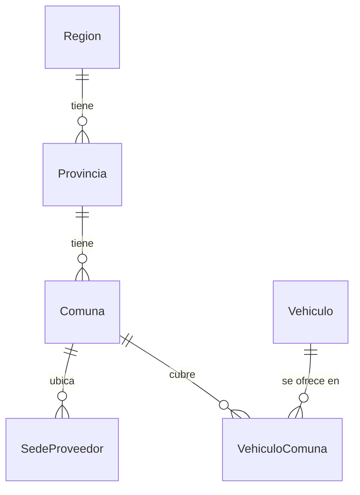
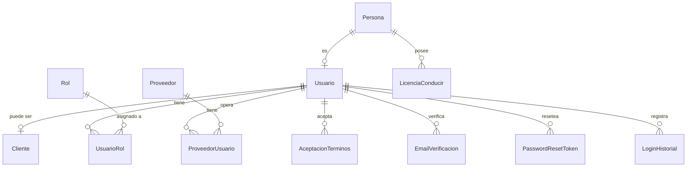
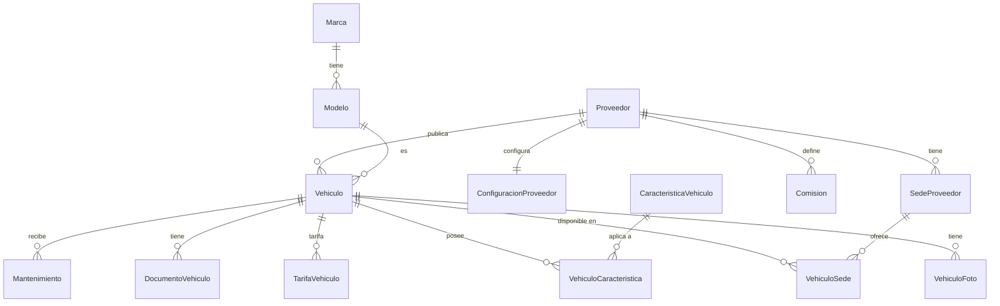
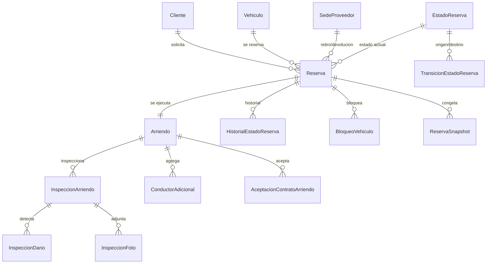
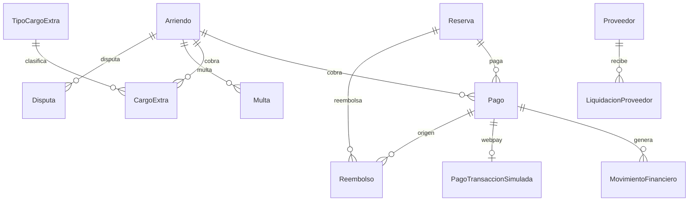
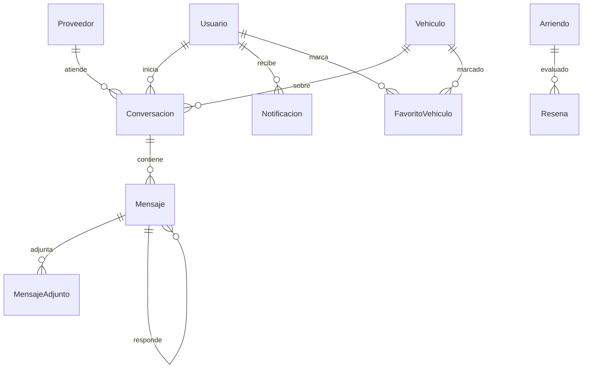

# Informe consolidado — Base de Datos RentaCarDB

Documento único que reúne toda la documentación del modelo relacional de `RentaCarDB`.
Generado a partir de los documentos de `docs/`.

## Contenido

1. Glosario de términos del dominio
2. Modelo relacional (diccionario de datos)
3. Relaciones y cardinalidades
4. Normalización 3FN
5. Clasificación de tablas
6. Alcance
7. Diagramas entidad-relación (ERD)

---

# Glosario de términos del dominio — RentaCarDB

Términos del negocio de **reserva y arriendo de vehículos** usados en el modelo.

## Actores
| Término | Definición |
|---------|-----------|
| **Persona** | Individuo con datos de identidad (RUT, nombres, contacto). Base de `Usuario`. |
| **Usuario** | Cuenta de acceso a la plataforma (email + contraseña). Toda persona que usa el sistema. |
| **Cliente** | Usuario habilitado para **reservar y arrendar** vehículos. |
| **Proveedor** | Dueño/gestor de vehículos que los publica en renta. Puede ser **persona** o **empresa**. |
| **Usuario de proveedor** | Usuario vinculado a un proveedor (operador o administrador) vía `ProveedorUsuario`. |
| **Sede** | Punto físico de un proveedor donde se entrega/recibe un vehículo (`SedeProveedor`). |

## Geografía (Chile)
| Término | Definición |
|---------|-----------|
| **Región** | Primera división territorial de Chile (16). |
| **Provincia** | Segunda división (56); pertenece a una región. |
| **Comuna** | Tercera división (346); pertenece a una provincia. |
| **Código de comuna** | Código oficial (CUT) de 5 dígitos de la comuna. |

## Vehículos
| Término | Definición |
|---------|-----------|
| **Vehículo** | Unidad concreta que se arrienda (patente, VIN, marca/modelo, año, km). |
| **Marca / Modelo** | Fabricante y versión del vehículo. |
| **Tipo de vehículo** | Categoría (Sedán, SUV, Hatchback, Pickup, Van, Coupé). |
| **Tipo de combustible** | Gasolina, Diésel, Híbrido, Eléctrico. |
| **Tipo de transmisión** | Manual o Automática. |
| **Estado del vehículo** | Disponible, Arrendado, En mantenimiento, Fuera de servicio. |
| **Estado de publicación** | Pendiente, Publicado, Rechazado, Suspendido. |
| **Característica** | Equipamiento del vehículo (GPS, aire acondicionado, silla de bebé…). Relación N:M. |
| **Tarifa** | Regla de precio por día según fecha, día de la semana, anticipación y duración. |
| **Documento de vehículo** | Permiso de circulación, revisión técnica, SOAP, seguro (con vencimiento). |
| **Mantenimiento** | Preventivo, correctivo, revisión técnica, lavado, otro. |
| **Movimiento de vehículo** | Traslado del vehículo entre sedes. |

## Reserva y arriendo
| Término | Definición |
|---------|-----------|
| **Reserva** | Solicitud de un cliente para usar un vehículo entre dos fechas, en sedes de retiro y devolución. |
| **Estado de reserva** | PENDIENTE, CONFIRMADA, EN_CURSO, COMPLETADA, CANCELADA, EXPIRADA. |
| **Transición de estado** | Regla que define qué cambios de estado de reserva son válidos y con qué evento/requisitos. |
| **Expiración de reserva** | Plazo (minutos) tras el cual una reserva no pagada pasa a EXPIRADA. |
| **Bloqueo de vehículo** | Intervalo en que el vehículo no está disponible (reserva, mantenimiento, traslado, manual, accidente, documentación). |
| **Snapshot de reserva** | Copia congelada de precios/condiciones al momento de reservar (trazabilidad). |
| **Arriendo** | Ejecución real de una reserva: retiro, uso y devolución del vehículo. |
| **Estado de arriendo** | ACTIVO, FINALIZADO, CANCELADO. |
| **Inspección** | Registro de entrega o devolución (combustible, km, limpieza, fotos, daños). |
| **Conductor adicional** | Persona extra autorizada a conducir el vehículo en el arriendo. |
| **Licencia de conducir** | Licencia del conductor, con clase y vigencia. |
| **Aceptación de contrato / términos** | Evidencia (hash, IP, versión) de que el cliente aceptó el contrato o los términos. |

## Pagos y finanzas
| Término | Definición |
|---------|-----------|
| **Pago** | Transacción monetaria asociada a una reserva, arriendo o cargo extra. |
| **Método de pago** | Débito, crédito, prepago, transferencia, efectivo, Webpay simulado. |
| **Estado de pago** | PENDIENTE, APROBADO, RECHAZADO, REEMBOLSADO. |
| **Tipo de operación de pago** | RESERVA, ARRIENDO, EXTRA. |
| **Movimiento financiero** | Asiento contable interno (cargo, comisión, reembolso, multa, depósito…). |
| **Comisión de plataforma** | Porcentaje que retiene la plataforma sobre el arriendo (global o por proveedor). |
| **Reembolso** | Devolución total o parcial del dinero pagado. |
| **Liquidación** | Cálculo periódico de lo que se paga a un proveedor (bruto − comisión − reembolsos + ajustes). |
| **Cargo extra** | Cobro adicional (combustible, km excedido, daño, limpieza, multa de tránsito). |
| **Multa** | Multa de tránsito asociada a un arriendo. |
| **Disputa** | Reclamo abierto entre cliente y proveedor por un arriendo. |
| **Pasarela simulada (Webpay)** | Emulación del flujo de pago Webpay (iniciar → `token_ws` → confirmar). |

## Comunicación y reputación
| Término | Definición |
|---------|-----------|
| **Conversación** | Hilo de mensajería entre un cliente y un proveedor (opcionalmente sobre un vehículo). |
| **Mensaje** | Texto/imagen/archivo/ubicación dentro de una conversación (soporta respuestas y edición). |
| **Adjunto de mensaje** | Archivo asociado a un mensaje. |
| **Notificación** | Aviso al usuario (EMAIL/SMS/PUSH) generado por eventos del sistema. |
| **Reseña** | Evaluación (1–5) de cliente a proveedor/vehículo o de proveedor a cliente. |
| **Favorito** | Vehículo marcado por un usuario como preferido. |
| **Búsqueda guardada** | Filtros de búsqueda que el usuario guarda para reutilizar. |

## Técnicos
| Término | Definición |
|---------|-----------|
| **Auditoría** | Registro de cambios relevantes (quién, cuándo, antes/después). |
| **Outbox** | Patrón de cola de eventos para integración asíncrona. |
| **Idempotencia** | `idempotency_key` que evita duplicar una operación si se reintenta. |
| **Correlación** | `correlation_id` que agrupa operaciones de un mismo flujo. |
| **Rowversion** | Columna de control de concurrencia optimista. |
| **Configuración global** | Parámetros de plataforma (IVA, comisión, expiración, moneda). |

---

# 01 — Modelo Relacional (Diccionario de datos)

Diccionario de `RentaCarDB`. Se detallan **completamente** las tablas del núcleo de
negocio y se **resumen** los catálogos (tablas de referencia con estructura homogénea
`ID + nombre + activo`).

Leyenda: **PK** = clave primaria · **FK** = clave foránea · **UQ** = único · **CK** = check.
Nulo: `NO` / `SÍ`.

---

## Módulo 1 — Geografía (Chile)

### `Region`
Propósito: regiones de Chile (16). Referencia estable.
- **PK:** `ID_region` · **UQ:** `nombre_region`

| Columna | Tipo | Nulo | Restricción |
|---|---|---|---|
| ID_region | int IDENTITY | NO | PK |
| nombre_region | nvarchar(100) | NO | UQ, CK no vacío |
| activo_region | bit | NO | |

### `Provincia`
Propósito: provincias (56); pertenecen a una región.
- **PK:** `ID_provincia` · **FK:** `ID_region_provincia → Region` · **UQ:** (`ID_region_provincia`,`nombre_provincia`)

| Columna | Tipo | Nulo | Restricción |
|---|---|---|---|
| ID_provincia | int IDENTITY | NO | PK |
| ID_region_provincia | int | NO | FK→Region |
| nombre_provincia | nvarchar(100) | NO | CK no vacío |
| activo_provincia | bit | NO | |

### `Comuna`
Propósito: comunas (346); pertenecen a una provincia. Incluye código oficial (CUT).
- **PK:** `ID_comuna` · **FK:** `ID_provincia_comuna → Provincia` · **UQ:** (`ID_provincia_comuna`,`nombre_comuna`), `codigo_comuna`

| Columna | Tipo | Nulo | Restricción |
|---|---|---|---|
| ID_comuna | int IDENTITY | NO | PK |
| nombre_comuna | nvarchar(100) | NO | CK no vacío |
| activo_comuna | bit | NO | |
| codigo_comuna | varchar(5) | SÍ | UQ (CUT) |
| ID_provincia_comuna | int | NO | FK→Provincia |

> Jerarquía **Región → Provincia → Comuna** (1:N en cada nivel). La región **no** se
> duplica en `Comuna` (se obtiene vía `Provincia`) → 3FN.

---

## Módulo 2 — Personas y seguridad

### `Persona`
Propósito: identidad de las personas (base de `Usuario` y `Proveedor`).
- **PK:** `ID_persona` · **UQ:** `rut_persona`

| Columna | Tipo | Nulo | Restricción |
|---|---|---|---|
| ID_persona | int IDENTITY | NO | PK |
| rut_persona | varchar(12) | NO | UQ, CK formato + `fn_ValidarRut` |
| nombres_persona | nvarchar(80) | NO | CK no vacío |
| apellido_paterno_persona | nvarchar(50) | NO | CK no vacío |
| apellido_materno_persona | nvarchar(50) | SÍ | |
| telefono_persona | varchar(20) | SÍ | |
| fecha_nacimiento_persona | date | SÍ | |

### `Usuario`
Propósito: cuenta de acceso (email + hash de contraseña).
- **PK:** `ID_usuario` · **FK:** `ID_persona_usuario → Persona` · **UQ:** `email_usuario`, `ID_persona_usuario`

| Columna | Tipo | Nulo | Restricción |
|---|---|---|---|
| ID_usuario | int IDENTITY | NO | PK |
| ID_persona_usuario | int | NO | FK→Persona, UQ (1:1) |
| email_usuario | varchar(150) | NO | UQ |
| password_hash_usuario | varchar(255) | NO | |
| activo_usuario | bit | NO | |
| email_confirmado_usuario | bit | NO | |
| fecha_creacion_usuario | datetime2(0) | NO | |

### `Cliente`
Propósito: rol de cliente (usuario habilitado para reservar). Extensión 1:1 de `Usuario`.
- **PK:** `ID_usuario_cliente` (= FK a Usuario)

| Columna | Tipo | Nulo | Restricción |
|---|---|---|---|
| ID_usuario_cliente | int | NO | PK, FK→Usuario |
| fecha_alta_cliente | datetime2(0) | NO | |
| activo_cliente | bit | NO | |

### `Rol` (catálogo)
`ID_rol` PK · `nombre_rol` UQ · `descripcion_rol`. Valores: ADMIN, OPERADOR, CLIENTE, PROVEEDOR.

### `UsuarioRol` (N:M)
`ID_usuario_usuario_rol` FK→Usuario · `ID_rol_usuario_rol` FK→Rol · `fecha_asignacion_usuario_rol`.
**PK** compuesta (`ID_usuario_usuario_rol`,`ID_rol_usuario_rol`).

### `ProveedorUsuario` (N:M)
`ID_proveedor_proveedor_usuario` FK→Proveedor · `ID_usuario_proveedor_usuario` FK→Usuario ·
`fecha_vinculacion_proveedor_usuario` · `es_administrador_proveedor_usuario`.
**PK** compuesta.

### `AceptacionTerminos`
Evidencia de aceptación de términos por un usuario.
`ID_aceptacion` PK · `ID_usuario_aceptacion` FK→Usuario · `version_terminos` · `fecha_aceptacion` · `ip_aceptacion` · `user_agent_aceptacion`.

### `EmailVerificacion`
Tokens de verificación de correo. `ID_email_verificacion` PK · `ID_usuario_email_verificacion` FK→Usuario · `token_hash_email_verificacion` UQ · expiración/uso/creación.

### `PasswordResetToken`
Tokens de restablecimiento de contraseña. `ID_password_reset` PK · `ID_usuario_password_reset` FK→Usuario · `token_hash_password_reset` UQ · expiración/uso/creación.

### `LoginHistorial` (técnica)
Registro de intentos de inicio de sesión. `ID_login` PK · `ID_usuario_login` FK→Usuario (nullable) · `email_intentado_login` · `exitoso_login` · `ip_login` · `user_agent_login` · `fecha_login`.

---

## Módulo 3 — Proveedores y sedes

### `Proveedor`
Propósito: dueño/gestor de vehículos (persona o empresa).
- **PK:** `ID_proveedor` · **FK:** tipo, persona, estado · **UQ:** `rut_proveedor`, `ID_persona_proveedor`

| Columna | Tipo | Nulo | Restricción |
|---|---|---|---|
| ID_proveedor | int IDENTITY | NO | PK |
| ID_tipo_proveedor_proveedor | int | NO | FK→TipoProveedor |
| ID_persona_proveedor | int | SÍ | FK→Persona |
| ID_estado_proveedor_proveedor | int | NO | FK→EstadoProveedor |
| razon_social_proveedor | nvarchar(150) | SÍ | |
| nombre_comercial_proveedor | nvarchar(150) | NO | CK no vacío |
| rut_proveedor | varchar(12) | SÍ | UQ |
| telefono_proveedor | varchar(50) | SÍ | |
| email_proveedor | varchar(150) | SÍ | |
| fecha_registro_proveedor | datetime2(0) | NO | |
| fecha_baja_proveedor | datetime2(0) | SÍ | |
| motivo_baja_proveedor | nvarchar(300) | SÍ | |

### `SedeProveedor`
Propósito: punto físico de retiro/devolución de un proveedor.
- **PK:** `ID_sede_proveedor` · **FK:** proveedor, comuna · **UQ:** (`ID_proveedor_sede_proveedor`,`nombre_sede_proveedor`)

| Columna | Tipo | Nulo | Restricción |
|---|---|---|---|
| ID_sede_proveedor | int IDENTITY | NO | PK |
| ID_proveedor_sede_proveedor | int | NO | FK→Proveedor |
| ID_comuna_sede_proveedor | int | NO | FK→Comuna |
| nombre_sede_proveedor | nvarchar(100) | NO | |
| direccion_sede_proveedor | nvarchar(200) | NO | |
| telefono_sede_proveedor | varchar(20) | SÍ | |
| email_sede_proveedor | varchar(150) | SÍ | |
| activo_sede_proveedor | bit | NO | |

### `ConfiguracionProveedor`
Propósito: parámetros operativos por proveedor. Extensión 1:1 de `Proveedor`.
- **PK:** `ID_proveedor_configuracion_proveedor` (= FK a Proveedor)

| Columna | Tipo | Nulo | Restricción |
|---|---|---|---|
| ID_proveedor_configuracion_proveedor | int | NO | PK, FK→Proveedor |
| permite_devolucion_otra_sede | bit | NO | |
| permite_entrega_domicilio | bit | NO | |
| permite_retiro_domicilio | bit | NO | |
| radio_maximo_km | decimal(8,2) | SÍ | CK >0 |
| minutos_expiracion_reserva | int | NO | CK 5–1440 |
| edad_minima_arriendo | int | SÍ | |
| requiere_deposito | bit | NO | |
| monto_deposito | decimal(14,2) | SÍ | CK ≥0 |
| dias_minimos_arriendo | int | SÍ | CK ≥1 |
| dias_maximos_arriendo | int | SÍ | CK ≥ mín |
| moneda_operacion | char(3) | NO | |

### `Comision`
Propósito: porcentaje de comisión de la plataforma (global si `ID_proveedor_comision` es NULL, o por proveedor).
- **PK:** `ID_comision` · **FK:** `ID_proveedor_comision → Proveedor` (nullable)

| Columna | Tipo | Nulo | Restricción |
|---|---|---|---|
| ID_comision | int IDENTITY | NO | PK |
| ID_proveedor_comision | int | SÍ | FK→Proveedor (NULL = global) |
| porcentaje_comision | decimal(5,2) | NO | CK 0–100 |
| fecha_inicio_comision | date | NO | |
| fecha_fin_comision | date | SÍ | CK ≥ inicio |
| activo_comision | bit | NO | |

> Función `fn_ComisionAplicable(@ID_proveedor,@fecha)` resuelve la comisión vigente
> (proveedor específico > global).

---

## Módulo 4 — Vehículos

### `Vehiculo`
Propósito: unidad arrendable.
- **PK:** `ID_vehiculo` · **UQ:** `patente_vehiculo`, `vin_vehiculo` · **FK:** proveedor, sede actual, modelo, tipo, combustible, transmisión, estado, publicación.

| Columna | Tipo | Nulo | Restricción |
|---|---|---|---|
| ID_vehiculo | int IDENTITY | NO | PK |
| ID_proveedor_vehiculo | int | NO | FK→Proveedor |
| ID_sede_actual_vehiculo | int | SÍ | FK→SedeProveedor |
| ID_modelo_vehiculo | int | NO | FK→Modelo |
| ID_tipo_vehiculo_vehiculo | int | NO | FK→TipoVehiculo |
| ID_tipo_combustible_vehiculo | int | NO | FK→TipoCombustible |
| ID_tipo_transmision_vehiculo | int | NO | FK→TipoTransmision |
| ID_estado_vehiculo_vehiculo | int | NO | FK→EstadoVehiculo |
| ID_estado_publicacion_vehiculo_vehiculo | int | NO | FK→EstadoPublicacionVehiculo |
| patente_vehiculo | varchar(10) | NO | UQ, CK formato (BBBB12/BBB12) |
| vin_vehiculo | varchar(17) | NO | UQ |
| anio_vehiculo | smallint | NO | CK 1950–2100 |
| kilometraje_vehiculo | int | NO | CK ≥0 |
| precio_diario_base_vehiculo | decimal(12,2) | NO | CK >0 |
| calificacion_promedio_vehiculo | decimal(3,2) | SÍ | (desnormalizado) |
| fecha_registro_vehiculo | datetime2(0) | NO | |
| fecha_baja_vehiculo | datetime2(0) | SÍ | |
| motivo_baja_vehiculo | nvarchar(300) | SÍ | |
| row_version_vehiculo | rowversion | NO | concurrencia |

### `Marca` / `Modelo`
`Marca`: `ID_marca` PK, `nombre_marca` UQ, `activo_marca`.
`Modelo`: `ID_modelo` PK, `ID_marca_modelo` FK→Marca, `nombre_modelo`, `activo_modelo`, **UQ** (`ID_marca_modelo`,`nombre_modelo`).

### `CaracteristicaVehiculo` (catálogo) + `VehiculoCaracteristica` (N:M)
`CaracteristicaVehiculo`: `ID_caracteristica_vehiculo` PK · `nombre_caracteristica` UQ ·
`categoria_caracteristica` (CK: EQUIPAMIENTO/SEGURIDAD/CONFORT/CONECTIVIDAD) · `descripcion_caracteristica` · `activo_caracteristica`.
`VehiculoCaracteristica`: **PK** (`ID_vehiculo_vehiculo_caracteristica`,`ID_caracteristica_vehiculo_caracteristica`) · `disponible_vehiculo_caracteristica` · `fecha_registro_vehiculo_caracteristica`. FKs a `Vehiculo` y `CaracteristicaVehiculo`.

### `VehiculoFoto`
`ID_foto_vehiculo` PK · `ID_vehiculo_vehiculo_foto` FK→Vehiculo · `url_foto_vehiculo` · `es_principal_foto` · `activo_foto_vehiculo` · `fecha_subida_foto`.

### `VehiculoComuna` (N:M)
Comunas donde se ofrece un vehículo. **PK** (`ID_vehiculo_vehiculo_comuna`,`ID_comuna_vehiculo_comuna`), FKs a `Vehiculo` y `Comuna`.

### `VehiculoSede` (N:M)
Sedes donde un vehículo puede entregarse/devolverse.
**PK** (`ID_vehiculo_vehiculo_sede`,`ID_sede_proveedor_vehiculo_sede`) · `disponible_para_entrega` · `disponible_para_devolucion` · `fecha_inicio_vehiculo_sede` · `fecha_fin_vehiculo_sede`.

### `TarifaVehiculo`
Propósito: reglas de precio por día.
- **PK:** `ID_tarifa` · **FK:** `ID_vehiculo_tarifa → Vehiculo`, `ID_proveedor_tarifa → Proveedor`

| Columna | Tipo | Nulo | Restricción |
|---|---|---|---|
| ID_tarifa | bigint IDENTITY | NO | PK |
| ID_vehiculo_tarifa | int | NO | FK→Vehiculo |
| ID_proveedor_tarifa | int | SÍ | FK→Proveedor |
| nombre_tarifa | varchar(80) | NO | |
| fecha_inicio_tarifa / fecha_fin_tarifa | date | NO | CK fin ≥ inicio |
| dia_semana_aplica | tinyint | SÍ | CK 1–7 |
| anticipacion_min_dias / anticipacion_max_dias | int | SÍ | |
| dias_minimos / dias_maximos | int | SÍ | |
| precio_dia_tarifa | decimal(14,2) | NO | CK >0 |
| prioridad_tarifa | int | NO | |
| activa_tarifa | bit | NO | |
| fecha_creacion_tarifa | datetime2(0) | NO | |
| ID_usuario_creacion | int | SÍ | |

> Función `fn_V5_PrecioAplicable(@ID_vehiculo,@inicio,@fin)` elige la tarifa vigente.

### `DocumentoVehiculo` + `TipoDocumentoVehiculo` (catálogo)
`TipoDocumentoVehiculo`: `ID_tipo_documento_vehiculo` PK · `nombre_tipo_documento` UQ · `obligatorio_tipo_documento` · `activo_tipo_documento`.
`DocumentoVehiculo`: `ID_documento_vehiculo` PK · FK a Vehiculo y TipoDocumentoVehiculo · `numero_documento` · `fecha_emision_documento` · `fecha_vencimiento_documento` (NO, CK ≥ emisión) · `url_archivo_documento` · `verificado_documento` · `activo_documento` · `fecha_registro_documento`.

### `Mantenimiento` + `TipoMantenimiento` (catálogo)
`Mantenimiento`: `ID_mantenimiento` PK · FK a Vehiculo y TipoMantenimiento · `descripcion_mantenimiento` · `taller_mantenimiento` · `kilometraje_mantenimiento` (CK ≥0) · `costo_mantenimiento` (CK ≥0) · `fecha_inicio_mantenimiento` / `fecha_fin_mantenimiento` (CK fin ≥ inicio) · `activo_mantenimiento` · `fecha_registro_mantenimiento` · `ID_usuario_registro_mantenimiento` FK→Usuario.

### `MovimientoVehiculo`
Traslado entre sedes. `ID_movimiento_vehiculo` PK · `ID_vehiculo_movimiento_vehiculo` FK→Vehiculo · `ID_sede_origen_movimiento_vehiculo` / `ID_sede_destino_movimiento_vehiculo` FK→SedeProveedor (CK: distintas si ambas) · `fecha_movimiento_vehiculo` · `observacion_movimiento_vehiculo`.

---

## Módulo 5 — Reservas y arriendos

### `Reserva`
Propósito: núcleo del negocio. Solicitud de uso de un vehículo entre dos fechas.
- **PK:** `ID_reserva` · **FK:** cliente, vehículo, sedes, estado, política de cancelación.

| Columna | Tipo | Nulo | Restricción |
|---|---|---|---|
| ID_reserva | int IDENTITY | NO | PK |
| ID_usuario_cliente_reserva | int | NO | FK→Cliente |
| ID_vehiculo_reserva | int | NO | FK→Vehiculo |
| ID_sede_retiro_reserva | int | NO | FK→SedeProveedor |
| ID_sede_devolucion_reserva | int | NO | FK→SedeProveedor |
| ID_estado_reserva_reserva | int | NO | FK→EstadoReserva |
| fecha_inicio_reserva / fecha_fin_reserva | date | NO | CK fin > inicio |
| precio_diario_aplicado_reserva | decimal(14,2) | NO | CK >0 |
| porcentaje_impuesto_aplicado_reserva | decimal(5,2) | NO | |
| monto_subtotal_reserva | decimal(14,2) | NO | |
| monto_descuento_reserva | decimal(14,2) | NO | CK ≥0 |
| monto_impuesto_reserva | decimal(14,2) | NO | |
| monto_total_reserva | decimal(14,2) | NO | CK >0 |
| monto_deposito_reserva | decimal(14,2) | NO | CK ≥0 |
| monto_reembolso_reserva | decimal(14,2) | NO | |
| politica_combustible_reserva | varchar(30) | SÍ | CK (LLENO_LLENO/MISMO_NIVEL/LIBRE) |
| km_incluidos_dia_reserva | int | SÍ | CK ≥0 |
| cargo_km_excedido_reserva | decimal(12,2) | SÍ | CK ≥0 |
| km_recorridos_reserva | int | SÍ | |
| cargo_km_total_reserva | decimal(12,2) | NO | CK ≥0 |
| fecha_reserva | datetime2(0) | NO | |
| fecha_expiracion_reserva | datetime2(0) | SÍ | |
| fecha_confirmacion_reserva | datetime2(0) | SÍ | |
| observaciones_reserva | nvarchar(500) | SÍ | |
| ID_politica_cancelacion_reserva | int | SÍ | FK→PoliticaCancelacion |
| correlation_id_reserva | uniqueidentifier | SÍ | trazabilidad |
| idempotency_key_reserva | varchar(100) | SÍ | UQ (evita duplicados) |
| moneda_reserva | char(3) | NO | DEFAULT 'CLP' |
| row_version_reserva | rowversion | NO | concurrencia |

### `EstadoReserva` (catálogo)
`ID_estado_reserva` PK · `nombre_estado_reserva` UQ. Valores: PENDIENTE, CONFIRMADA, EN_CURSO, COMPLETADA, CANCELADA, EXPIRADA.

### `TransicionEstadoReserva` (regla de negocio)
Define transiciones válidas de estado.
`ID_transicion` PK · `ID_estado_origen`/`ID_estado_destino` FK→EstadoReserva · `evento` · `requiere_pago` · `requiere_arriendo` · `activo` · **UQ** (`ID_estado_origen`,`ID_estado_destino`,`evento`).

### `HistorialEstadoReserva`
Bitácora de cambios de estado. `ID_historial` PK · `ID_reserva_historial` FK→Reserva · `ID_estado_anterior`/`ID_estado_nuevo` FK→EstadoReserva · `evento` · `motivo` · `ID_usuario_historial` FK→Usuario · `fecha_historial`.

### `BloqueoVehiculo`
Intervalos de no disponibilidad. `ID_bloqueo` PK · `ID_vehiculo_bloqueo` FK→Vehiculo · `tipo_bloqueo` (CK: RESERVA/MANTENIMIENTO/MANUAL/TRASLADO/ACCIDENTE/DOCUMENTACION) · `fecha_inicio_bloqueo`/`fecha_fin_bloqueo` (CK fin > inicio) · `activo_bloqueo` · `motivo_bloqueo` · `ID_reserva_bloqueo` FK→Reserva · `ID_mantenimiento_bloqueo` FK→Mantenimiento · `fecha_creacion_bloqueo` · `fecha_cierre_bloqueo` · `ID_usuario_creacion` FK→Usuario.

### `ReservaSnapshot`
Copia congelada de condiciones al reservar. `ID_snapshot` PK · `ID_reserva_snapshot` FK→Reserva · `version_snapshot` (**UQ** con reserva) · montos (precio_dia, subtotal, descuento, impuesto, total; CK ≥0) · `porcentaje_impuesto` (CK 0–100) · `porcentaje_comision` · `km_incluidos_dia` · `cargo_km_excedido` · `nombre_tarifa` · `politica_cancelacion` · `condiciones_comerciales` · `snapshot_json` · `hash_snapshot` · `fecha_snapshot` · `ID_usuario_snapshot` FK→Usuario.

### `Arriendo`
Propósito: ejecución real de la reserva. Relación 1:1 con `Reserva`.
- **PK:** `ID_arriendo` · **FK:** reserva, sedes reales, estado · **UQ:** `ID_reserva_arriendo`

| Columna | Tipo | Nulo | Restricción |
|---|---|---|---|
| ID_arriendo | int IDENTITY | NO | PK |
| ID_reserva_arriendo | int | NO | FK→Reserva, UQ (1:1) |
| ID_sede_retiro_real_arriendo | int | NO | FK→SedeProveedor |
| ID_sede_devolucion_real_arriendo | int | SÍ | FK→SedeProveedor |
| ID_estado_arriendo_arriendo | int | NO | FK→EstadoArriendo |
| fecha_hora_retiro_real_arriendo | datetime2(0) | NO | |
| fecha_hora_devolucion_real_arriendo | datetime2(0) | SÍ | CK ≥ retiro |
| kilometraje_inicial_arriendo | int | NO | CK ≥0 |
| kilometraje_final_arriendo | int | SÍ | CK ≥ inicial |
| combustible_inicial_arriendo | decimal(5,2) | NO | CK 0–100 |
| combustible_final_arriendo | decimal(5,2) | SÍ | CK 0–100 |
| row_version_arriendo | rowversion | NO | concurrencia |

### `InspeccionArriendo` + `InspeccionDano` + `InspeccionFoto`
`InspeccionArriendo`: `ID_inspeccion_arriendo` PK · `ID_arriendo_inspeccion_arriendo` FK→Arriendo · `tipo_inspeccion` (CK: ENTREGA/DEVOLUCION) · `nivel_combustible_inspeccion` (CK 0–100) · `kilometraje_inspeccion` (CK ≥0) · `limpieza_inspeccion` (CK) · `observaciones_inspeccion` · `firma_cliente_inspeccion` · `ID_usuario_operador_inspeccion` FK→Usuario · `fecha_inspeccion` · **UQ** (arriendo,tipo).
`InspeccionDano`: `ID_inspeccion_dano` PK · FK→InspeccionArriendo · `zona_dano` · `tipo_dano` · `severidad_dano` (CK: LEVE/MEDIO/GRAVE) · `descripcion_dano` · `monto_estimado_dano` (CK ≥0) · `activo_dano` · `fecha_registro_dano`.
`InspeccionFoto`: `ID_inspeccion_foto` PK · FK→InspeccionArriendo · `url_foto_inspeccion` · `angulo_foto_inspeccion` (CK) · `activa_foto_inspeccion` · `fecha_subida_foto_inspeccion`.

### `ConductorAdicional`
`ID_conductor_adicional` PK · `ID_arriendo_conductor_adicional` FK→Arriendo · `ID_persona_conductor_adicional` FK→Persona · `ID_licencia_conducir_conductor_adicional` FK→LicenciaConducir · `activo_conductor_adicional` · `fecha_registro` · **UQ** (arriendo,persona).

### `LicenciaConducir` + `ClaseLicencia` (catálogo)
`LicenciaConducir`: `ID_licencia_conducir` PK · `ID_persona_licencia_conducir` FK→Persona · `ID_clase_licencia_licencia_conducir` FK→ClaseLicencia · `numero_licencia` UQ · `fecha_emision_licencia`/`fecha_vencimiento_licencia` (CK fin ≥ emisión) · `url_archivo_licencia` · `verificada_licencia` · `activa_licencia` · `fecha_registro_licencia`.
`ClaseLicencia`: `ID_clase_licencia` PK · `codigo_clase_licencia` UQ · `descripcion_clase_licencia` · `activo_clase_licencia` (A1…F, B).

### `AceptacionContratoArriendo`
Evidencia de aceptación del contrato. `ID_aceptacion_contrato` PK · `ID_arriendo_aceptacion` FK→Arriendo · `version_contrato` (**UQ** con arriendo) · `es_vigente` · `hash_contrato` (CK largo 64) · `url_contrato` · `fecha_generacion` · `fecha_aceptacion` · `ip_aceptacion` · `user_agent_aceptacion` · `ID_usuario_aceptacion` FK→Usuario.

---

## Módulo 6 — Pagos y finanzas

### `Pago`
Propósito: transacción monetaria.
- **PK:** `ID_pago` · **FK:** reserva, arriendo, cargo extra, tipo operación, método, estado.

| Columna | Tipo | Nulo | Restricción |
|---|---|---|---|
| ID_pago | int IDENTITY | NO | PK |
| ID_reserva_pago | int | NO | FK→Reserva |
| ID_arriendo_pago | int | SÍ | FK→Arriendo |
| ID_cargo_extra_pago | int | SÍ | FK→CargoExtra |
| ID_tipo_operacion_pago_pago | int | NO | FK→TipoOperacionPago |
| ID_metodo_pago_pago | int | NO | FK→MetodoPago |
| ID_estado_pago_pago | int | NO | FK→EstadoPago |
| monto_pago | decimal(14,2) | NO | CK >0 |
| moneda_pago | char(3) | NO | CK = 'CLP' |
| referencia_proveedor_pago | varchar(100) | SÍ | |
| idempotency_key_pago | varchar(100) | SÍ | UQ |
| referencia_externa_pago | varchar(150) | SÍ | |
| proveedor_pago | varchar(50) | SÍ | |
| fecha_pago | datetime2(0) | SÍ | |
| fecha_confirmacion_pago | datetime2(0) | SÍ | |
| row_version_pago | rowversion | NO | concurrencia |

### `Reembolso`
`ID_reembolso` PK · `ID_reserva_reembolso` FK→Reserva · `ID_pago_reembolso` FK→Pago · `monto_reembolso` (CK >0) · `moneda_reembolso` · `estado_reembolso` (CK: PENDIENTE/PROCESANDO/COMPLETADO/RECHAZADO/CANCELADO) · `motivo_reembolso` · `referencia_externa` · `idempotency_key_reembolso` UQ · `fecha_solicitud_reembolso` · `fecha_procesamiento_reembolso` · `ID_usuario_reembolso` FK→Usuario.

### `MovimientoFinanciero`
Asiento contable interno.
`ID_movimiento` PK · `ID_reserva_movimiento` FK→Reserva · `ID_pago_movimiento` FK→Pago · `tipo_movimiento` (CK: CARGO_RESERVA, PAGO, REEMBOLSO, COMISION_PLATAFORMA, CARGO_KM, CARGO_DANO, MULTA, DEPOSITO, LIBERACION_DEPOSITO, AJUSTE, DESCUENTO) · `monto_movimiento` (CK ≠0) · `moneda_movimiento` · `referencia_externa` · `descripcion` · `fecha_movimiento` · `ID_usuario_movimiento` FK→Usuario.

### `CargoExtra` + `TipoCargoExtra` (catálogo) + `EstadoCargoExtra` (catálogo)
`TipoCargoExtra`: `ID_tipo_cargo_extra` PK · `nombre_tipo_cargo_extra` UQ (CK: COMBUSTIBLE/KM_EXCEDIDO/DANO/LIMPIEZA/MULTA_TRANSITO/OTRO) · `descripcion_tipo_cargo_extra` · `activo_tipo_cargo_extra`.
`CargoExtra`: `ID_cargo_extra` PK · `ID_arriendo_cargo_extra` FK→Arriendo · `ID_estado_cargo_extra_cargo_extra` FK→EstadoCargoExtra · `ID_tipo_cargo_extra_cargo_extra` FK→TipoCargoExtra · `concepto_cargo_extra` (CK no vacío) · `monto_cargo_extra` (CK >0) · `fecha_registro_cargo_extra` · `observaciones_cargo_extra` · `row_version_cargo_extra`.

### `Multa` + `EstadoMulta` (catálogo)
`Multa`: `ID_multa` PK · `ID_arriendo_multa` FK→Arriendo · `ID_estado_multa_multa` FK→EstadoMulta · `fecha_multa` · `descripcion_multa` · `organismo_multa` · `numero_parte` · `monto_multa` (CK >0) · `fecha_registro_multa` · `ID_usuario_registro_multa` FK→Usuario · `row_version_multa`.

### `LiquidacionProveedor` + `EstadoLiquidacion` (catálogo)
`LiquidacionProveedor`: `ID_liquidacion` PK · `ID_proveedor_liquidacion` FK→Proveedor · `periodo_inicio`/`periodo_fin` (CK fin ≥ inicio) · `moneda_liquidacion` · `total_bruto` · `total_comision` · `total_reembolsos` · `total_ajustes` · `total_neto` · `estado_liquidacion` (CK: BORRADOR/CALCULADA/APROBADA/PAGADA/ANULADA) · `idempotency_key_liquidacion` UQ · `fecha_generacion` · `fecha_pago` · `ID_usuario_liquidacion` FK→Usuario · `row_version_liquidacion`.

### `PagoTransaccionSimulada`
Emulación Webpay. `ID_transaccion_simulada` PK · `ID_pago_transaccion_simulada` FK→Pago (UQ) · `buy_order_transaccion_simulada` UQ · `session_id_transaccion_simulada` UQ · `token_ws_transaccion_simulada` UQ · `monto_transaccion_simulada` (CK >0) · `estado_transaccion_simulada` (CK: CREADA/APROBADA/RECHAZADA/ABORTADA/REEMBOLSADA) · `fecha_creacion_transaccion_simulada` · `fecha_respuesta_transaccion_simulada`.

### `Disputa` + `EstadoDisputa` (catálogo)
`Disputa`: `ID_disputa` PK · `ID_arriendo_disputa` FK→Arriendo · `ID_usuario_reporta_disputa` FK→Usuario · `ID_estado_disputa_disputa` FK→EstadoDisputa · `tipo_disputa` · `descripcion_disputa` · `monto_disputado` (CK ≥0) · `resolucion_disputa` · `fecha_apertura_disputa`/`fecha_cierre_disputa` (CK cierre ≥ apertura).

---

## Módulo 7 — Comunicación y reputación

### `Conversacion`
Hilo cliente ↔ proveedor. `ID_conversacion` PK · `ID_usuario_conversacion` FK→Usuario · `ID_proveedor_conversacion` FK→Proveedor · `ID_vehiculo_conversacion` FK→Vehiculo · `activa_conversacion` · `fecha_inicio_conversacion` · `fecha_ultimo_mensaje` · `vehiculo_conversacion_calc` (columna calculada persistida) · `ultimo_mensaje_preview_conversacion` · `ID_usuario_ultimo_mensaje_conversacion` FK→Usuario · `archivada_cliente_conversacion` · `archivada_proveedor_conversacion`.

### `Mensaje`
`ID_mensaje` PK · `ID_conversacion_mensaje` FK→Conversacion · `ID_usuario_emisor_mensaje` FK→Usuario · `contenido_mensaje` (CK no vacío) · `leido_mensaje` · `fecha_mensaje` · `tipo_mensaje` (CK: TEXTO/IMAGEN/ARCHIVO/UBICACION/SISTEMA) · `fecha_entrega_mensaje` · `fecha_lectura_mensaje` · `editado_mensaje` · `eliminado_mensaje` · `fecha_edicion_mensaje` · `fecha_eliminacion_mensaje` · `ID_mensaje_padre_mensaje` FK→Mensaje (respuestas).

### `MensajeAdjunto`
`ID_adjunto_mensaje_adjunto` PK · `ID_mensaje_mensaje_adjunto` FK→Mensaje · `url_archivo_mensaje_adjunto` (CK no vacío) · `nombre_archivo_mensaje_adjunto` · `tipo_mime_mensaje_adjunto` · `tamano_bytes_mensaje_adjunto` (CK >0) · `fecha_subida_mensaje_adjunto` · `activo_mensaje_adjunto`.

### `Notificacion`
`ID_notificacion` PK · `ID_usuario_notificacion` FK→Usuario · `tipo_notificacion` · `canal_notificacion` (CK: EMAIL/SMS/PUSH) · `destinatario_notificacion` · `asunto_notificacion` · `cuerpo_notificacion` · `estado_notificacion` (CK: PENDIENTE/ENVIADA/FALLIDA) · `fecha_creacion_notificacion` · `fecha_envio_notificacion` · `error_notificacion`.

### `Resena` + `TipoResena` (catálogo)
`Resena`: `ID_resena` PK · `ID_arriendo_resena` FK→Arriendo · `ID_usuario_autor_resena` FK→Usuario · `ID_tipo_resena_resena` FK→TipoResena · `calificacion_resena` (CK 1–5) · `comentario_resena` · `fecha_resena` · `activo_resena` · **UQ** (arriendo, autor, tipo).
`TipoResena`: `ID_tipo_resena` PK · `nombre_tipo_resena` UQ · `descripcion_tipo_resena` · `activo_tipo_resena`.

### `FavoritoVehiculo` (N:M)
**PK** (`ID_usuario_favorito`,`ID_vehiculo_favorito`) · FKs a Usuario y Vehiculo · `fecha_favorito`.

### `BusquedaGuardada` (técnica)
`ID_busqueda` PK · `ID_usuario_busqueda` FK→Usuario · `nombre_busqueda` · `ID_comuna_busqueda` FK→Comuna · `ID_tipo_vehiculo_busqueda` FK→TipoVehiculo · `precio_maximo_busqueda` (CK >0) · `fecha_desde_busqueda`/`fecha_hasta_busqueda` · `activa_busqueda` · `fecha_creacion_busqueda`.

---

## Módulo 8 — Técnicas / plataforma

### `ConfiguracionGlobal`
Parámetros de plataforma (fila única).
`ID_configuracion` PK (CK =1) · `iva_porcentaje` (CK 0–100) · `comision_porcentaje` (CK 0–100) · `minutos_expiracion_reserva` (CK 1–1440) · `moneda` (CK largo 3) · `dias_minimos_publicacion` · `fecha_actualizacion`.

### `Auditoria`
`ID_auditoria` PK · `entidad` (CK no vacío) · `ID_registro` · `accion` (CK: INSERT/UPDATE/DELETE/STATE_CHANGE/FINANCIAL/PUBLISH/CUSTOM) · `ID_usuario` FK→Usuario · `fecha` · `valor_anterior` · `valor_nuevo` · `descripcion` · `correlation_id` · `origen` (CK) · `ip_origen` · `user_agent` · `motivo`.

### `OutboxEvento`
`ID_evento` PK · `tipo_evento` · `agregado_tipo` · `agregado_id` · `payload` (CK JSON válido) · `fecha_creacion` · `fecha_procesamiento` · `estado` (CK: PENDIENTE/PROCESANDO/PROCESADO/ERROR/CANCELADO) · `intentos` (CK ≥0) · `ultimo_error` · `lock_id` · `fecha_lock`.

### `MigracionLog`
`ID_migracion` PK · `nombre_migracion` UQ · `fecha_ejecucion` · `detalles`.

---

## Catálogos (resumen)

Estructura homogénea `ID + nombre (+ activo)`. Valores sembrados entre paréntesis.

| Catálogo | PK | UQ | Valores |
|---|---|---|---|
| `EstadoVehiculo` | ID_estado_vehiculo | nombre_estado_vehiculo | DISPONIBLE, ARRENDADO, EN_MANTENIMIENTO, FUERA_DE_SERVICIO |
| `EstadoPublicacionVehiculo` | ID_estado_publicacion_vehiculo | nombre_estado_publicacion_vehiculo | PENDIENTE, PUBLICADO, RECHAZADO, SUSPENDIDO |
| `EstadoProveedor` | ID_estado_proveedor | nombre_estado_proveedor | PENDIENTE, APROBADO, RECHAZADO, SUSPENDIDO, INACTIVO |
| `EstadoReserva` | ID_estado_reserva | nombre_estado_reserva | PENDIENTE, CONFIRMADA, EN_CURSO, COMPLETADA, CANCELADA, EXPIRADA |
| `EstadoArriendo` | ID_estado_arriendo | nombre_estado_arriendo | ACTIVO, FINALIZADO, CANCELADO |
| `EstadoPago` | ID_estado_pago | nombre_estado_pago | PENDIENTE, APROBADO, RECHAZADO, REEMBOLSADO |
| `EstadoCargoExtra` | ID_estado_cargo_extra | nombre_estado_cargo_extra | PENDIENTE, PAGADO, ANULADO |
| `EstadoMulta` | ID_estado_multa | nombre_estado_multa | PENDIENTE, COBRADA, ANULADA |
| `EstadoDisputa` | ID_estado_disputa | nombre_estado_disputa | ABIERTA, EN_REVISION, RESUELTA, CERRADA |
| `EstadoLiquidacion` | ID_estado_liquidacion | nombre_estado_liquidacion | BORRADOR, CALCULADA, PAGADA, ANULADA |
| `TipoVehiculo` | ID_tipo_vehiculo | nombre_tipo_vehiculo | SEDAN, SUV, HATCHBACK, PICKUP, VAN, COUPE |
| `TipoCombustible` | ID_tipo_combustible | nombre_tipo_combustible | GASOLINA, DIESEL, HIBRIDO, ELECTRICO |
| `TipoTransmision` | ID_tipo_transmision | nombre_tipo_transmision | MANUAL, AUTOMATICA |
| `TipoProveedor` | ID_tipo_proveedor | nombre_tipo_proveedor | PERSONA, EMPRESA |
| `TipoOperacionPago` | ID_tipo_operacion_pago | nombre_tipo_operacion_pago | RESERVA, ARRIENDO, EXTRA |
| `MetodoPago` | ID_metodo_pago | nombre_metodo_pago | TARJETA_DEBITO, TARJETA_CREDITO, TARJETA_PREPAGO, TRANSFERENCIA, EFECTIVO, WEBPAY_SIMULADO |
| `TipoDocumentoVehiculo` | ID_tipo_documento_vehiculo | nombre_tipo_documento | PERMISO_CIRCULACION, REVISION_TECNICA, SOAP, SEGURO |
| `TipoMantenimiento` | ID_tipo_mantenimiento | nombre_tipo_mantenimiento | PREVENTIVO, CORRECTIVO, REVISION_TECNICA, LAVADO, OTRO |
| `TipoResena` | ID_tipo_resena | nombre_tipo_resena | CLIENTE_A_PROVEEDOR, CLIENTE_A_VEHICULO, PROVEEDOR_A_CLIENTE |
| `TipoCargoExtra` | ID_tipo_cargo_extra | nombre_tipo_cargo_extra | COMBUSTIBLE, KM_EXCEDIDO, DANO, LIMPIEZA, MULTA_TRANSITO, OTRO |
| `CaracteristicaVehiculo` | ID_caracteristica_vehiculo | nombre_caracteristica | GPS, Aire acondicionado, Silla de bebe, Bluetooth, … (12) |
| `ClaseLicencia` | ID_clase_licencia | codigo_clase_licencia | A1…A5, B, C, D, E, F |
| `Marca` | ID_marca | nombre_marca | (dato de negocio) |
| `Modelo` | ID_modelo | (marca+nombre) | (dato de negocio) |
| `Rol` | ID_rol | nombre_rol | ADMIN, OPERADOR, CLIENTE, PROVEEDOR |
| `PoliticaCancelacion` | ID_politica_cancelacion | nombre_politica_cancelacion | FLEXIBLE, MODERADA, ESTRICTA, NO_REEMBOLSABLE |
| `Region` / `Provincia` / `Comuna` | ID_* | nombre (+ UQ) | 16 / 56 / 346 |

---

# 02 — Relaciones y cardinalidades

Todas las relaciones de `RentaCarDB`. **Notación:** `#` = lado **uno (1)** · `∞` = lado
**muchos (N)**. La **clave foránea (FK) siempre vive en el lado `∞`** (el hijo).

> Regla de lectura: `Padre # —— ∞ Hijo` significa "un Padre tiene muchos Hijos, y cada
> Hijo apunta a un Padre con su FK".

Todas las FK son **NO ACTION** (sin `ON DELETE/UPDATE CASCADE`): el borrado en cascada se
evita a propósito (se usan bajas lógicas con `activo_*` / `fecha_baja_*`).

---

## 1) Relaciones 1:N (uno a muchos)

### Geografía
| # | Padre | ∞ | Hijo | FK en el hijo |
|---|-------|---|------|----------------|
| 1 | Region | ∞ | Provincia | ID_region_provincia |
| 1 | Provincia | ∞ | Comuna | ID_provincia_comuna |
| 1 | Comuna | ∞ | SedeProveedor | ID_comuna_sede_proveedor |
| 1 | Comuna | ∞ | VehiculoComuna | ID_comuna_vehiculo_comuna |
| 1 | Comuna | ∞ | BusquedaGuardada | ID_comuna_busqueda |

### Personas y seguridad
| # | Padre | ∞ | Hijo | FK en el hijo |
|---|-------|---|------|----------------|
| 1 | Persona | ∞ | Usuario | ID_persona_usuario |
| 1 | Persona | ∞ | Proveedor | ID_persona_proveedor |
| 1 | Persona | ∞ | LicenciaConducir | ID_persona_licencia_conducir |
| 1 | Persona | ∞ | ConductorAdicional | ID_persona_conductor_adicional |
| 1 | Usuario | ∞ | AceptacionTerminos | ID_usuario_aceptacion |
| 1 | Usuario | ∞ | UsuarioRol | ID_usuario_usuario_rol |
| 1 | Usuario | ∞ | ProveedorUsuario | ID_usuario_proveedor_usuario |
| 1 | Usuario | ∞ | EmailVerificacion | ID_usuario_email_verificacion |
| 1 | Usuario | ∞ | PasswordResetToken | ID_usuario_password_reset |
| 1 | Usuario | ∞ | LoginHistorial | ID_usuario_login |
| 1 | Usuario | ∞ | Auditoria | ID_usuario |
| 1 | Usuario | ∞ | BusquedaGuardada | ID_usuario_busqueda |
| 1 | Usuario | ∞ | FavoritoVehiculo | ID_usuario_favorito |
| 1 | Usuario | ∞ | Conversacion | ID_usuario_conversacion |
| 1 | Usuario | ∞ | Mensaje | ID_usuario_emisor_mensaje |
| 1 | Usuario | ∞ | Notificacion | ID_usuario_notificacion |
| 1 | Usuario | ∞ | Resena | ID_usuario_autor_resena |
| 1 | Usuario | ∞ | Mantenimiento | ID_usuario_registro_mantenimiento |
| 1 | Usuario | ∞ | Multa | ID_usuario_registro_multa |
| 1 | Usuario | ∞ | InspeccionArriendo | ID_usuario_operador_inspeccion |
| 1 | Usuario | ∞ | MovimientoFinanciero | ID_usuario_movimiento |
| 1 | Usuario | ∞ | Reembolso | ID_usuario_reembolso |
| 1 | Usuario | ∞ | LiquidacionProveedor | ID_usuario_liquidacion |
| 1 | Usuario | ∞ | AceptacionContratoArriendo | ID_usuario_aceptacion |
| 1 | Usuario | ∞ | BloqueoVehiculo | ID_usuario_creacion |
| 1 | Usuario | ∞ | ReservaSnapshot | ID_usuario_snapshot |
| 1 | Rol | ∞ | UsuarioRol | ID_rol_usuario_rol |

### Proveedores y sedes
| # | Padre | ∞ | Hijo | FK en el hijo |
|---|-------|---|------|----------------|
| 1 | Proveedor | ∞ | SedeProveedor | ID_proveedor_sede_proveedor |
| 1 | Proveedor | ∞ | Vehiculo | ID_proveedor_vehiculo |
| 1 | Proveedor | ∞ | TarifaVehiculo | ID_proveedor_tarifa |
| 1 | Proveedor | ∞ | Comision | ID_proveedor_comision |
| 1 | Proveedor | ∞ | Conversacion | ID_proveedor_conversacion |
| 1 | Proveedor | ∞ | ProveedorUsuario | ID_proveedor_proveedor_usuario |
| 1 | Proveedor | ∞ | LiquidacionProveedor | ID_proveedor_liquidacion |

### Vehículos
| # | Padre | ∞ | Hijo | FK en el hijo |
|---|-------|---|------|----------------|
| 1 | Marca | ∞ | Modelo | ID_marca_modelo |
| 1 | Modelo | ∞ | Vehiculo | ID_modelo_vehiculo |
| 1 | TipoVehiculo | ∞ | Vehiculo | ID_tipo_vehiculo_vehiculo |
| 1 | TipoCombustible | ∞ | Vehiculo | ID_tipo_combustible_vehiculo |
| 1 | TipoTransmision | ∞ | Vehiculo | ID_tipo_transmision_vehiculo |
| 1 | EstadoVehiculo | ∞ | Vehiculo | ID_estado_vehiculo_vehiculo |
| 1 | EstadoPublicacionVehiculo | ∞ | Vehiculo | ID_estado_publicacion_vehiculo_vehiculo |
| 1 | SedeProveedor | ∞ | Vehiculo | ID_sede_actual_vehiculo |
| 1 | Vehiculo | ∞ | VehiculoFoto | ID_vehiculo_vehiculo_foto |
| 1 | Vehiculo | ∞ | VehiculoComuna | ID_vehiculo_vehiculo_comuna |
| 1 | Vehiculo | ∞ | VehiculoSede | ID_vehiculo_vehiculo_sede |
| 1 | Vehiculo | ∞ | VehiculoCaracteristica | ID_vehiculo_vehiculo_caracteristica |
| 1 | CaracteristicaVehiculo | ∞ | VehiculoCaracteristica | ID_caracteristica_vehiculo_caracteristica |
| 1 | Vehiculo | ∞ | TarifaVehiculo | ID_vehiculo_tarifa |
| 1 | Vehiculo | ∞ | DocumentoVehiculo | ID_vehiculo_documento_vehiculo |
| 1 | TipoDocumentoVehiculo | ∞ | DocumentoVehiculo | ID_tipo_documento_vehiculo_documento_vehiculo |
| 1 | Vehiculo | ∞ | Mantenimiento | ID_vehiculo_mantenimiento |
| 1 | TipoMantenimiento | ∞ | Mantenimiento | ID_tipo_mantenimiento_mantenimiento |
| 1 | Vehiculo | ∞ | MovimientoVehiculo | ID_vehiculo_movimiento_vehiculo |
| 1 | SedeProveedor | ∞ | MovimientoVehiculo | ID_sede_origen_movimiento_vehiculo |
| 1 | SedeProveedor | ∞ | MovimientoVehiculo | ID_sede_destino_movimiento_vehiculo |

### Reservas y arriendos
| # | Padre | ∞ | Hijo | FK en el hijo |
|---|-------|---|------|----------------|
| 1 | Cliente | ∞ | Reserva | ID_usuario_cliente_reserva |
| 1 | Vehiculo | ∞ | Reserva | ID_vehiculo_reserva |
| 1 | SedeProveedor | ∞ | Reserva | ID_sede_retiro_reserva |
| 1 | SedeProveedor | ∞ | Reserva | ID_sede_devolucion_reserva |
| 1 | EstadoReserva | ∞ | Reserva | ID_estado_reserva_reserva |
| 1 | PoliticaCancelacion | ∞ | Reserva | ID_politica_cancelacion_reserva |
| 1 | Reserva | ∞ | Arriendo | ID_reserva_arriendo |
| 1 | EstadoArriendo | ∞ | Arriendo | ID_estado_arriendo_arriendo |
| 1 | SedeProveedor | ∞ | Arriendo | ID_sede_retiro_real_arriendo |
| 1 | SedeProveedor | ∞ | Arriendo | ID_sede_devolucion_real_arriendo |
| 1 | Reserva | ∞ | HistorialEstadoReserva | ID_reserva_historial |
| 1 | EstadoReserva | ∞ | HistorialEstadoReserva | ID_estado_anterior |
| 1 | EstadoReserva | ∞ | HistorialEstadoReserva | ID_estado_nuevo |
| 1 | EstadoReserva | ∞ | TransicionEstadoReserva | ID_estado_origen |
| 1 | EstadoReserva | ∞ | TransicionEstadoReserva | ID_estado_destino |
| 1 | Vehiculo | ∞ | BloqueoVehiculo | ID_vehiculo_bloqueo |
| 1 | Reserva | ∞ | BloqueoVehiculo | ID_reserva_bloqueo |
| 1 | Mantenimiento | ∞ | BloqueoVehiculo | ID_mantenimiento_bloqueo |
| 1 | Reserva | ∞ | ReservaSnapshot | ID_reserva_snapshot |
| 1 | Arriendo | ∞ | InspeccionArriendo | ID_arriendo_inspeccion_arriendo |
| 1 | InspeccionArriendo | ∞ | InspeccionDano | ID_inspeccion_arriendo_inspeccion_dano |
| 1 | InspeccionArriendo | ∞ | InspeccionFoto | ID_inspeccion_arriendo_inspeccion_foto |
| 1 | Arriendo | ∞ | ConductorAdicional | ID_arriendo_conductor_adicional |
| 1 | ClaseLicencia | ∞ | LicenciaConducir | ID_clase_licencia_licencia_conducir |
| 1 | LicenciaConducir | ∞ | ConductorAdicional | ID_licencia_conducir_conductor_adicional |
| 1 | Arriendo | ∞ | AceptacionContratoArriendo | ID_arriendo_aceptacion |

### Pagos y finanzas
| # | Padre | ∞ | Hijo | FK en el hijo |
|---|-------|---|------|----------------|
| 1 | Reserva | ∞ | Pago | ID_reserva_pago |
| 1 | Arriendo | ∞ | Pago | ID_arriendo_pago |
| 1 | CargoExtra | ∞ | Pago | ID_cargo_extra_pago |
| 1 | TipoOperacionPago | ∞ | Pago | ID_tipo_operacion_pago_pago |
| 1 | MetodoPago | ∞ | Pago | ID_metodo_pago_pago |
| 1 | EstadoPago | ∞ | Pago | ID_estado_pago_pago |
| 1 | Reserva | ∞ | Reembolso | ID_reserva_reembolso |
| 1 | Pago | ∞ | Reembolso | ID_pago_reembolso |
| 1 | Reserva | ∞ | MovimientoFinanciero | ID_reserva_movimiento |
| 1 | Pago | ∞ | MovimientoFinanciero | ID_pago_movimiento |
| 1 | Arriendo | ∞ | CargoExtra | ID_arriendo_cargo_extra |
| 1 | EstadoCargoExtra | ∞ | CargoExtra | ID_estado_cargo_extra_cargo_extra |
| 1 | TipoCargoExtra | ∞ | CargoExtra | ID_tipo_cargo_extra_cargo_extra |
| 1 | Arriendo | ∞ | Multa | ID_arriendo_multa |
| 1 | EstadoMulta | ∞ | Multa | ID_estado_multa_multa |
| 1 | Arriendo | ∞ | Disputa | ID_arriendo_disputa |
| 1 | EstadoDisputa | ∞ | Disputa | ID_estado_disputa_disputa |
| 1 | Pago | ∞ | PagoTransaccionSimulada | ID_pago_transaccion_simulada |

### Comunicación y reputación
| # | Padre | ∞ | Hijo | FK en el hijo |
|---|-------|---|------|----------------|
| 1 | Conversacion | ∞ | Mensaje | ID_conversacion_mensaje |
| 1 | Mensaje | ∞ | MensajeAdjunto | ID_mensaje_mensaje_adjunto |
| 1 | Mensaje | ∞ | Mensaje | ID_mensaje_padre_mensaje (auto‑referencia: respuestas) |
| 1 | Arriendo | ∞ | Resena | ID_arriendo_resena |
| 1 | TipoResena | ∞ | Resena | ID_tipo_resena_resena |
| 1 | Vehiculo | ∞ | FavoritoVehiculo | ID_vehiculo_favorito |
| 1 | Vehiculo | ∞ | Conversacion | ID_vehiculo_conversacion |
| 1 | TipoVehiculo | ∞ | BusquedaGuardada | ID_tipo_vehiculo_busqueda |

---

## 2) Relaciones 1:1 (uno a uno)

Se implementan poniendo la **PK del hijo = FK del padre** (o un `UNIQUE` sobre la FK).

| # | Tabla A | 1:1 | Tabla B | Cómo se garantiza |
|---|---------|-----|---------|-------------------|
| 1 | Persona | ↔ | Usuario | `UQ_usuario_persona` (ID_persona_usuario) |
| 1 | Usuario | ↔ | Cliente | `Cliente.ID_usuario_cliente` es PK y FK |
| 1 | Proveedor | ↔ | ConfiguracionProveedor | PK `ID_proveedor_configuracion_proveedor` es FK |
| 1 | Reserva | ↔ | Arriendo | `UQ_arriendo_reserva` (ID_reserva_arriendo) |
| 1 | Pago | ↔ | PagoTransaccionSimulada | `UQ_pago_transaccion_pago` (ID_pago_transaccion_simulada) |

---

## 3) Relaciones N:M (muchos a muchos)

Se implementan con **tablas asociativas** cuya PK es la **combinación de las dos FK**.

| Tabla A | N:M | Tabla B | Tabla asociativa | PK compuesta |
|---------|-----|---------|------------------|--------------|
| Usuario | N:M | Rol | `UsuarioRol` | (ID_usuario_usuario_rol, ID_rol_usuario_rol) |
| Usuario | N:M | Proveedor | `ProveedorUsuario` | (ID_proveedor_proveedor_usuario, ID_usuario_proveedor_usuario) |
| Usuario | N:M | Vehiculo | `FavoritoVehiculo` | (ID_usuario_favorito, ID_vehiculo_favorito) |
| Vehiculo | N:M | Comuna | `VehiculoComuna` | (ID_vehiculo_vehiculo_comuna, ID_comuna_vehiculo_comuna) |
| Vehiculo | N:M | SedeProveedor | `VehiculoSede` | (ID_vehiculo_vehiculo_sede, ID_sede_proveedor_vehiculo_sede) |
| Vehiculo | N:M | CaracteristicaVehiculo | `VehiculoCaracteristica` | (ID_vehiculo_vehiculo_caracteristica, ID_caracteristica_vehiculo_caracteristica) |

---

## 4) Verificación (FK en el lado correcto)

- [x] **Toda FK está en el lado `∞`** (el hijo): nunca hay una FK apuntando "hacia el uno".
- [x] **Toda relación 1:N** tiene su FK indexada (cobertura de índices sobre FK).
- [x] **Las 6 relaciones N:M** usan tabla asociativa con PK compuesta; ninguna duplica datos.
- [x] **Las 5 relaciones 1:1** usan PK=FK o `UNIQUE` sobre la FK, impidiendo más de una fila.
- [x] **Auto‑referencia** controlada: `Mensaje.ID_mensaje_padre_mensaje → Mensaje` (respuestas).
- [x] **Sin `ON DELETE CASCADE`**: las bajas son lógicas (`activo_*`, `fecha_baja_*`), evitando borrados masivos accidentales.

---

# 03 — Normalización (3FN)

El modelo `RentaCarDB` está normalizado hasta **Tercera Forma Normal (3FN)**. Se aplican
además **desnormalizaciones controladas** (documentadas al final) para rendimiento o
trazabilidad.

---

## 1FN — Primera Forma Normal (valores atómicos, sin grupos repetidos)

**Regla:** cada celda contiene un valor atómico y no hay columnas multivaluadas ni grupos
repetidos.

Cómo se cumple:
- No existe ningún campo del tipo `"GPS,A/C,Bluetooth"`. Lo multivaluado se resuelve con
  **tablas hijas**:
  - Características del vehículo → `CaracteristicaVehiculo` + `VehiculoCaracteristica` (N:M).
  - Fotos → `VehiculoFoto` / `InspeccionFoto` (una fila por foto).
  - Teléfonos/emails por sede → una fila por `SedeProveedor`.
- Cada columna guarda **un solo dato** (fechas, montos, textos, IDs).

## 2FN — Segunda Forma Normal (sin dependencias parciales)

**Regla:** ya en 1FN, y ningún atributo no‑clave depende de **parte** de una clave
compuesta.

Cómo se cumple:
- Las tablas con **clave compuesta** son las asociativas, y **solo** contienen atributos
  que dependen de la combinación completa:
  - `VehiculoCaracteristica` (PK: vehículo + característica): `disponible`, `fecha_registro`
    dependen de **ambos**.
  - `UsuarioRol`, `ProveedorUsuario`, `VehiculoSede`, etc.: igual.
- El detalle descriptivo vive en su **propia tabla** (p. ej. el nombre de la característica
  está en `CaracteristicaVehiculo`, no en `VehiculoCaracteristica`).

## 3FN — Tercera Forma Normal (sin dependencias transitivas)

**Regla:** ya en 2FN, y ningún atributo no‑clave depende de otro atributo no‑clave
(no hay dependencias transitivas).

Cómo se cumple (ejemplos clave):
- **Geografía:** `Comuna` depende de `Provincia`, y `Provincia` de `Region`. `Comuna` **no**
  almacena `region`; se obtiene vía `Provincia` (Región→Provincia→Comuna). Evita la
  dependencia transitiva `Comuna → Provincia → Región`.
- **Vehículo:** la marca está en `Marca`; `Modelo` depende de `Marca`; `Vehiculo` referencia
  `Modelo`. No se repite `marca` en `Vehiculo`.
- **Precio:** las reglas de precio viven en `TarifaVehiculo`; en `Reserva` se guarda solo el
  **valor aplicado** (`precio_diario_aplicado_reserva`) como dato histórico, no el catálogo.
- **Estados/tipos:** todos los `Estado*` y `Tipo*` son catálogos; las tablas de negocio
  guardan solo la FK. No hay descripciones duplicadas.
- **Usuario/Persona:** los datos de identidad están en `Persona`; `Usuario` solo añade
  credenciales. No hay `nombre`/`rut` repetidos en `Usuario`.
- **Pago/Liquidación:** montos y porcentajes de comisión se calculan desde `Comision` /
  `ConfiguracionGlobal`; no se replican en cada tabla.

---

## Desnormalizaciones controladas (y por qué)

Se desnormaliza **a propósito** en pocos casos, priorizando rendimiento/trazabilidad. Son
**cacheos** o **copias históricas** con una fuente de verdad clara:

| Tabla.Columna | Tipo | Motivo | Fuente de verdad |
|---|---|---|---|
| `Vehiculo.calificacion_promedio_vehiculo` | Cache de agregado | Evita `AVG()` sobre `Resena` en cada listado | `Resena` |
| `Reserva.precio_diario_aplicado_reserva`, `monto_*`, `porcentaje_impuesto_aplicado_reserva` | Copia histórica | El precio/IVA del momento debe congelarse (no cambiar si sube la tarifa) | `TarifaVehiculo` / `ConfiguracionGlobal` |
| `ReservaSnapshot.*` | Copia congelada | Trazabilidad contractual (hash, condiciones) | `Reserva` + tarifas |
| `Conversacion.ultimo_mensaje_preview_conversacion`, `fecha_ultimo_mensaje` | Cache | Evita consultar el último `Mensaje` al listar chats | `Mensaje` |
| `Conversacion.vehiculo_conversacion_calc` | Columna calculada persistida | Permite `UNIQUE` sobre `ISNULL(vehiculo,0)` | `ID_vehiculo_conversacion` |
| `LiquidacionProveedor.total_*` | Agregados persistidos | Reporte inmutable del período liquidado | `MovimientoFinanciero` |
| `*.row_version_*` | Control de concurrencia | Optimistic locking (no es dato de negocio) | — |
| `MetodoPago 'WEBPAY_SIMULADO'`, `Reserva.monto_descuento_reserva` | Reserva para extensiones | Pago simulado y descuentos futuros (cupones retirados) | — |

Estas desnormalizaciones **no rompen 3FN** en el sentido de la fuente de verdad: son
duplicaciones **intencionales y documentadas**, no redundancias accidentales.

---

## Resumen

| Forma | Estado | Evidencia principal |
|---|---|---|
| 1FN | ✅ | Sin valores multivaluados; N:M con tablas asociativas |
| 2FN | ✅ | Asociativas con PK compuesta y atributos dependientes de toda la clave |
| 3FN | ✅ | Jerarquías (Región→Provincia→Comuna), catálogos de estados/tipos, sin dependencias transitivas |
| Desnormalización | ✅ controlada | Cacheos/históricos documentados en la tabla anterior |

---

# 04 — Clasificación de tablas

Las **82 tablas** de `RentaCarDB` se clasifican en cinco grupos según su rol en el proceso
comercial:

1. **Maestras / referencia (catálogos):** información relativamente estable que describe el
   dominio. Casi no cambian y se siembran una vez.
2. **Maestras de entidad / activos:** entidades principales del negocio (personas, usuarios,
   proveedores, vehículos) que evolucionan lentamente.
3. **Transaccionales:** registran **operaciones, movimientos o hechos** del proceso (reservar,
   arrendar, pagar, inspeccionar…). Crecen constantemente.
4. **Asociativas (N:M):** resuelven relaciones muchos‑a‑muchos entre dos entidades.
5. **Técnicas / infraestructura:** soporte de la plataforma (auditoría, eventos, seguridad),
   no del negocio en sí.

---

## 1) Maestras / referencia — catálogos (30)

| Tabla | Qué describe |
|---|---|
| `EstadoVehiculo` | Estados del vehículo (disponible, arrendado…) |
| `EstadoPublicacionVehiculo` | Estados de publicación (pendiente, publicado…) |
| `EstadoProveedor` | Estados del proveedor (pendiente, aprobado…) |
| `EstadoReserva` | Estados de la reserva |
| `EstadoArriendo` | Estados del arriendo |
| `EstadoPago` | Estados del pago |
| `EstadoCargoExtra` | Estados del cargo extra |
| `EstadoMulta` | Estados de la multa |
| `EstadoDisputa` | Estados de la disputa |
| `EstadoLiquidacion` | Estados de la liquidación |
| `TipoVehiculo` | Categoría del vehículo (sedán, SUV…) |
| `TipoCombustible` | Gasolina, diésel, híbrido, eléctrico |
| `TipoTransmision` | Manual / automática |
| `TipoProveedor` | Persona / empresa |
| `TipoOperacionPago` | Reserva / arriendo / extra |
| `MetodoPago` | Débito, crédito, transferencia… |
| `TipoDocumentoVehiculo` | Permiso, revisión técnica, SOAP, seguro |
| `TipoMantenimiento` | Preventivo, correctivo… |
| `TipoResena` | Cliente↔proveedor/vehículo |
| `TipoCargoExtra` | Combustible, km excedido, daño… |
| `CaracteristicaVehiculo` | Equipamiento (GPS, A/C…) |
| `ClaseLicencia` | Clases A1…F, B |
| `Marca` | Fabricante del vehículo |
| `Modelo` | Modelo (depende de marca) |
| `Region` | Regiones de Chile (16) |
| `Provincia` | Provincias (56) |
| `Comuna` | Comunas (346) |
| `Rol` | Roles del sistema |
| `PoliticaCancelacion` | Políticas de cancelación/reembolso |
| `TransicionEstadoReserva` | Reglas de transición de estados de reserva |

## 2) Maestras de entidad / activos (9)

| Tabla | Qué representa |
|---|---|
| `Persona` | Identidad de las personas (RUT, nombres) |
| `Usuario` | Cuenta de acceso (credenciales) |
| `Cliente` | Rol de cliente (habilita reservar) |
| `Proveedor` | Dueño/gestor de vehículos |
| `SedeProveedor` | Punto físico de un proveedor |
| `Vehiculo` | Unidad arrendable |
| `ConfiguracionProveedor` | Parámetros operativos del proveedor (1:1) |
| `Comision` | Porcentaje de comisión (global o por proveedor) |
| `TarifaVehiculo` | Reglas de precio por día |

## 3) Transaccionales / de movimiento (29)

| Tabla | Qué registra |
|---|---|
| `Reserva` | Solicitud de arriendo entre fechas |
| `Arriendo` | Ejecución real de la reserva |
| `Pago` | Transacción monetaria |
| `Reembolso` | Devolución de dinero |
| `MovimientoFinanciero` | Asiento contable (cargo, comisión, multa…) |
| `CargoExtra` | Cobro adicional |
| `Multa` | Multa de tránsito |
| `Disputa` | Reclamo de un arriendo |
| `Resena` | Evaluación de un arriendo |
| `LiquidacionProveedor` | Liquidación periódica a un proveedor |
| `PagoTransaccionSimulada` | Transacción Webpay simulada |
| `InspeccionArriendo` | Inspección de entrega/devolución |
| `InspeccionDano` | Daño detectado en la inspección |
| `InspeccionFoto` | Fotos de la inspección |
| `ConductorAdicional` | Conductor extra del arriendo |
| `Mantenimiento` | Servicio de mantenimiento |
| `MovimientoVehiculo` | Traslado entre sedes |
| `BloqueoVehiculo` | Intervalo de no disponibilidad |
| `DocumentoVehiculo` | Documento legal del vehículo |
| `LicenciaConducir` | Licencia de un conductor |
| `AceptacionContratoArriendo` | Evidencia de aceptación del contrato |
| `AceptacionTerminos` | Evidencia de aceptación de términos |
| `HistorialEstadoReserva` | Bitácora de cambios de estado |
| `ReservaSnapshot` | Copia congelada de condiciones |
| `VehiculoFoto` | Fotografías del vehículo |
| `Conversacion` | Hilo de mensajería |
| `Mensaje` | Mensaje de una conversación |
| `MensajeAdjunto` | Adjunto de un mensaje |
| `Notificacion` | Aviso generado por el sistema |

## 4) Asociativas (N:M) (6)

| Tabla | Relaciona |
|---|---|
| `UsuarioRol` | Usuario ↔ Rol |
| `ProveedorUsuario` | Proveedor ↔ Usuario |
| `FavoritoVehiculo` | Usuario ↔ Vehiculo |
| `VehiculoComuna` | Vehiculo ↔ Comuna |
| `VehiculoSede` | Vehiculo ↔ SedeProveedor |
| `VehiculoCaracteristica` | Vehiculo ↔ CaracteristicaVehiculo |

## 5) Técnicas / infraestructura (8)

| Tabla | Rol |
|---|---|
| `Auditoria` | Traza de cambios |
| `OutboxEvento` | Cola de eventos (integración asíncrona) |
| `LoginHistorial` | Registro de inicios de sesión |
| `EmailVerificacion` | Tokens de verificación de correo |
| `PasswordResetToken` | Tokens de reseteo de contraseña |
| `BusquedaGuardada` | Búsquedas guardadas por el usuario |
| `MigracionLog` | Registro de migraciones |
| `ConfiguracionGlobal` | Parámetros de la plataforma (fila única) |

---

## Resumen

| Clasificación | Cantidad |
|---|---|
| Maestras / referencia (catálogos) | 30 |
| Maestras de entidad / activos | 9 |
| Transaccionales | 29 |
| Asociativas (N:M) | 6 |
| Técnicas / infraestructura | 8 |
| **Total** | **82** |

> **Regla práctica:** las **maestras** se siembran y casi no cambian; las **transaccionales**
> crecen con cada operación y son el objeto de la mayoría de reportes; las **asociativas**
> solo existen para modelar un N:M; las **técnicas** sirven a la plataforma, no al negocio.

---

# 05 — Alcance del proyecto

Documento de **alcance, supuestos y límites** de `RentaCarDB` (proyecto universitario de
Base de Datos).

## 1) Descripción general
Sistema web de **reserva y arriendo de vehículos** con:
- Usuarios que se **registran, inician sesión y reservan/arriendan** un vehículo por día.
- **Múltiples proveedores (dueños)** que publican vehículos en renta.
- **Varias sedes** repartidas en distintas **regiones de Chile**.

## 2) Dentro del alcance (lo que el modelo SÍ cubre)

| Área | Incluido |
|---|---|
| Usuarios y seguridad | Registro, login, roles, verificación de correo, reseteo de contraseña, historial de login |
| Proveedores | Registro/aprobación de proveedores (persona o empresa), sedes por comuna |
| Geografía | Regiones, provincias y comunas de Chile (16 / 56 / 346) |
| Vehículos | Marca, modelo, tipo, combustible, transmisión, características (equipamiento), fotos, documentos, tarifas por día |
| Reservas | Solicitud por fechas, cálculo de precio/IVA, expiración, transiciones de estado, historial |
| Arriendos | Retiro y devolución reales, kilometraje, combustible, inspecciones (fotos y daños), conductores adicionales |
| Pagos | Pagos, métodos, estados, idempotencia, **pasarela simulada tipo Webpay** |
| Finanzas | Movimientos financieros, comisión de plataforma, reembolsos, liquidación a proveedores |
| Extras | Cargos extra, multas de tránsito, disputas |
| Comunicación | Mensajería cliente↔proveedor (con adjuntos) y notificaciones |
| Reputación | Reseñas, favoritos, búsquedas guardadas |
| Auditoría | Traza de cambios, outbox de eventos, snapshots de reserva |

## 3) Fuera del alcance (extensiones / simplificaciones)

| Tema | Decisión | Motivo |
|---|---|---|
| **Cupones / códigos de descuento** | **Retirados** (`Cupon`, `UsoCupon` eliminados) | Simplificar; `Reserva.monto_descuento_reserva` se conserva para futuros descuentos |
| **OAuth 2.0 / login con proveedor externo** | Fuera de alcance (documentado) | Es capa de aplicación; el modelo local (email+password) es suficiente |
| **Envío real de notificaciones (email/SMS/push)** | Fuera de alcance | La BD **encola/guarda**; el envío lo hace la app/worker (consume `OutboxEvento`) |
| **Pasarela de pago real (Transbank)** | Solo **simulada** | Sin integración productiva; se emula el flujo `token_ws` |
| **Job de expiración de reservas** | Tarea programada de la app | La edición SQL **Express no tiene SQL Server Agent** |
| **Pago con múltiples monedas** | Solo **CLP** | `CHECK` fija moneda CLP en pagos |
| **Multi‑país** | Solo **Chile** | Geografía acotada a regiones/provincias/comunas |
| **Cálculo de impuestos por región** | IVA único (global) | `ConfiguracionGlobal.iva_porcentaje` (19%) |
| **Facturación electrónica (SII)** | Fuera de alcance | Requiere integración tributaria externa |
| **App móvil / frontend** | Fuera de alcance de la BD | Este proyecto entrega el **modelo de datos** y su lógica |

## 4) Supuestos

- Motor: **Microsoft SQL Server 2025** (`COMPATIBILITY_LEVEL = 170`), base `RentaCarDB`.
- Los montos se manejan en **pesos chilenos (CLP)** con `decimal` (sin centavos fraccionarios).
- Las fechas de reserva son por **día** (`date`); los instantes operativos usan `datetime2(0)`.
- Los proveedores deben estar **APROBADOS** y sus vehículos **PUBLICADOS** para poder reservar.
- Un vehículo no puede tener **dos reservas activas solapadas** (validado por SP + trigger).
- Las **bajas son lógicas** (`activo_*`, `fecha_baja_*`); no se borran filas con historial.

## 5) Límites conocidos

- **Concurrencia optimista** por `rowversion` en tablas críticas (no bloqueo pesimista global).
- La **comisión** se registra como movimiento financiero al completar el arriendo; la liquidación
  la agrega por período.
- Los datos de **ejemplo** (operativos) no vienen en el script de esquema; se pueden añadir aparte.
- El **audit** se genera por triggers sobre `Reserva` y `Pago` (no sobre todas las tablas).

## 6) Entregables

1. **Modelo relacional** (este directorio `docs/`): diccionario, relaciones, 3FN, clasificación, alcance y ERD.
2. **Script de creación** de la base (`estesiscript.sql` + complementos `sql/`).
3. **Lógica de negocio** en base de datos: 54 procedimientos, 3 funciones, 4 triggers, 6 vistas.
4. **Datos de referencia** sembrados: geografía de Chile y catálogos del dominio.

---

# 06 — Diagramas Entidad‑Relación (ERD)

Diagramas por **módulo** (más legibles que un único diagrama con las 82 tablas).

**Notación (crow's foot):**
- `||--o{` = **uno a muchos** (`#` en el uno · `∞` en el muchos).
- `||--||` = **uno a uno**.
- `}o--o{` = **muchos a muchos** (se implementa con tabla asociativa).

> La **FK siempre está en el lado `∞`** (hijo). Los nombres son las tablas reales.

---

## Módulo 1 — Geografía (Chile)

## Módulo 2 — Usuarios y seguridad

## Módulo 3 — Proveedores y vehículos

## Módulo 4 — Reservas y arriendos

## Módulo 5 — Pagos y finanzas

## Módulo 6 — Comunicación y reputación

---

## Cómo dibujarlo en el Diseñador de MS‑SQL Server (SSMS)

1. En el **Explorador de objetos**, expande **Bases de datos → RentaCarDB**.
2. Clic derecho en **Diagramas de base de datos** → **Nuevo diagrama de base de datos**
   (si pregunta, acepta crear el soporte de diagramas).
3. En el panel **Tablas**, agrega las tablas del módulo que quieras (arrástralas al lienzo).
   - Sugerencia: dibuja **un diagrama por módulo** (como arriba) para que sea legible.
4. SSMS dibuja automáticamente las relaciones con **llave (`#`) en el lado uno** y
   **símbolo de infinito (`∞`) en el lado muchos**.
5. Verifica que cada línea tenga la llave en el lado **correcto** (el "uno") y el infinito en
   el lado con la FK (el "muchos").
6. Guarda con un nombre por módulo (p. ej. `ERD_Reservas`).

> Atajo: si prefieres dibujarlos desde cero, usa la vista de **Mermaid** de este documento y
> replica las mismas entidades/relaciones en el lienzo de SSMS.

## Verificación de cardinalidades
- [x] Llave (`#`) siempre en el lado **uno**.
- [x] Infinito (`∞`) siempre en el lado **muchos** (donde está la FK).
- [x] N:M representados con su **tabla asociativa** (no como línea directa).
- [x] 1:1 con `||--||` (PK=FK o `UNIQUE`).

---

