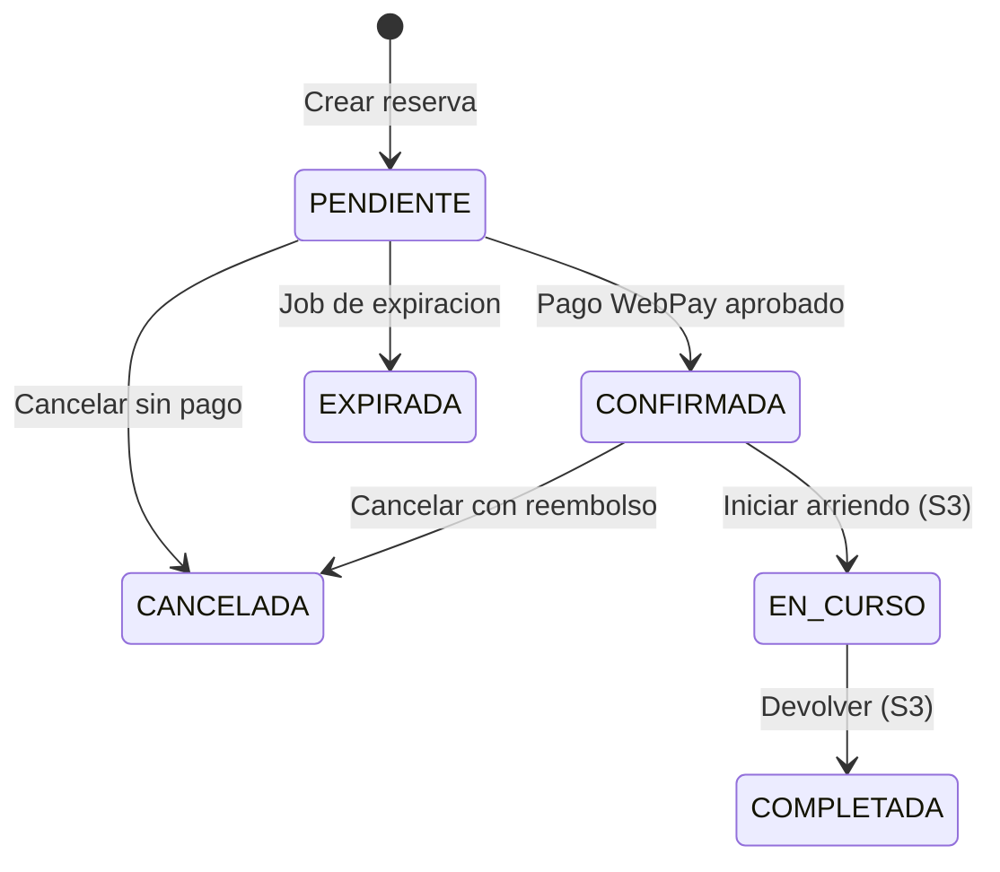

# Reservas y pagos — diseño, SQL y seguridad (S2)

Documento de implementación del Sprint S2. Cubre E7 (reservas) y E8 (pagos),
con el mapeo exacto entre endpoints, vistas, SPs y reglas de negocio.

## 1. Flujo funcional

Estados soportados en S2: `PENDIENTE`, `CONFIRMADA`, `CANCELADA`, `EXPIRADA`.
`EN_CURSO` y `COMPLETADA` pertenecen a S3.

## 2. Endpoints y objetos SQL

### Reservas

| Método | Ruta | Acceso | Objeto SQL |
|---|---|---|---|
| GET | `/vehiculos/buscar` | Público | `u_sp_BuscarVehiculos` + `vw_VehiculosDisponibles` |

`/vehiculos/buscar` acepta `page` y `pageSize` (máximo 100). Cada fila incluye
`total_registros` para calcular el total de páginas.
| GET | `/vehiculos/:id/disponibilidad` | Público | `vw_VehiculosDisponibles`, `fn_PrecioAplicable`, `ConfiguracionGlobal`, `ConfiguracionProveedor` |
| GET | `/vehiculos/:id` | Público | `Vehiculo` + `VehiculoSede` + `SedeProveedor` |
| GET | `/reservas` | AUTH | `vw_ReservasDetalle` + `Reserva` |
| POST | `/reservas` | CLIENTE | `u_sp_CrearReserva` |
| GET | `/reservas/:id` | AUTH | `vw_ReservasDetalle` + `Reserva` + `Reembolso` |
| GET | `/reservas/:id/historial` | AUTH | `HistorialEstadoReserva` |
| GET | `/reservas/:id/snapshot` | AUTH | `ReservaSnapshot` |
| GET | `/reservas/:id/cancelacion` | AUTH | `Reserva`, `PoliticaCancelacion`, `Pago`, `Reembolso` |
| POST | `/reservas/:id/cancelar` | CLIENTE dueño | `u_sp_CancelarReserva` |
| POST | `/reservas/:id/estado` | ADMIN | `u_sp_CambiarEstadoReserva` |
| POST | `/admin/reservas/expirar` | ADMIN | `u_sp_ExpirarReservas` |

### Pagos y reembolsos

| Método | Ruta | Acceso | Objeto SQL |
|---|---|---|---|
| POST | `/pagos` | ADMIN | `u_sp_RegistrarPago` |
| GET | `/pagos?reserva=` | AUTH | `Pago` + catálogos |
| POST | `/pagos/webpay/iniciar` | CLIENTE dueño | `u_sp_WebPay_IniciarTransaccion` |
| GET | `/pagos/webpay/transaccion/:token` | AUTH dueño | `PagoTransaccionSimulada` + `Pago` + `Reserva` |
| POST | `/pagos/webpay/confirmar` | CLIENTE dueño | `u_sp_WebPay_ConfirmarTransaccion` |
| POST | `/reembolsos` | ADMIN | `u_sp_CrearReembolso` |
| POST | `/reembolsos/:id/completar` | ADMIN | `u_sp_MarcarReembolsoCompletado` |
| GET | `/reembolsos?reserva=` | AUTH | `Reembolso` |
| GET | `/reportes/ingresos?anio=` | ADMIN | `u_sp_ReporteIngresosMensuales` |

## 3. Integración de vistas

- **`vw_ReservasDetalle`** es la fuente principal de los listados y del
  detalle de reserva. La API la consulta directamente y hace `JOIN Reserva`
  solo para obtener `ID_usuario_cliente_reserva` (la vista no lo expone) y
  aplicar ownership.
- **`vw_VehiculosDisponibles`** se consume en la cotización de disponibilidad
  y en `u_sp_BuscarVehiculos`.
- La vista `vw_ReservasDetalle` no es una copia de tabla: combina cliente,
  persona, vehículo, marca/modelo, proveedor, sedes, estado, arriendo y el
  último pago.

## 4. Seguridad y ownership

| Riesgo | Control |
|---|---|
| Cliente reserva a nombre de otro | `ID_usuario_cliente` se toma del JWT; no se acepta en el body. |
| Cliente ve reservas ajenas | Filtro por `Reserva.ID_usuario_cliente_reserva` y validación en detalle. |
| Proveedor ve reservas de otros | Filtro por `ProveedorUsuario` → `Vehiculo.ID_proveedor_vehiculo`. |
| Cliente se autoaprueba un pago | `POST /pagos` es solo ADMIN; el cliente usa WebPay simulado. |
| Monto manipulado en WebPay | El monto se lee de `Reserva.monto_total_reserva`, no del body. |
| Token WebPay de otro usuario | Se resuelve la transacción y se compara el cliente dueño antes de confirmar. |
| Reembolso mayor al saldo | El servidor calcula con la política y `u_sp_CrearReembolso` valida el saldo. |
| Transición inválida | `TransicionEstadoReserva` + `u_sp_CambiarEstadoReserva`. |
| Solapamiento | Validación en `u_sp_CrearReserva` + triggers `70900/70901`. |

### Idempotencia

- `POST /reservas`: exige `Idempotency-Key` (header) o `idempotency_key`
  (body). El SP devuelve la reserva existente si la clave se repite.
- `POST /reservas/:id/cancelar`: exige clave cuando se solicita reembolso.
  El reintento devuelve el reembolso existente y su monto real.
- `POST /pagos/webpay/iniciar`: reutiliza la transacción `CREADA` pendiente de
  la reserva; no crea una nueva si ya existe una.
- `POST /pagos/webpay/confirmar`: la transacción solo puede resolverse una vez.
  El SP usa `UPDLOCK/HOLDLOCK` y `UPDATE ... WHERE estado='CREADA'`.
- `POST /reembolsos`: ADMIN y el SP exige `idempotency_key`.

### Regla de reembolso

1. Se suman los pagos `APROBADOS` de la reserva.
2. Se restan los reembolsos `PENDIENTE/PROCESANDO/COMPLETADO`.
3. Se calculan los días entre hoy y `fecha_inicio_reserva`.
4. Si `dias >= dias_anticipacion_reembolso`, se aplica
   `porcentaje_reembolso` de la política; si no, el reembolso es 0.
5. El monto se redondea a 2 decimales y se limita al saldo disponible.
6. Si el monto es 0, la reserva se cancela sin crear reembolso.

La función pura está en `src/services/reembolso-policy.ts` y tiene tests.

## 5. Notas de implementación relevantes

- `u_sp_CrearReserva` y `u_sp_CancelarReserva` devuelven **múltiples
  recordsets** (snapshot, reembolso, reserva, vista). El repositorio
  selecciona explícitamente el recordset de `vw_ReservasDetalle` para no
  mapear una fila equivocada.
- `u_sp_CambiarEstadoReserva` no recibe `@correlation_id`; usa el de la
  reserva y `SESSION_CONTEXT`.
- `u_sp_WebPay_ConfirmarTransaccion` confirma la reserva directamente. No se
  llama después a `u_sp_CambiarEstadoReserva`.
- **Hardening WebPay S2:** el SP toma la transacción con `UPDLOCK/HOLDLOCK`,
  exige reserva y pago `PENDIENTE`, valida expiración, rechaza si ya hay un
  pago aprobado y actualiza con `WHERE estado='CREADA'` + `@@ROWCOUNT`. También
  inserta `HistorialEstadoReserva` al confirmar. La migración está en
  `sql/migrations/2026-10-21_s2_webpay_hardening.sql`.
- **Iniciar WebPay:** el SP bloquea la reserva con `UPDLOCK/HOLDLOCK`, valida
  el monto contra `monto_total_reserva` y reutiliza una transacción `CREADA`
  pendiente en vez de crear otra.
- La cancelación administrativa usa `POST /reservas/:id/cancelar` y pasa el
  `idCliente` al SP; `POST /reservas/:id/estado` no permite cancelar una
  reserva con pago aprobado (deriva al flujo con reembolso).
- `POST /reembolsos` y `/reembolsos/:id/completar` son solo ADMIN. El cliente
  no puede crear ni completar reembolsos manuales.
- `u_sp_RegistrarPago` también confirma la reserva al aprobar un pago
  `RESERVA`; se usa solo desde ADMIN para registros manuales.
- Los SPs de reembolso validan que el `ID_usuario` sea el dueño. Para el
  flujo ADMIN, la API resuelve el cliente dueño y se lo pasa al SP; el
  endpoint sigue protegido por rol ADMIN.
- `VehiculoSede` y `verificado_documento` no tienen SP propio. El seed demo
  los crea/marca como `sa`; se documenta como brecha para S3/S4.

## 6. Códigos de error principales

| Código | HTTP | Significado |
|---|---|---|
| `RESERVA_SOLAPADA` | 409 | Fechas ocupadas por otra reserva |
| `VEHICULO_BLOQUEADO` | 409 | Bloqueo activo |
| `VEHICULO_EN_MANTENIMIENTO` | 409 | Mantenimiento activo |
| `DOCUMENTOS_VEHICULO_INVALIDOS` | 409 | Documentos obligatorios no verificados |
| `SIN_PRECIO_DISPONIBLE` | 409 | No hay tarifa aplicable |
| `RESERVA_NO_PENDIENTE` | 409 | Pago o confirmación sobre reserva no pendiente |
| `RESERVA_EXPIRADA` | 409 | Intento de pago o confirmación sobre reserva vencida |
| `TRANSACCION_YA_RESUELTA` | 409 | Confirmación repetida de WebPay |
| `PAGO_NO_PENDIENTE` | 409 | Confirmar transacción sobre pago no pendiente |
| `PAGO_PENDIENTE_INCONSISTENTE` | 409 | Transacción pendiente con otro monto |
| `PAGO_YA_APROBADO` | 409 | La reserva ya tiene pago aprobado |
| `REEMBOLSO_EXCEDE_SALDO` | 409 | Monto mayor al disponible |
| `FECHA_INVALIDA` | 400 | Fecha inexistente (`2026-02-31`) |
| `OPERACION_DUPLICADA` | 409 | Violación de unicidad (p. ej. `buy_order`) |
| `DEADLOCK_REINTENTAR` | 503 | Deadlock de SQL Server; reintentar |
| `IDEMPOTENCY_KEY_REQUIRED` | 400 | Falta clave de idempotencia |
| `FORBIDDEN` | 403 | Sin ownership o rol |

El mapeo está en `src/middlewares/errorHandler.ts`.

## 7. Pruebas

- `sql/tests/05_reservas_pagos.sql`: 30 casos de reserva, solapamiento,
  idempotencia, WebPay, reutilización/doble confirmación, reembolso,
  expiración y vista.
- `tests/reservas.test.ts`, `tests/pagos.test.ts`: validación, autenticación
  y autorización sin dependencia de BD.
- `tests/reembolso-policy.test.ts`: cálculo puro de reembolsos.
- `scripts/smoke-s2.ts`: flujo real contra API + BD, incluyendo carrera de
  confirmación WebPay (`npm run smoke:s2`).

## 8. Limitaciones conocidas de S2

- `POST /reservas/:id/estado` valida el pago aprobado en el servicio; una
  aprobación concurrente entre la consulta y el SP podría permitir una
  cancelación sin reembolso. El flujo recomendado para ADMIN es
  `/reservas/:id/cancelar`.
- `u_sp_BuscarVehiculos` no aplica los mismos checks de documentos/sedes/
  duración que la cotización de checkout; un vehículo puede aparecer en la
  búsqueda y luego no estar disponible en el detalle.
- Las acciones ADMIN de cancelación/reembolso usan el `ID_usuario` del cliente
  dueño porque los SP validan ownership; la auditoría las atribuye al cliente.
- La fecha “hoy” se calcula con la zona horaria del servidor; el contenedor SQL
  puede estar en UTC. Las reservas de la demo usan fechas futuras.
- La suite SQL se ejecuta manualmente; CI corre lint/typecheck/tests/build de
  backend y frontend, pero no levanta SQL Server.
